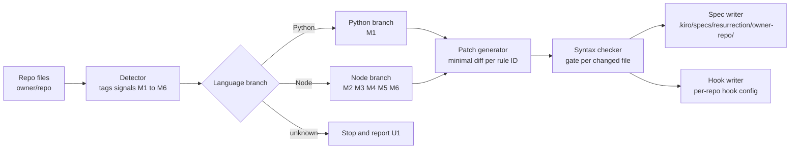
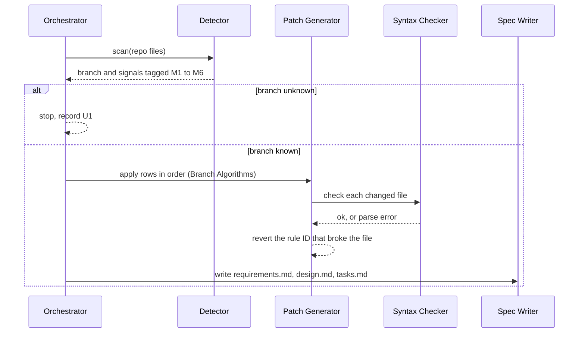
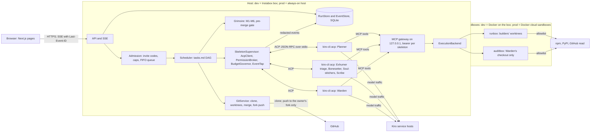
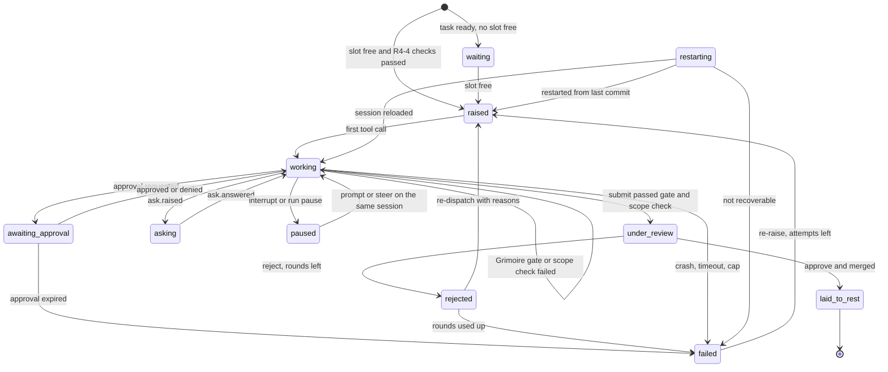
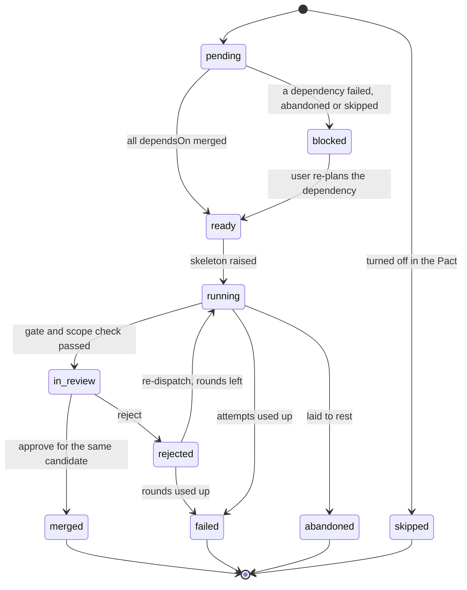

# Design Document: resurrection-engine

> **Resolved (2026-11-07).** This is the engine spec. Per-repo bundles (`requirements.md`, `design.md`, `tasks.md`) live in `.kiro/specs/resurrection/<owner>-<repo>/`. Precedence: Revision 4 over Revision 3 over Revision 2 over Revision 1.

## Overview

The resurrection engine takes a dormant GitHub repo, detects legacy patterns, and applies the smallest patch that clears each detected pattern. Every patch cites a rule ID from `.kiro/steering/modernization-rules.md` (M1 to M6). The engine then writes the three spec documents for that repo. Business logic stays unchanged. Anything the engine cannot determine is recorded as `unknown`.

No target language is chosen in this document. Each repo's language is detected at run time. Algorithms are written in pseudocode because no language is fixed. The Python branch (M1) and the Node branch (M2, M3, M4, M5, M6) are separate sections under Branch Algorithms.

## Unknowns

| ID | Item | Status | Resolved in |
|---|---|---|---|
| U1 | Target runtime per repo (README example: Node 20 LTS) | unknown | `requirements.md` of each repo |
| U2 | Latest stable version numbers for M5 | unknown here; looked up at run time, never stored in this file | run time |
| U3 | Lock file tool for Python repos (M6 names `poetry.lock` only as an example) | unknown | requirements phase |
| U4 | Whether a Node repo is an application or a library (decides the M3 shim) | unknown per repo | detector output |
| U5 | `request` to `httpx` mapping for Python (PLAN.md §2, layer 3) | no rule ID in `modernization-rules.md`; excluded from Data Models | add a rule to the steering file first |
| U6 | Autopsy signals in PLAN.md (CVE count, commit age, stars) | not migration rules; outside this mapping | separate diagnostics design |
| U7 | Node syntax checker | PLAN.md §3 suggests esprima; not confirmed | design review |
| U8 | Whether a repo has tests that can check business logic | unknown per repo | detector output |
| U9 | Property-based testing library | unknown; candidates are fast-check (Node) and hypothesis (Python) | design review |

## Architecture



### Per-repo run



## Components and Interfaces

```pascal
STRUCTURE Signal
  ruleId: {M1, M2, M3, M4, M5, M6}
  file: Path
  line: Integer
  matched: String
END STRUCTURE

STRUCTURE MappingRow
  ruleId: {M1, M2, M3, M4, M5, M6}
  branch: {Python, Node, Both}
  oldPattern: String
  newPattern: String
  needsCompat: Boolean
  breaking: Boolean
END STRUCTURE
```

| Component | Responsibility | Signature |
|---|---|---|
| Detector | Finds legacy patterns and picks the branch | `detect(files) -> (branch, Signal[])` |
| Patch generator | Applies one mapping row to one file | `apply(row, file) -> Patched \| Unknown` |
| Syntax checker | Parses a changed file; never runs repo code | `check(file) -> Ok \| ParseError` |
| Spec writer | Writes the three spec files; every item cites a rule ID or `unknown` | `write(outDir, bundle)` |
| Hook writer | Writes the per-repo hook config (see Hook Configuration) | `write(hookDir, branch)` |

## Data Models

### Migration mapping

Only rows that trace to M1 to M6 appear here.

| Rule | Branch | Old | New | Compat layer | Notes |
|---|---|---|---|---|---|
| M1 | Python | `print x` (statement) | `print(x)` | No | Single-line statements only. Multi-line print statements are recorded as `unknown` for review. |
| M1 | Python | `except E, e:` | `except E as e:` | No | |
| M1 | Python | `unicode(` | `str(` | No | Rewritten and listed for review. Byte-string callers need a per-call-site check, recorded as `unknown` if unclear. |
| M1 | Python | `.iteritems()` | `.items()` | No | |
| M2 | Node | `require('request')` | `fetch` or `axios` (choice per repo, U1) | Yes, see Compatibility Layer | Callback API becomes a promise API. |
| M3 | Node | `require(...)` and `module.exports` | `import` and `export` | Only if library (U4) | Application repos convert with no shim. |
| M4 | Node | `webpack@2` config (`CommonsChunkPlugin`) | `vite` with `@vitejs/plugin-react` (React repos only) | No | No equivalent for `CommonsChunkPlugin` in the rule text. Recorded as `unknown`. |
| M5 | Node, Python | Dependency major version at least 2 behind | Latest stable (U2) | Per dependency when breaking | Target version is `unknown` until looked up. |
| M6 | Node | No `package-lock.json` | Generated `package-lock.json` | No | |
| M6 | Python | No lock file | `poetry.lock` only if the repo uses Poetry (U3) | Unknown | Tool choice is `unknown`. |

### Excluded mapping

PLAN.md §2 (layer 3, phase 2) lists `request` to `httpx`. No rule ID in `modernization-rules.md` covers this mapping, and M2 covers only Node. The row is excluded (U5). It can be added only after a rule ID exists.

### Spec bundle

```pascal
STRUCTURE SpecBundle
  requirements: Markdown    // target runtime (U1), removed deps (M2, M5), checks
  design: Markdown          // rows from the mapping table that fired, compat notes, unknown list
  tasks: Markdown           // steps in Branch Algorithms order
END STRUCTURE
```

## Compatibility Layer

### M2: `request` adapter (Node)

Purpose: keep the repo's call sites unchanged while the library underneath changes. The adapter exposes only the options the detector found in use.

Behavior that must match `request`:
- The callback receives `(err, response, body)`.
- An HTTP 4xx or 5xx response passes `err = null`. `fetch` does not throw on HTTP errors, so the adapter must not convert them into errors.
- `response.statusCode` is set. `fetch` names this field `status`, so the adapter maps it.
- With `json: true`, the body is parsed as JSON. The error behavior on invalid JSON is `unknown`.

If `axios` is chosen, set `validateStatus` to accept all statuses. Otherwise `axios` throws on 4xx and 5xx responses, which breaks the rule above.

```pascal
PROCEDURE requestCompat(options, callback)
INPUT: options (keys must be in ALLOWED_KEYS), callback(err, response, body)
OUTPUT: none; callback is invoked exactly once

PRECONDITIONS:
  ALLOWED_KEYS is generated by the detector from the call sites in the repo

POSTCONDITIONS:
  callback called exactly once
  err = NULL whenever a response was received, whatever its status

BEGIN
  FOR each key IN keysOf(options) DO
    IF key NOT IN ALLOWED_KEYS THEN
      THROW UnsupportedOption(key)        // fail loud, do not ignore
    END IF
  END FOR

  TRY
    raw ← AWAIT fetch(options.url, toFetchInit(options))
    text ← AWAIT raw.text()
  CATCH networkError
    callback(networkError, NULL, NULL)
    RETURN
  END TRY

  response ← withStatusCode(raw)          // statusCode ← raw.status
  body ← text
  IF options.json = TRUE AND text is not empty THEN
    body ← parseJson(text)                 // invalid JSON behavior: unknown
  END IF
  callback(NULL, response, body)
END
```

### M3: CommonJS shim (Node)

- **Application repo:** convert every file to ESM. No shim.
- **Library repo:** consumers may still call `require`. The shim design depends on the package's `exports` map and build tool, both `unknown` at this stage. The engine records U4 and leaves the repo in CommonJS. It does not guess.

### M1: Python

No shim. The target is Python 3 only. If a repo must still run on Python 2, M1 conflicts with that requirement. The engine stops for that repo and reports the conflict.

## Branch Algorithms

### Python branch (M1; M5 and M6 apply with U3 unresolved)

```pascal
PROCEDURE migratePython(files)
INPUT: files (*.py)
OUTPUT: patches, unknownList

BEGIN
  FOR each file IN files DO
    FOR each row IN M1_ROWS DO
      FOR each match m IN findAll(row.oldPattern, file) DO
        IF m.isSingleLine THEN
          applyPatch(file, m, row.newPattern, row.ruleId)
        ELSE
          unknownList.add(row.ruleId, file, m.line, "multi-line statement")
        END IF
      END FOR
    END FOR
  END FOR
END
```

Running the procedure a second time produces no new patches (P2).

### Node branch (M2, M3, M4, M5, M6)

Order matters. Dependencies are added before the call sites that use them, and the lock file is generated last.

1. M5: update outdated major versions and add any new dependency.
2. M2: add the adapter (Compatibility Layer) and point `require('request')` at it. Files stay CommonJS at this step.
3. M3: convert CommonJS to ESM across the repo, adapter included. Apply the shim rule in Compatibility Layer.
4. M4: convert a webpack 2 build config to Vite.
5. M6: generate the lock file.
6. Syntax-check every changed file (gate, see Architecture).

```pascal
PROCEDURE migrateNode(repo)
BEGIN
  deps ← readPackageJson(repo)

  IF deps.hasMajorBehind(2) THEN                    // M5
    bumpToLatestStable(deps)                         // versions: unknown until lookup (U2)
  END IF

  IF deps.has("request") THEN                        // M2
    adapterKeys ← detectOptionsInUse(repo)
    addAdapter(repo, adapterKeys)
    rewriteRequireCalls(repo, "request", adapterPath)
  END IF

  IF repo.usesCommonJs() THEN                        // M3
    IF repo.isLibrary = UNKNOWN THEN
      recordUnknown("M3", U4)                        // leave CommonJS in place
    ELSE
      convertToEsm(repo, shim = repo.isLibrary)
    END IF
  END IF

  IF deps.has("webpack", major = 2) THEN             // M4
    replaceWithVite(repo)                            // CommonsChunkPlugin mapping: unknown
  END IF

  IF NOT repo.hasLockfile() THEN                     // M6
    generateLockfile(repo)
  END IF

  FOR each file IN repo.changedFiles() DO
    IF check(file) = ParseError THEN
      revertRuleFor(file)                            // revert the rule that changed the file
      recordUnknown("syntax", file)
    END IF
  END FOR
END
```

## Spec Output

Each resurrected repo gets three files in `.kiro/specs/resurrection/<owner>-<repo>/`, consistent with the folder README:

- `requirements.md`: target runtime (U1), deprecated dependencies removed (M2, M5), checks to run. Tests are required only if U8 says the repo has them.
- `design.md`: the mapping rows that fired, compat notes, and the `unknown` list.
- `tasks.md`: steps in Branch Algorithms order.

Every item cites a rule ID from M1 to M6, or is marked `unknown`. Cause-of-death claims that the rules do not support are not written.

## Hook Configuration

### What is wrong in PLAN.md

The invalid example is in PLAN.md §4 item 3 (the file name also appears in the §1 diagram). README.md and the folder README.md contain no hook schema. REFERENCES.md lists `PreToolExecution` as a trigger, which is also not in the valid list.

The example in PLAN.md §4.3 has these problems:

1. `"trigger": "PostCodeGeneration"` is not a valid trigger. Valid PascalCase triggers are `PreToolUse`, `PostToolUse`, `SessionStart`, `Stop`, `UserPromptSubmit`, `PreTaskExec`, `PostTaskExec`, `PreCompact`, `PostCompact`, `PostFileCreate`, `PostFileSave`, `PostFileDelete`.
2. `"action"` is a string. It must be an object with `type` set to `command` or `agent`, and `command` or `prompt`.
3. `"command"` sits at the top level. It must sit inside `action`.
4. The file has no `version` and no `hooks` array. The shape is `{"version": "v1", "hooks": [...]}`.
5. The command checks one fixed file name (`resurrected_app.py`) and only works for Python.
6. Exit codes: only exit 2 blocks, and only for `PreToolUse`, `UserPromptSubmit`, `PreTaskExec`, and `PreCompact`. A failing `PostTaskExec` command is silent. A hook cannot be the only gate.

This schema comes from the `createHook` tool description in this environment. I did not check it against Kiro IDE's native hook format. Confirm which format the project uses before the hook is written.

### Proposed shape (Python branch)

```json
{
  "version": "v1",
  "hooks": [
    {
      "name": "PostResurrectionVerify",
      "trigger": "PostTaskExec",
      "action": {
        "type": "command",
        "command": "python -m compileall -q ."
      }
    }
  ]
}
```

- The syntax checker in Architecture is the blocking gate. The hook is a second check.
- Because a silent failure is not visible, the hook command must also write its result to `verify-result.json` in the repo's spec folder. The shell quoting for that write must be tested on Windows (`unknown` until tested).
- Whether Kiro loads hooks from a resurrected repo's own `.kiro/hooks/` is `unknown`.
- The Node branch hook command is `unknown` until U7 is resolved.

## Error Handling

| Condition | Response | Recovery |
|---|---|---|
| Language branch cannot be determined | Stop this repo, record U1 | Re-run after the requirements phase sets the runtime |
| M1 multi-line print or ambiguous `unicode(` | Leave the code unchanged, record `unknown` | Manual review |
| A patch breaks parsing | Revert the rule's change to that file | Record the rule ID and file |
| Repo uses a `request` option the adapter does not allow | Throw `UnsupportedOption` | Detector must list the option before the adapter is built |
| Version lookup fails (M5) | Keep the old version, record U2 | Retry at run time |
| Repo needs Python 2 | Stop this repo | Reported as a conflict with M1 |
| Hook command fails | Silent (Hook Configuration, item 6) | The syntax checker in Architecture is the gate |

## Security

- Analysis never runs the target repo's code.
- When dependencies are installed for verification, run `npm install --ignore-scripts`. Install lifecycle scripts run arbitrary code from an untrusted repo.
- The GitHub token is read from an environment variable (README). It is never written to a spec file, a hook file, or a log.
- Spec files contain repo URLs and rule IDs. They contain no tokens.
- If the engine downloads a repo archive (PLAN.md §5 mentions zip download), validate every extracted path. Whether the engine downloads archives or clones is `unknown`.

## Performance

No performance requirement exists yet (`unknown`). The README gives one constraint: unauthenticated GitHub API access is limited to 60 requests per hour. Use a token for batch runs.

## Testing Strategy

- **Unit:** the detector and each mapping row, with one positive and one negative fixture per rule ID.
- **Property-based:** the properties in Correctness Properties. Library is `unknown` (U9).
- **Integration:** one fixture repo per branch, run end to end. Business-logic checks need the repo's own tests (U8).

## Correctness Properties

### Property 1: Traceability (P1)

For every patch `p` in the output, `p.ruleId` is in {M1, M2, M3, M4, M5, M6}.

**Validates: Requirements 6.1**

### Property 2: M1 idempotence (P2)

For every Python file `f`, `applyM1(applyM1(f)) = applyM1(f)`.

**Validates: Requirements 6.15**

### Property 3: Adapter status (P3)

For every response with HTTP status 400 or above and no network error, the adapter calls back with `err = NULL`.

**Validates: Requirements 7.12**

### Property 4: Syntax gate (P4)

For every changed file `f` in the output, `parses(f)` holds, or the rule that changed `f` was reverted.

**Validates: Requirements 9.5, 9.7, 9.8** (as amended in R3-18; Python files: P8)

### Property 5: Mapping rows (P5)

Every row in the design output has a rule ID in {M1 to M6}.

**Validates: Requirements 6.2**

### Property 6: Business logic (P6)

For every test `t` in the repo, `pass(t, before) = pass(t, after)`. This property is untestable and marked `unknown` when U8 says there are no tests.

## Dependencies

- GitHub REST API (PLAN.md §1).
- `.kiro/steering/modernization-rules.md` (rule IDs M1 to M6).
- Python and Node toolchains for syntax checks. Versions are `unknown`.
- The Kiro hook format, confirmed as described in Hook Configuration.

---

# Revision 2 — Buildable design

> Added 2026-11-07. Revision 1 is a contract: interfaces, mapping rows, properties, and nine unknowns. Nothing in it can be built, run, or demoed as written. R2 keeps every claim of R1 that survives review, converts the unknowns that block construction into decisions, and adds the layers R1 never covered: the run-time boundary, API, job lifecycle, UI, fixtures, and a cut list.

## R2-1 The main correction: Kiro is not in the request path

R1 (and PLAN.md section 1) reads as if a web request reaches "the Kiro engine" and Kiro casts the spell. Kiro is an IDE and a CLI agent. It exposes no HTTP inference endpoint, so no browser request can invoke it. Leaving that ambiguity in place is the single largest reason this document reads as a wish.

R2 splits the system into two planes and states what crosses the seam.

| Plane | What runs there | What Kiro contributes | Artifact that proves it |
|---|---|---|---|
| Build time | this repository: rule library, detectors, patchers, tests | writes and refines them through this spec; steering and hooks are durable outputs | `.kiro/specs/**`, `.kiro/steering/**`, `.kiro/hooks/**`, and the code they produced |
| Run time | the Next.js app (rule engine, optional narration) | nothing in the request path | none, and the demo must not claim otherwise |

Consequences that change the demo:

1. The demo runs from a clean clone with `npm run dev`. No IDE session, no agent, no token.
2. The "spec-driven" claim is backed by artifacts (spec to tasks to code), not by a runtime teleport.
3. An optional lane (R2-9) hands the artifact back to Kiro for the in-editor story. It is a handoff, not a dependency.

## R2-2 Stack decisions

Versions are pinned by `package.json` at install time, not in prose.

| Concern | Decision | Rejected | Reason |
|---|---|---|---|
| Framework | Next.js 15 App Router, React 19, TypeScript strict | Vite SPA plus a separate API process | one process, no CORS, one deploy target |
| Styling | Tailwind plus a small hand-written CSS layer for the gothic chrome | animation-heavy component kits | transitions must stay at 60 fps on a demo laptop |
| Diff view | Monaco Diff editor | diff2html | hunks must map back to rule IDs on hover |
| JavaScript and TypeScript parsing | `@babel/parser` (`typescript`, `jsx` plugins) | esprima, acorn | esprima is unmaintained; acorn needs plugins for TSX |
| Python parsing | `web-tree-sitter` with the Python grammar as WebAssembly | Pyodide, a server-side CPython | serverless-safe, no interpreter; Py2 source is found by regex, only the patched result is parsed |
| Patch format | unified diff generated by `diff` (jsdiff) over an in-memory file tree | shelling out to `git` | no git in serverless; an in-memory tree makes per-file revert trivial |
| HTTP client | native `fetch` | axios | the M2 adapter targets fetch anyway |
| Boundary validation | `zod` on every external input and on model output | hand-written checks | SSE payloads and model text both need schemas |
| Persistence | in-memory jobs plus a `.cache/` directory for fetched archives | database | scope; TTL documented in R2-6 |

## R2-3 Determinism first, model optional

Every claim the product makes must survive with the model switched off. This is what makes the output testable, and it is also the honest reading of MODERNIZATION rules (they are deterministic patterns).

| Stage | Deterministic | Model allowed | Gate before the stage is accepted |
|---|---|---|---|
| Detect | yes (regex plus light tokenizer) | no | every signal carries `file:line:column` and a matched literal |
| Plan | yes (mapping rows) | no | every step cites M1 to M6 |
| Patch | yes (one template per row) | no | the patched file parses |
| Autopsy narrative | numbers from the GitHub API | yes, wording only | the model may not introduce a number, a CVE, or a star count |
| Spec prose | template skeleton | yes, wording only | every sentence cites a rule ID or says `unknown` |

`RESURRECTION_LLM` selects the narration provider (`none`, `bedrock`, `openai-compatible`). Default is `none`; with `none` every screen still works, using templates. A demo that needs a network call to look finished is a demo that fails on stage.
## R2-4 Data contracts

These are the actual shapes the app exchanges. R1 structures are a subset; the additions are what make the UI and the spec writer possible.

```ts
type RuleId = "M1" | "M2" | "M3" | "M4" | "M5" | "M6";
type Language = "python" | "node" | "unknown";

interface RepoRef {
  owner: string;
  repo: string;
  ref: string;          // commit sha, resolved at fetch time; tags are not trusted
}

interface Signal {
  ruleId: RuleId;
  file: string;         // path inside the repo
  line: number;         // 1-based
  column: number;
  matched: string;      // the literal text that fired
  confidence: "high" | "medium";   // medium = needs a human look
}

interface AutopsyReport {
  repo: RepoRef;
  language: Language;
  archived: boolean;
  createdAt: string;
  lastCommitAt: string;
  ageYears: number;              // computed from createdAt, one decimal
  lastBreathYears: number;       // computed from lastCommitAt, one decimal
  stars: number;
  cause: string;                 // template or model wording, never new facts
  signals: Signal[];
}

interface PatchStep {
  id: string;                    // stable: ruleId + file + ordinal
  ruleId: RuleId;
  file: string;
  diff: string;                  // unified diff, 3 lines of context
  hunks: number;
  reverted?: boolean;            // true when the syntax gate rolled it back
}

interface UnknownItem {
  ruleId: RuleId | "";
  file?: string;
  reason: string;                // one of the R1 unknown codes or a gate failure
}

interface PatchPlan {
  repo: RepoRef;
  language: Language;
  steps: PatchStep[];
  unknowns: UnknownItem[];
}
```

Stream events. One connection per job, replayable from the first event:

```ts
type JobEvent =
  | { t: "phase"; phase: Phase; pct: number }
  | { t: "signal"; signal: Signal }
  | { t: "step"; step: PatchStep }
  | { t: "unknown"; item: UnknownItem }
  | { t: "error"; code: ErrorCode; message: string; retryable: boolean }
  | { t: "done"; artifactId: string; partial: boolean };
```

## R2-5 API surface

| Method | Path | Body | Response | Notes |
|---|---|---|---|---|
| POST | `/api/autopsy` | `{ url: string }` | `AutopsyReport` | resolves the commit sha; cached 10 min per repo |
| POST | `/api/resurrect` | `{ url: string }` | `{ jobId: string }` (202) | creates a job; one active job per process |
| GET | `/api/jobs/{id}/events` | - | `text/event-stream` | replays from event 0, then streams |
| GET | `/api/jobs/{id}` | - | `{ status, phase, error? }` | polling fallback when SSE is blocked |
| GET | `/api/artifacts/{id}` | - | `application/zip` | diffs, spec bundle, report, verify result |
| GET | `/api/health` | - | `{ ok, llm, githubLimit }` | the demo opens with this |

Error codes (stable strings, used by the UI copy):

| Code | Status | Meaning |
|---|---|---|
| `REPO_NOT_FOUND` | 404 | URL is not a public repo, or private and no token |
| `RATE_LIMITED` | 429 | GitHub budget exhausted; `resetAt` returned |
| `TOO_LARGE` | 413 | archive above 20 MB or more than 2000 entries |
| `LANGUAGE_UNKNOWN` | 422 | neither package.json nor any .py found |
| `PARSE_FAILED_AFTER_REVERT` | 500 | a file stayed broken after the gate reverted its last edit |
| `LLM_UNAVAILABLE` | - | never fatal; narration degrades to templates |

Limits enforced at the edge: 20 MB archive, 400 scanned files, 60 s per job, one job at a time (a second request joins the queue and the UI says so).

## R2-6 Job lifecycle

```
queued -> fetching -> detecting -> planning -> patching -> verifying -> writing_spec -> done
                              \-> failed (any phase)
```

- Every transition appends one `phase` event. A failure appends `error` and then `done` with `partial: true`, because a broken run that still yields a report and the diff of what succeeded is more useful than a blank screen.
- Per-phase timeouts: fetch 15 s, detect 10 s, plan 5 s, patch 20 s, verify 10 s, spec 5 s. A timeout is `retryable: true` only for `fetching`.
- Job state lives in memory with a 30 min TTL; artifacts go to `.cache/artifacts/<jobId>/` with the same TTL. Restarting the process loses jobs, which is acceptable for a demo and stated in the README.
- Cancellation: the SSE client aborting sets a flag; the loop checks it between phases, never mid-file.
## R2-7 Patch pipeline, concretely

1. Fetch `https://codeload.github.com/{owner}/{repo}/tar.gz/{sha}`. Reject when `Content-Length` exceeds the limit; stream into memory with a hard byte cap.
2. Extract with path validation: no absolute paths, no `..` segments, no symlinks, at most 2000 entries, at most 20 MB uncompressed. A rejected entry aborts the job with `TOO_LARGE` rather than silently skipping.
3. Build `FileTree = Map<string, { text: string; bytes: Uint8Array }>`. Binary files are kept byte-exact and never scanned.
4. Detection walks a whitelist only: `package.json`, `*.py`, `*.js`, `*.cjs`, `*.mjs`, `*.ts`, `*.tsx`, `webpack.config.*`. Everything else is ignored on purpose, so a scan is bounded.
5. Each mapping row produces `Edit { ruleId, file, start, end, replacement }` against the original text. Edits within one file are applied right to left so earlier offsets stay valid.
6. After a file is fully patched, parse it. On a parse error, revert the last applied edit for that file, re-parse, and record `{ ruleId, file, reason: "parse_failed" }`. Repeat until the file parses or no edits remain.
7. Emit a unified diff per changed file with three lines of context. The diff is the artifact; the patched tree itself is not shipped.
8. Write the spec bundle and zip: `diffs/<path>.patch`, `spec/requirements.md`, `spec/design.md`, `spec/tasks.md`, `report.json`, `verify-result.json`.

Why diffs and not files: a diff is reviewable by a human in ten seconds, applies to the original repo at the pinned sha, and cannot silently drop a file the engine failed to read.

## R2-8 UI, screen by screen

Four screens, one route each, no client-side router tricks.

| Screen | Route | Minimum content | States |
|---|---|---|---|
| Gate | `/` | URL input, three preset tombstones, one-line explanation | idle, invalid URL, fetching |
| Tombstone | `/tomb/[owner]/[repo]` | name, age, last breath, stars, archived badge, signal chips grouped by rule id, CTA | loading, no signals (CTA disabled with reason), error |
| Altar | `/ritual/[jobId]` | event console (one line per event), phase rail, cancel | streaming, partial failure, complete |
| Reliquary | `/relic/[artifactId]` | file list, Monaco diff, unknowns panel, download zip | ready, partial |

Interaction rules that matter for the demo:

- Hovering a signal chip highlights the exact source line in the diff view; clicking copies `file:line`.
- Every console line is also a DOM node with `data-rule` and `data-file`, so the demo can be driven by a keyboard and read by a screen reader.
- Motion budget: fog drift and candle flicker only, both disabled under `prefers-reduced-motion`. No parallax, no scroll hijack.
- Contrast: body text at least 4.5:1 on `#0a0a0c`; the accent purple is used for borders and icons, never for small text.
- Failure copy is specific: `RATE_LIMITED` shows the reset time and offers "use a token"; `LANGUAGE_UNKNOWN` names the files it looked for.

## R2-9 Optional Kiro lane (the honest way to show Kiro in the loop)

After a job finishes, the Reliquary offers **Open in Kiro**: it downloads the artifact and prints the two commands that place it in the repo the user is working on.

```
.kiro/specs/resurrection/<owner>-<repo>/requirements.md
.kiro/specs/resurrection/<owner>-<repo>/design.md
.kiro/specs/resurrection/<owner>-<repo>/tasks.md
diffs/<path>.patch
```

The user then applies the diffs and lets Kiro work through `tasks.md` with hooks enabled. Kiro does the last mile in an editor where it actually has tools; the app never pretends to be Kiro. This is also the story to tell on stage: the spec bundle is the interface between a deterministic engine and an agentic editor.
## R2-10 Fixtures and acceptance

Three fixtures, one per branch, each pinned by the commit sha resolved when the fixture was created. Shas are recorded by `scripts/fixtures/pin.ts`, never typed by hand, and pasted into `fixtures/repos.json`. Archives are cached under `_fixtures/` (gitignored) so tests run offline.

| Fixture | Branch exercised | Why this one |
|---|---|---|
| `F-node-webpack2` | M4, M5, M6 | old webpack config plus stale majors plus no lock file |
| `F-node-cjs-request` | M2, M3, M5 | callback `request`, CommonJS, no lock file |
| `F-python2` | M1, M6 | Python 2 print statements and `.iteritems()` |

Selection rule: the fixture must be public, small (under 5 MB), and unmaintained. Candidate names are collected in `fixtures/candidates.md` and promoted only after a dry run produces a plan with at least one signal.

Acceptance criteria, all machine-checkable:

| ID | Check | Command |
|---|---|---|
| A1 | Every signal resolves to a literal at the recorded line | `npm run test:signals` |
| A2 | Every step cites M1 to M6 (property P1) | `npm run test:props` |
| A3 | Every changed file parses, or its step is marked `reverted` (P4) | `npm run test:props` |
| A4 | M1 is idempotent on the fixture (P2) | `npm run test:props` |
| A5 | M2 adapter never converts an HTTP error into `err` (P3) | `npm run test:props` |
| A6 | Golden diffs match byte for byte | `npm run test:golden` |
| A7 | A full job finishes in under 60 s per fixture on the demo machine | `npm run test:e2e` |
| A8 | With `RESURRECTION_LLM=none` every screen still renders a complete result | `npm run test:e2e -- --no-llm` |

A8 is the one that keeps the submission honest. If it fails, the product depends on something the judges cannot reproduce.

## R2-11 What happens to the R1 unknowns

| R1 | R2 decision |
|---|---|
| U1 target runtime | read `engines.node` or `requires-python`; if absent, requirements.md says `unspecified` and the UI shows it as a caveat |
| U3 Python lock file | Poetry only when `pyproject.toml` contains a `tool.poetry` table; otherwise no lock step and an `unknown` entry |
| U5 `request` to `httpx` | out of scope; recorded as an M7 candidate for the steering file, not implemented |
| U6 autopsy signals | now in scope, but only API-derived facts: stars, createdAt, lastCommitAt, archived. No CVE counting in v1 (no reliable free source without extra keys) |
| U7 Node syntax checker | `@babel/parser`; success means no throw |
| U9 property library | `fast-check` |
| U2 latest versions | looked up from the npm registry at run time, cached per job; if the lookup fails, keep the old version and record `unknown` |
| U4 library or application | `package.json` has `main`/`exports` and no `private: true` start script implies library; ambiguous stays `unknown` and M3 is skipped |
| U8 repo tests | out of scope for v1; the fixture smoke test is the proxy |

## R2-12 Build order and cut list

Two days. Each row ends in something demoable, so a slip costs a demo increment rather than the whole submission.

| # | Increment | Demo after this row |
|---|---|---|
| 1 | fetch, detect, tombstone | type a URL, see a filled tombstone with signal chips |
| 2 | Node patch: M5, M6, M2 with the gate | see a real diff for a real repo |
| 3 | Python branch M1 | a second fixture on a different branch |
| 4 | SSE altar | watch the four phases stream live |
| 5 | spec writer, zip, reliquary | download a bundle a judge can open |
| 6 | M3, M4 | wider coverage for the pitch |

Cut in this order when behind: M4, then M3, then model narration, then Monaco (fall back to a plain diff block), then the zip (two separate downloads). Never cut the syntax gate, the rule-ID citation, or A8.

## R2-13 Delta against Revision 1

| R1 position | R2 position |
|---|---|
| Runtime implies Kiro | Kiro is build-time plus an optional handoff; runtime is deterministic |
| Pseudocode, language unspecified | TypeScript interfaces plus concrete libraries |
| 9 unknowns, several blocking | 5 closed by decision, 4 made non-blocking with a stated fallback |
| Autopsy out of scope | 4 API-derived facts in scope; CVE count explicitly deferred |
| No API, no job model, no UI | R2-5, R2-6, R2-8 |
| No fixtures, no acceptance | R2-10, eight machine-checkable criteria |

Everything in R1 that R2 does not contradict stays in force: the mapping rows, the four `request` behaviors, the M1 stop condition on Python 2, the hook schema correction, and properties P1 to P6.

---

# Revision 3 - Internal workflow (decided 2026-11-07)

> R3 records owner decisions D1 to D12 as settled. Evidence for every external claim is in `01_evidence/design-research-2026-11-07/wp-a-product.md` (A1, A2) and `01_evidence/design-research-2026-11-07/wp-b-workflow.md` (B1 and its appendix). The short source tag is repeated inline. "unknown" means not verified.

## R3-0 Superseded

| # | R1/R2 statement | R3 position | Reason or source |
|---|---|---|---|
| S1 | Python gate is "the patched file parses" (R2-7 step 6, R2-2, A3, P4) | Monotone gate plus Py2-residue query; label `m1-clean` or `m1-partial` (R3-9, P8) | tree-sitter-python parses `print_statement`, `exec_statement`, `except E, e:`, `<>`, `0777`, `10L`, backticks (grammar.js and scanner.c, wp-b F1) |
| S2 | Detection by "regex plus light tokenizer" (R2-3); R1 `findAll(row.oldPattern, file)` | Python: tree-sitter queries. JS and TS: `@babel/parser` AST. Regex only for manifests and file names (R3-7) | Regex cannot tell code from strings and comments (wp-b F4) |
| S3 | R1 M1 rows "single-line only, multi-line is `unknown`"; R1 `migratePython` | Extended M1 rows over node ranges; multi-line statements are handled (R3-8.1) | wp-b F3, F4 |
| S4 | R1 M2 "`fetch` or `axios` (choice per repo)"; R1 `axios` `validateStatus` note | Native `fetch` only; `engines.node` raised to `>=22` as an M2 edit; scoped adapter (D4, R3-8.2) | R2-3 determinism (wp-b N16, F11) |
| S5 | R1 M5 "latest stable"; R1 `bumpToLatestStable`; R2-11 U2 bump | Report-only unless another rule forces a bump (D5) | The npm registry gives versions, not migration notes; blind bumps break hard constraints 1 and 4 (wp-b N2) |
| S6 | R1 Node step 5 `generateLockfile`; R1 Python `poetry.lock` generation | `tasks.md` step; locks baked offline for presets only; fires only when no lock file of any manager exists (D5, R3-8.4) | Needs the npm CLI and registry; a lock goes stale when `package.json` changes (wp-b F12, N3) |
| S7 | R1 `detect(files) -> (branch, Signal[])`; R1 single-branch routing; R2-4 `language: Language` | `languages: Language[]`; both branches run, Node first; M5 and M6 per manifest directory (D7, R3-7) | wp-b F10 |
| S8 | R2-5 "one active job per process" and queue; R2-6 in-memory jobs, 30 min TTL, `.cache/artifacts/<jobId>/`; R2-4 "one connection per job, replayable"; R2-6 cancel on SSE client abort; R2-5 `GET /api/jobs/{id}` polling | One streaming POST per job (NDJSON); content-addressed, recomputable artifacts; replay from the artifact's event log; closing the request cancels (D1, R3-2) | Fluid compute shares instances with no routing guarantee found (Vercel docs, wp-b F13, inference); `EventSource` is GET-only |
| S9 | R2-6 stage timeouts 15 + 10 + 5 + 20 + 10 + 5 = 65 s against a 60 s cap | Stage caps sum to 54 s, watchdog 55 s, `maxDuration` 60 (R3-3) | wp-b F8 |
| S10 | R2-11 U4 "`main`/`exports` and no `private: true` start script implies library" | F9 truth table (R3-7) | `private` is a package field and `start` is a script (wp-b F9) |
| S11 | R2-10 gitignored `_fixtures/`; `fixtures/repos.json` and `fixtures/candidates.md` at the root | Committed minimal snapshots in `01_evidence/fixtures/` (D9, R3-12) | A fresh clone has no fixture data; AGENTS.md puts third-party samples in `01_evidence/` (wp-b F14) |
| S12 | R1 Hook Configuration item 6 "A failing `PostTaskExec` command is silent"; R1 Error Handling "Hook command fails: Silent"; R1 hook writes `verify-result.json` "because a silent failure is not visible" | A non-zero exit sends stderr to the agent, and the agent is told the hook returned an error. Post hooks cannot block. Blocking hooks always exit 2 (R3-14) | kiro.dev/docs/hooks/actions.md (wp-b F20) |
| S13 | R1 "schema comes from the `createHook` tool description; not checked against Kiro IDE's native hook format" | Checked: `.kiro/hooks/*.json`, `{"version":"v1","hooks":[...]}` | kiro.dev/docs/hooks, updated 2026-10-21 (wp-b F20, wp-a A1 #25) |
| S14 | R2-2 Next.js 15 | Next.js 16 (D10) | npm `next` latest 16.4.5; 16.x is Active LTS, 15.x is Maintenance LTS (nextjs.org/support-policy, wp-b F18) |
| S15 | R2-5 routes `/api/autopsy`, `/api/resurrect`, `/api/jobs/*`, `/api/artifacts/{id}` | R3-5 routes | structure.md is being amended: top-level action routes use verb-noun, resource routes may nest (wp-b F17) |
| S16 | R2-4 `PatchStep` lacks R1 `MappingRow.needsCompat`, `MappingRow.breaking`, and any behavior note | `PatchStep.compat`, `PatchStep.behavior`, `PatchStep.notes` (R3-4) | Hard constraint 1 in modernization-rules.md (wp-b N14) |
| S17 | R2-4 `RepoRef.ref`; `ageYears`, `lastBreathYears`; `lastCommitAt` with no source | `RepoRef.sha`; `lifespanYears`, `yearsDead`; `lastCommitAt` from the head commit (D8, D11) | wp-b F15, N15 |
| S18 | R2-6 and R2-7 order `patching`, `verifying`, `writing_spec` | Plan, draft spec, execute, verify, finalize (D2) | wp-b F7 |
| S19 | R2-3 "Spec prose: model allowed, wording only" | Artifact text is template-only. Model narration appears in the UI only | Required by P9 and A6 |
| S20 | R2-5 "20 MB archive" versus R2-7 "20 MB uncompressed" | 20 MB compressed, 60 MB decompressed, 2000 entries (R3-6) | wp-b N22 |
| S21 | R2-7 step 4 whitelist | Extended inventory, including lock files and Python manifests (R3-7) | wp-b N3 |
| S22 | R2-7 step 8 per-file diffs only; R2-9 "two commands" for four paths | `all.patch` (`git apply -p1`) plus per-file diffs and `events.ndjson` (R3-2, R3-14) | wp-b N18 |
| S23 | R2-11 U6 "no reliable free CVE source without extra keys" | OSV is keyless with no stated limit. CVE stays out of v1; OSV is a stretch (D6) | OSV API docs (wp-b N12) |
| S24 | R1 Hook writer component and per-repo hook config | Not in the v1 bundle. D1 to D12 do not cover it; reopen only on owner request | wp-b N14 |
| S25 | R2-12 build order rows 1 to 6 | R3-20 (row 0 added; M5 and M6 changed) | wp-b N20 |
| S26 | R1 U1 example target "Node 20 LTS" | Example target is Node 22 or 24 LTS | Node 20 end of life 2026-04-30 (nodejs/Release schedule.json, wp-b N10) |
| S27 | R2-6 "retry only for fetching"; R1 "retry at run time" for M5 lookups | Retry column in R3-3 | wp-b N14 |
| S28 | R1 "M5 and M6 apply" to the Python branch | Python M5 is `unknown` in v1 (no package index lookup chosen). Python M6 task only for Poetry repos (R2-11 U3) | R3-8.4 |
| S29 | R2-8 routes `/ritual/[jobId]`, `/relic/[artifactId]` | `/ritual/[owner]/[repo]/[sha]`, `/relic/[owner]/[repo]/[sha]` | No job store under D1 |
| S30 | AGENTS.md acceptance 2 and tech.md Validation row (`ast.parse` / `esprima`, failure means stop) | R3-9 gates: revert and record `unknown`; the job stops only on an internal invariant violation | Outside this file; owner edit pending (wp-b F5). `esprima` latest 4.0.1 was published 2018-07-13 (npm registry) |

Everything in R1 and R2 not listed here stays in force, including the R1 mapping rows not replaced by R3-8, the four R1 `request` behaviors, the M1 stop condition for repos that must still run on Python 2, R2-1 (Kiro is not in the request path), R2-3 (determinism first), and properties P1 to P6 (P4 amended in R3-18).

## R3-1 Decisions

| ID | Decision | Section |
|---|---|---|
| D1 | Vercel, stateless. One streaming POST runs the whole job in its own response. Artifacts are content-addressed and recomputable on GET. The Altar replays the recorded event log, labelled "Replay". Closing the request cancels the job. | R3-2 |
| D2 | Spec-driven order: plan, draft the bundle with every task unchecked, execute tasks as patch steps, verify, finalize. | R3-3, R3-10, P7 |
| D3 | Python gate is monotone with a residue query and a per-file label. CPython oracle in CI only. JS gate parses the original as script and the patched file as module only if M3 fired. | R3-9, P8 |
| D4 | M2 targets native `fetch` only, raises `engines.node` to `>=22`, and rewrites eligible call sites only. | R3-8.2 |
| D5 | M5 is report-only unless forced. M6 is a `tasks.md` step, baked offline for presets only, and fires only when no lock file exists. | R3-8.4 |
| D6 | M3 and M4 are first on the cut list and not guaranteed in v1. CVE is out of v1; OSV is a stretch. | R3-8.3, R3-16 |
| D7 | `languages: Language[]`. Both branches run, Node first. M5 and M6 are scoped per manifest directory. | R3-7 |
| D8 | Dead: archived, or no commit for 24 months, or at least one high-confidence deprecation signal. Otherwise "still breathing". | R3-11 |
| D9 | Presets are chosen by running the detector on candidates, stored as committed minimal snapshots, and baked by `npm run bake:presets`. Presets never call GitHub. | R3-12 |
| D10 | Next.js 16, React 19, `@babel/parser`, `web-tree-sitter` with the tree-sitter-python wasm, local Monaco 0.52.2, `<pre>` fallback. Node 24 LTS if Vercel offers it. | R3-13 |
| D11 | `lastCommitAt` is the committer date of the default-branch head commit, from the same request that pins the sha. `pushed_at` is not used. | R3-6 |
| D12 | Build-time Kiro evidence: three hooks, one read-only custom agent, a generated evidence page, a tested "Open in Kiro" handoff. | R3-14 |

## R3-2 Runtime model (D1)

- **Platform.** Vercel, Node.js runtime. Hobby default and maximum function duration is 300 s, so `export const maxDuration = 60` fits (Vercel Functions Limits, updated 2026-08-24). Request and response bodies are capped at 4.5 MB (same page).
- **No cross-request state.** Fluid compute lets invocations share an instance, but no routing guarantee was found (wp-b F13, inference). `/tmp` is treated as ephemeral and per instance. It holds a best-effort cache keyed by the R3-3 cache keys; a miss always recomputes.
- **One job is one POST.** `POST /api/start-resurrection` runs stages 0 to 7 and streams `application/x-ndjson`, one `JobEvent` per line, flushed per event. The client reads it with `fetch` and `response.body.getReader()`. `EventSource` is not used because it is GET-only.
- **Errors.** A failure before the first byte returns JSON `{ code, message }` with the HTTP status from R3-4. After the stream opens, the status is already 200, so failures are an `error` event followed by `done { partial: true }`.
- **Cancellation.** The client calls `AbortController.abort()`, or the tab closes. The request signal aborts the pipeline's `AbortSignal`, which stages check between files, never mid-file. No DELETE route exists. Reloading the Altar during a live run starts a new run; P9 makes the result identical.
- **Content address.** `artifactId = sha256("<owner>/<repo>@<sha>#<engineVersion>")` in hex, with `owner` and `repo` lowercased. `engineVersion` is generated at `prebuild` from a hash of the `lib/rules/**` and `lib/engine/**` sources, so any rule change changes every id.
- **Recompute on GET.** The artifact routes rerun stages 1 to 7 for `(owner, repo, sha)` without streaming. For presets they read the committed snapshot. A `/tmp` hit returns the cached bytes.
- **Artifact contents.** Deterministic zip (fixed mtimes, sorted entries, no timestamps): `all.patch`, `diffs/<path>.patch`, `spec/requirements.md`, `spec/design.md`, `spec/tasks.md`, `report.json` (plan, tasks, steps, unknowns, behavior notes, gate results), `verify-result.json`, `events.ndjson` (every event of the run, `done` included), and for presets `locks/<manifestDir>/...`.
- **Not in the artifact.** GitHub metadata (stars, archived, dates, Last Words), model narration, and timings. They change over time; the artifact must not (P9). Live M5 report lines depend on npm registry answers at run time, so a later recompute can differ in those lines only. Presets freeze registry answers in the snapshot.
- **Replay.** `/ritual/[owner]/[repo]/[sha]?replay=1` loads `events` from the report route and plays them at a fixed pacing constant. A "Replay" label stays visible for the whole playback; a replay is never shown as a live run.
- **Size.** Every response stays under 4.5 MB. Past 4 MB of stream, `step` events drop `diff` and set `diffOmitted: true`. An artifact over 4.5 MB fails with `ARTIFACT_TOO_LARGE` and the run is partial.
- **Hand-off to the Reliquary.** After a live run, the client passes the collected events to the Reliquary in memory. Permalinks call the report route.

## R3-3 Pipeline stage contracts

Adapted from wp-b B2 to D1. Types are in R3-4. Cache keys are `/tmp` optimizations only.

| # | Stage | Input | Output | Invariants | Failure codes | Cap (s) | Retry | Cache key | Events | Altar |
|---|---|---|---|---|---|---|---|---|---|---|
| 0 | accept | `{ url, sha? }` | `{ owner, repo, sha?, source }` | `zod` schema; R3-6 normalization; `source = "snapshot"` when `owner/repo` is a committed preset | `BAD_URL` 400 | 1 | none | none | none (runs before the stream opens) | 1 |
| 1 | fetching | stage 0 output | `FileTree`; `RepoMeta` in run-autopsy only | sha is 40 hex; R3-6 caps and path checks; non-UTF-8 text marked `encoding_unsupported`; snapshot source makes no network call | `REPO_NOT_FOUND` 404, `REPO_EMPTY` 422, `RATE_LIMITED` 429 with `resetAt`, `TOO_LARGE` 413, `ARCHIVE_UNSAFE` 422, `GITHUB_UNAVAILABLE` 502 | 12 (6 per HTTP call) | one retry on network error or 5xx; none on 4xx or 429 | `tar:<owner>/<repo>@<sha>` | `phase` | 1 |
| 2 | detecting | `FileTree` | `languages`, `inventory`, `signals`, `unknowns` | Whitelist only; at most 400 files, sorted by path; every signal quotes a literal at `file:line:column` (A1); output sorted by `(file, line, column, ruleId)`; an unparseable original becomes `unknown` | `LANGUAGE_UNKNOWN` 422 (only when `languages` is empty) | 8 | none | `det:<sha>:<engineVersion>` | `phase`; `signal` for the first 500, then one summary `unknown`; `unknown` | 1 |
| 3 | planning | stage 2 output; npm registry answers (live) or `registry.json` (snapshot) | `PatchPlan` with `tasks`, no diffs | Every task cites M1 to M6 (P1); Node manifest directories first, then Python, each sorted by path; M5 report-only unless forced; registry lookups in parallel, 2 s each | none fatal; lookup failure becomes `unknown` `registry_unavailable` | 3 | none | `plan:<sha>:<engineVersion>` | `phase`, `unknown` | 2 |
| 4 | writing_spec | `PatchPlan` | draft `SpecBundle`; every task `[ ]` | Template text only; every sentence cites a rule ID or says `unknown`; no number that is not in the inputs (R2-3) | none | 2 | none | same as 3 | `phase`; `spec { status: "draft" }` per file; `task { status: "pending" }` per task | 3 |
| 5 | patching | `FileTree`, `PatchPlan` | `PatchStep[]`, patched `FileTree` | One step per `(ruleId, file)`; edits computed from node ranges against the original; overlapping edits conflict; Python per-edit gate (R3-9); bytes outside edit ranges, BOM and line endings unchanged; non-UTF-8 files never edited | `EDIT_CONFLICT`: the later edit is skipped and recorded as `unknown` | 14 | none | same as 3 | `step`, `unknown` | 4 |
| 6 | verifying | originals, patched tree, steps | final step status, per-file gate result, `verify-result.json` | JS per-file gate with step revert; Python label `m1-clean` or `m1-partial`; one pass, terminates | `ORIGINAL_UNPARSEABLE` becomes `unknown` and the file stays unchanged; `PARSE_FAILED_AFTER_REVERT` 500 (internal invariant, unreachable because the original parses) | 8 | none | same as 3 | `step { reverted: true }`; `task { status: "done" or "reverted" }`; `unknown` | 4 |
| 7 | finalizing | steps, tasks, unknowns, draft bundle | final bundle, `report.json`, `all.patch`, `diffs/`, `events.ndjson`, zip | P7; byte-deterministic output (P9); under 4.5 MB | `ARTIFACT_TOO_LARGE` 413, run becomes partial | 6 | none | `art:<artifactId>` | `phase`; `spec { status: "final" }` per file; `done` | 4 |
| - | watchdog | all stages | - | 55 s from the start of stage 0; `AbortSignal` checked between files; request abort cancels | `TIMEOUT` 504 | 55 | none | - | `error`, `done { partial: true }` | - |

Budget: 1 + 12 + 8 + 3 + 2 + 14 + 8 + 6 = 54 s, inside the 55 s watchdog, which leaves 5 s before `maxDuration` 60 to flush `error` and `done`.

`POST /api/run-autopsy` runs stages 0 to 2 plus the two GitHub metadata calls (R3-6) in one request, with a 20 s watchdog and `maxDuration` 30. It returns JSON. `LANGUAGE_UNKNOWN` is HTTP 422 there, and the message names the files looked for.

### Altar phase mapping

| PLAN.md §2 phase | Internal stages | What the console shows |
|---|---|---|
| Phase 1 Exhuming Skeleton | 0 accept, 1 fetching, 2 detecting | manifests found, signals with `file:line` |
| Phase 2 Consulting Steering Docs | 3 planning | each planned task with its rule ID from modernization-rules.md |
| Phase 3 Generating Kiro Specs | 4 writing_spec | the three draft files; every task unchecked |
| Phase 4 Synthesizing Soul | 5 patching, 6 verifying, 7 finalizing | steps, reverts, task ticks, `done` |

Altar copy says the ritual follows Kiro's spec-driven phases and file formats. No copy says Kiro runs the ritual (R2-1).

## R3-4 Data contracts

Replaces the R2-4 types where they differ.

```ts
type RuleId = "M1" | "M2" | "M3" | "M4" | "M5" | "M6";
type Language = "node" | "python";           // R2 member "unknown" removed: an empty array means LANGUAGE_UNKNOWN
type Stage = "fetching" | "detecting" | "planning" | "writing_spec" | "patching" | "verifying" | "finalizing";
type AltarPhase = 1 | 2 | 3 | 4;

interface RepoRef { owner: string; repo: string; sha: string }  // canonical names from the API full_name; sha is 40 hex

interface RepoMeta {                 // Tombstone only; never inside an artifact
  repo: RepoRef;
  defaultBranch: string;
  createdAt: string;                 // GitHub created_at
  lastCommitAt: string;              // committer date of the default-branch head commit (D11)
  lastCommitMessage: string;         // first line, max 120 chars, rendered as text ("Last Words")
  archived: boolean;
  stars: number;
  asOf: string;                      // request time for live; pinned for presets
  source: "live" | "snapshot";
}

interface AutopsyReport {
  meta: RepoMeta;
  languages: Language[];             // non-empty
  lifespanYears: number | "unknown"; // (lastCommitAt - createdAt) / 365.25 d, 1 decimal; "unknown" if negative
  yearsDead: number;                 // (asOf - lastCommitAt) / 365.25 d, 1 decimal
  status: "dead" | "alive";          // D8; "alive" renders "still breathing"
  deadReasons: ("archived" | "dormant_24m" | "deprecation_signal")[];
  signals: Signal[];
  cause: string;                     // template; a model may reword it in the UI, never add facts (R2-3)
}

interface Signal {                   // R2-4 fields plus manifestDir
  ruleId: RuleId; file: string; line: number; column: number; matched: string;
  confidence: "high" | "medium";
  manifestDir: string;               // D7 scope
}

interface Task {
  id: string;                        // patch: "<ruleId>:<file>"; manual: "<ruleId>:<manifestDir>:manual"
  kind: "patch" | "manual";          // manual = M5 report, M6 lock, lock refresh; the engine never runs these
  ruleId: RuleId;
  target: string;                    // file for patch tasks, manifest directory for manual tasks
  status: "pending" | "done" | "reverted";
  outcome?: string;                  // e.g. "reverted (parse_failed)"; "baked by bake:presets"
}

interface PatchStep {
  id: string;                        // "<ruleId>:<file>"; equals its Task id (P7)
  ruleId: RuleId;
  file: string;
  diff: string;                      // unified diff vs the original, 3 lines of context
  diffOmitted?: true;                // set only on stream events past the 4 MB budget
  hunks: number;
  compat: boolean;                   // R1 MappingRow.needsCompat; true for the M2 adapter and its call sites
  behavior: "preserved" | "changed" | "unknown";   // R1 MappingRow.breaking; hard constraint 1
  notes?: string;                    // required unless behavior is "preserved"; copied into design.md
  confidence: "high" | "medium";
  reverted: boolean;                 // required (optional in R2)
  revertReason?: "parse_failed" | "all_edits_rejected";
}

interface BehaviorNote { ruleId: RuleId; file: string; line: number; note: string }  // no edit, written to design.md

interface UnknownItem {
  ruleId: RuleId | "";
  file?: string;
  line?: number;
  reason: string;                    // R1 unknown code, or one of: gate_errors_rose, gate_residue_not_reduced,
                                     // parse_timeout, original_unparseable, encoding_unsupported, edit_conflict,
                                     // registry_unavailable, request_unsupported_call, request_promise_unsupported,
                                     // iterator_use, unicode_rebound, py2_residue, manifest_cap, engines_unparseable
}

interface PatchPlan {
  repo: RepoRef;
  languages: Language[];
  tasks: Task[];
  steps: PatchStep[];                // empty until stage 5
  behaviorNotes: BehaviorNote[];
  unknowns: UnknownItem[];
}

interface GateResult {
  file: string;
  gate: "python" | "js";
  label?: "m1-clean" | "m1-partial"; // Python only
  errorsBefore: number; errorsAfter: number;
  residueBefore?: number; residueAfter?: number;
  parseMode?: "script" | "module";   // JS only
}

type JobEvent = { seq: number } & (  // seq starts at 0, +1 per event; no timestamps (P9)
  | { t: "phase"; stage: Stage; phase: AltarPhase }
  | { t: "signal"; signal: Signal }
  | { t: "spec"; file: "requirements.md" | "design.md" | "tasks.md"; status: "draft" | "final" }
  | { t: "task"; task: Task }
  | { t: "step"; step: PatchStep }
  | { t: "unknown"; item: UnknownItem }
  | { t: "error"; code: ErrorCode; message: string; retryable: boolean }
  | { t: "done"; artifactId: string; partial: boolean }
);
```

Error codes. The HTTP status applies only before the stream opens.

| Code | HTTP | Change from R2-5 |
|---|---|---|
| `BAD_URL` | 400 | new (stage 0) |
| `REPO_NOT_FOUND` | 404 | kept; also covers private repos (the token has no private access) and an unknown sha |
| `REPO_EMPTY` | 422 | new; no default-branch commit |
| `RATE_LIMITED` | 429 | kept, with `resetAt` |
| `TOO_LARGE` | 413 | kept; size and entry caps only |
| `ARCHIVE_UNSAFE` | 422 | new; split from `TOO_LARGE` |
| `GITHUB_UNAVAILABLE` | 502 | new |
| `LANGUAGE_UNKNOWN` | 422 | kept; names the files looked for |
| `TIMEOUT` | 504 | new; watchdog |
| `ARTIFACT_TOO_LARGE` | 413 | new |
| `ENGINE_VERSION_MISMATCH` | 410 | new; artifact routes only, when `?id=` does not match the current engine |
| `PARSE_FAILED_AFTER_REVERT` | 500 | kept as an internal invariant |
| `LLM_UNAVAILABLE` | - | kept; never fatal |
| queue and "one job at a time" | - | removed (no shared queue under D1) |

## R3-5 API routes and pages

structure.md is being amended: top-level action routes use `<verb-noun>`, and resource routes may nest under a noun with dynamic segments.

| Method | Route file | Input | Output | `maxDuration` |
|---|---|---|---|---|
| POST | `app/api/run-autopsy/route.ts` | `{ url }` | `AutopsyReport` JSON | 30 |
| POST | `app/api/start-resurrection/route.ts` | `{ url, sha }`, with `sha` taken from the autopsy response (wp-b N7) | `200 application/x-ndjson`, one `JobEvent` per line | 60 |
| GET | `app/api/artifacts/[owner]/[repo]/[sha]/route.ts` | optional `?id=` | `application/zip` | 60 |
| GET | `app/api/artifacts/[owner]/[repo]/[sha]/report/route.ts` | optional `?id=` | `report.json` including `events` | 60 |
| GET | `app/api/health/route.ts` | - | `{ ok, llm, githubLimit, engineVersion }` | default |

| Page | Route | Content added to R2-8 |
|---|---|---|
| Gate | `/` | One-line purpose; three preset buttons first, URL box second; health badge "Live" or "Offline" |
| Tombstone | `/tomb/[owner]/[repo]` | Dead or still breathing (D8); Last Words; signal chips with receipts; source label (live, or snapshot with `asOf`) |
| Altar | `/ritual/[owner]/[repo]/[sha]` | Opens the stream on load; `?replay=1` plays the event log with a persistent "Replay" label; cancel button aborts the request |
| Reliquary | `/relic/[owner]/[repo]/[sha]` | Diff (Monaco or `<pre>`), task list with ticks and Outcome lines, unknowns, behavior notes, downloads, Open in Kiro; preset pages prerendered at build |
| Evidence | `/built-with-kiro` | Reads the committed `kiro-evidence.json` (R3-14) |

## R3-6 Input normalization and fetch

Accepted input forms (wp-b N21), all reduced to `(owner, repo)`:

- `https://github.com/<owner>/<repo>`, with or without the scheme, a trailing slash, a `.git` suffix, `/tree/...` or `/blob/...` paths, a query, or a fragment. A ref in `/tree/<ref>` is ignored; the UI says the default-branch head is used.
- `git@github.com:<owner>/<repo>` with or without `.git`.

Rejected with `BAD_URL`: any host other than exactly `github.com`, userinfo, a port, and `owner` or `repo` outside `[A-Za-z0-9_.-]+` or equal to `.` or `..`. Validation uses `zod`. Cache keys and `artifactId` use lowercased names. Display uses the API `full_name`, which also resolves renamed repos.

Outbound requests go only to `api.github.com`, `codeload.github.com`, and `registry.npmjs.org`, with URLs built from validated `owner`, `repo` and `sha`. This closes SSRF through the URL field.

Live fetch, in order (D11):

1. `GET /repos/{owner}/{repo}`: `full_name`, `default_branch`, `created_at`, `archived`, `stargazers_count`.
2. `GET /repos/{owner}/{repo}/commits/{default_branch}`: `sha`, `commit.committer.date` (`lastCommitAt`), `commit.message` (Last Words). No commit gives `REPO_EMPTY`. `pushed_at` is not read. (GitHub REST docs, apiVersion 2022-11-28.)
3. `GET https://codeload.github.com/{owner}/{repo}/tar.gz/{sha}` (start-resurrection and artifact routes; run-autopsy also needs it for signals).

Archive limits (wp-b N22): 20 MB compressed, checked against `Content-Length` and then counted while streaming; 60 MB decompressed; 2000 entries. Absolute paths, `..` segments, symlinks and hard links give `ARCHIVE_UNSAFE`. Size or count overruns give `TOO_LARGE`. Neither is skipped silently. Git LFS pointer files are treated as binary and not scanned. Submodule paths are not followed. The extraction library is `unknown` (U21).

## R3-7 Detection, inventory and languages (D7)

Scanned whitelist (wp-b N3): `package.json`, `*.js`, `*.cjs`, `*.mjs`, `*.jsx`, `*.ts`, `*.tsx`, `webpack.config.*`, `*.py`, `requirements*.txt`, `setup.py`, `pyproject.toml`, `Pipfile`. Lock files are checked for existence only: `package-lock.json`, `npm-shrinkwrap.json`, `yarn.lock`, `pnpm-lock.yaml`, `poetry.lock`, `Pipfile.lock`.

- `languages` contains `node` if any `package.json` exists and `python` if any `*.py` or Python manifest exists. Empty gives `LANGUAGE_UNKNOWN`.
- A manifest directory is a directory holding `package.json` (Node) or a Python manifest (Python). Each source file belongs to its nearest ancestor manifest directory; Python files with none belong to the repo root. At most 10 manifest directories are processed (wp-b proposal, adopted as a limit); the rest are `unknown` `manifest_cap`.
- Order is fixed: Node manifest directories sorted by path, then Python ones sorted by path. Goldens depend on this.
- Python files are queried with tree-sitter. JS and TS files are parsed with `@babel/parser` (R3-9 plugin choice). Regex is used only for manifests and file names.

Library or application for M3 (replaces R2-11 U4, wp-b F9). Inputs from `package.json`: `P` = `private === true`; `S` = `scripts.start` is a string; `E` = any of `exports`, `main`, `module`; `B` = `bin`; `W` = `workspaces`; `T` = `type === "module"`. First match wins.

| Order | Condition | Result | M3 |
|---|---|---|---|
| 1 | `T` | already ESM | not applicable |
| 2 | `W` | `unknown` (monorepo) | skip, record U4 |
| 3 | `P` | application | convert, no shim |
| 4 | not `P`, `E`, not `S` | library | skip, keep CommonJS, record U4 |
| 5 | not `P`, not `E`, and `S` or `B` | application | convert, no shim |
| 6 | anything else | `unknown` | skip, record U4 |

## R3-8 Rule changes

### R3-8.1 M1 rows (replace the R1 M1 rows)

An edit is a set of splices against the original text, applied atomically. Two edits conflict only when their splices overlap, so `print unicode(x)` yields two compatible edits. Positions of later splices are mapped through the splices already applied.

| Match (tree-sitter) | Edit | Confidence | Not edited when | Note |
|---|---|---|---|---|
| `print x, y` (`print_statement`, no `chevron`, no trailing comma) | `print(x, y)` | high | - | Node ranges cover multi-line statements |
| `print x,` (trailing comma) | `print(x, end=" ")` | medium | - | behavior note: Py2 softspace output is not identical |
| `print >>f, x` (`chevron`) | `print(x, file=f)`; with a trailing comma, `print(x, end=" ", file=f)` | high (medium with a trailing comma) | - | |
| bare `print` (expression statement whose only child is the identifier `print`) | `print()` | high | - | |
| `print(a, b)` call with two or more arguments, file without `from __future__ import print_function` | none | - | always | behavior note: Py2 prints a tuple |
| `except E, e:` (`except_clause` with two `value` fields and no alias) | `except E as e:` | high | - | |
| `unicode(...)` (`call` whose `function` is the identifier `unicode`) | `str(...)` | medium | `obj.unicode(`, `def unicode`, or the file binds the name `unicode` (assignment, def, import): `unknown` `unicode_rebound` | R1 review note kept |
| `.iteritems()`, `.iterkeys()`, `.itervalues()` (attribute call) | `.items()`, `.keys()`, `.values()` | medium (receiver type unknown) | the call is the argument of `next(...)` or is followed by `.next()`: `unknown` `iterator_use` | `next({1:2}.items())` raises `TypeError` (local CPython 3.14.7) |

`print(x)` already parses as a `call` (grammar conflict resolution, wp-b F4) and is not edited. Residue items with no row (`exec`, `<>`, backticks, `ur''` prefixes, octal `0777`, `L` suffixes, tuple parameters, `raise E, msg`) are recorded as `unknown` `py2_residue` and give `m1-partial`.

### R3-8.2 M2 (D4)

Detection, all tagged M2: `require('request')`, `require("request")`, `import request from 'request'` (either quote), and `request-promise`, `request-promise-native`, `request-promise-any` (named in the request README). The modernization-rules.md M2 signature lists only the single-quoted literal; the steering edit is pending (R3-21).

A call site is eligible only if all of these hold:

- The callee is the binding from `require('request')` or the default import.
- The call is `request(opts, cb)` or `request.<verb>(opts, cb)` with `verb` in `get`, `post`, `put`, `patch`, `del`, `head` (request README).
- `opts` is an object literal whose keys are all in `ALLOWED_KEYS` (R1). A string URL or a variable is not eligible in v1.
- `cb` is present.
- The return value is unused (the call is an expression statement).
- The file is `.js`, `.cjs`, `.mjs` or `.jsx`. TypeScript sites are `unknown`, because module interop is not verified.

`request.defaults`, `jar`, `.pipe`, streams, `.on`, and a used return value give `unknown` `request_unsupported_call`. A file with any ineligible site gets no M2 edit. The request-promise family gives a signal plus `unknown` `request_promise_unsupported`, with no edit.

Edits per manifest directory, all M2:

1. Add `request-compat.cjs` at the manifest root: the R1 adapter on native `fetch`, keeping the four R1 behaviors. `compat: true`. The `.cjs` extension keeps it CommonJS even when `type` is `module`.
2. In each file where every site is eligible, rewrite the `request` specifier to the relative adapter path. `compat: true`, `behavior: "unknown"`, note "transport is fetch; only the R1 adapter behaviors are kept".
3. Remove `request` from `dependencies` when no file in the manifest directory still imports it. Otherwise keep it and record `unknown`.
4. Set `engines.node` to `">=22"` when it is absent or its minimum version is below 22. An unparseable range gives `unknown` `engines_unparseable`. Note: "requires Node 22 or later". Node 18 reached end of life 2025-04-30 and Node 20 on 2026-04-30 (nodejs/Release schedule.json).

The R1 adapter pseudocode stays in force; the `axios` paragraph is withdrawn (S4).

### R3-8.3 M3 and M4 (D6)

First on the cut list; not guaranteed in v1. If M3 ships, it converts applications only (R3-7 table), uses an AST transform only, and skips files that use `__dirname`, `__filename`, `require.resolve`, or conditional `require`, recording `unknown` (wp-b N9). If M4 ships, the target is the current stable Vite looked up at run time (U2), not the literal "Vite 5" in modernization-rules.md (wp-b N11); the `CommonsChunkPlugin` mapping stays `unknown` (R1).

### R3-8.4 M5 and M6 (D5)

- **M5 (Node).** Report-only. Majors at least 2 behind are listed in `design.md` and get one manual task per manifest directory. A bump is applied only when another rule forces it; in the v1 scope only M4 (adding `vite`) can force one, because M2 adds no dependency. Breaking changes are `unknown`.
- **M5 (Python).** `unknown` in v1; no package index lookup is chosen.
- **M6.** Fires only when the manifest directory has no lock file from any package manager (R3-7 list). It becomes a manual task: Node `npm install --package-lock-only --ignore-scripts`; Python only when `pyproject.toml` has a `tool.poetry` table (R2-11 U3), task `poetry lock`; otherwise `unknown`.
- **Lock refresh.** When an M2 edit changes `package.json` and a lock exists, a manual task tagged M2 asks to rerun the same npm command.
- **Presets.** `bake:presets` runs the M6 command on the developer machine against the patched `package.json` and stores the result under `test/golden/<owner>-<repo>/locks/<manifestDir>/`. The preset artifact includes it, and the M6 task is ticked with Outcome `baked by bake:presets`.

## R3-9 Gates (D3)

### Python: monotone gate (stage 5, per file)

```ts
// Edits come from R3-8.1 and are evaluated in a fixed order: first splice offset, then row order.
function gatePython(orig: string, edits: Edit[]): PyGateOutput {
  let text = orig;
  const t0 = parsePy(text);                         // web-tree-sitter: Tree or null
  if (t0 === null) return keepOriginal(orig, edits, "parse_timeout");
  let err = errorCount(t0);                         // nodes with isError or isMissing
  let res = residue(t0);                            // matches of the residue list below
  const accepted: Edit[] = [], rejected: Rejected[] = [];
  for (const e of edits) {
    const next = applyMapped(text, e);              // positions mapped through accepted splices
    const t = parsePy(next);
    if (t !== null && errorCount(t) <= err && residue(t) < res) {
      text = next; err = errorCount(t); res = residue(t); accepted.push(e);
    } else {
      rejected.push({ e, reason: t === null ? "parse_timeout"
        : errorCount(t) > err ? "gate_errors_rose" : "gate_residue_not_reduced" });
    }
  }
  return { text, accepted, rejected, label: res === 0 ? "m1-clean" : "m1-partial" };
}
// Loop invariant: errorCount(text) <= errorCount(orig) and residue(text) = residue(orig) - (residue removed by accepted edits).
// Terminates after one pass. Rejected edits and remaining residue nodes become UnknownItems with line numbers.
// A step with no accepted edit has reverted = true, revertReason = "all_edits_rejected".
```

Residue list (wp-b F1/F2 detail): `print_statement`; `exec_statement`; an expression statement whose only child is the identifier `print`; `chevron`; `except_clause` with two or more `value` fields and no alias; `raise_statement` whose child is an `expression_list`; comparison operator `<>`; a string whose start token contains a backtick; a string prefix containing both `u` and `r`; an integer matching `^0[0-9]+$` or ending in `L` or `l`; parameters or lambda parameters containing a `tuple_pattern`; a call to the identifier `unicode`; an attribute call `iteritems`, `iterkeys` or `itervalues`.

The label is `m1-clean`, not `py3-clean`: runtime-level Python 2 usage (`urllib2`, `xrange`, `dict.has_key`) is outside the residue list (wp-b F2).

### JavaScript and TypeScript (stage 6, per file)

- Plugins by extension: `.ts` gets `typescript`; `.tsx` gets `typescript` and `jsx`; `.js`, `.jsx`, `.cjs`, `.mjs` get `jsx`.
- The original is parsed as `script`, except `.mjs` files and files under a `package.json` with `type: "module"`, which are parsed as `module`. A failure gives `unknown` `original_unparseable`, and the file is left unchanged.
- The patched file is parsed as `module` only if an unreverted M3 step changed it; otherwise in the original's mode.
- On failure, the last unreverted step for that file is reverted (`reverted: true`, `revertReason: "parse_failed"`), the mode is recomputed, and the file is reparsed. This terminates because the original parses.

### CI-only oracle

`npm run test:oracle` runs CPython `ast.parse(src, feature_version=(3, 13))` over every golden Python output labelled `m1-clean` and expects zero `SyntaxError`. `feature_version` is required: on CPython 3.14.7, `ast.parse` accepts `except E, e:` as `except (E, e):`, while `feature_version=(3,13)` raises `SyntaxError` (local run, wp-b F2, N1). CPython never runs at request time.

## R3-10 Spec-driven bundle (D2)

- **Draft (stage 4).** `requirements.md`: target runtime from `engines.node` or `requires-python`, else `unspecified`; `>=22` when M2 fires; EARS-style templates (wp-a A3 row 12, templates only). `design.md`: the mapping rows that will fire, compat notes, behavior notes, the `unknown` list. `tasks.md`: one patch task per `(ruleId, file)` in plan order, then the manual tasks. All tasks `[ ]`.
- **Execute (stages 5 and 6).** Each patch task runs as one `PatchStep`.
- **Finalize (stage 7).** Patch tasks whose step is not reverted become `[x]`. Reverted ones stay `[ ]` with an `Outcome:` line. Manual tasks stay `[ ]`, except the preset M6 task (R3-8.4). `design.md` gains an `## Outcome` section with counts per status and the label of each Python file.
- **Text source.** Templates only. No model text is written into the artifact (S19).

Shape of `tasks.md` (whether Kiro accepts this checkbox format is U19):

```markdown
- [x] 1. M2 `lib/api.js`: route `request(opts, cb)` calls through `request-compat.cjs`
- [ ] 2. M1 `tools/build.py`: rewrite Python 2 print statements
  - Outcome: reverted (all_edits_rejected)
- [ ] 3. M6 (manual) `./`: run `npm install --package-lock-only --ignore-scripts`
```

## R3-11 Dead or alive (D8)

- `archived`: GitHub `archived` is true.
- `dormant_24m`: `lastCommitAt` is earlier than `asOf` minus 24 calendar months.
- `deprecation_signal`: at least one signal with `confidence: "high"` and `ruleId` in M1 to M4. M5 drift and M6 missing locks do not count.
- `status = "dead"` when any reason holds; otherwise `"alive"`, shown as "still breathing" with the autopsy still available. The ritual CTA follows R2-8 (disabled when there are no signals).
- `lifespanYears = (lastCommitAt - createdAt) / 365.25 days`; `yearsDead = (asOf - lastCommitAt) / 365.25 days`; one decimal. `createdAt` can be later than the first commit for imported repos (wp-b N15); a negative lifespan shows `unknown`.
- `asOf` is the request time for live runs and a pinned date for presets, so the preset tombstone, video and goldens agree (wp-a A4 gap 4).
- `request/request` is not archived (`archived=false`, last push 2024-08-14, checked 2026-11-07, wp-a A4 gap 1). An archive-only rule would call it alive; D8 covers it through the other two reasons.

## R3-12 Presets and fixtures (D9)

- **Selection.** Candidates are listed in `01_evidence/fixtures/candidates.md`. A candidate is promoted only after a dry run gives at least one signal and `status = "dead"`, and it meets R2-10 (public, under 5 MB, unmaintained). One preset per R2-10 fixture: `F-node-webpack2`, `F-node-cjs-request`, `F-python2`. If M4 is cut, `F-node-webpack2` still shows detection, the M5 report and the M6 task. PLAN.md presets `kennethreitz/requests` and `request/request` are dropped (wp-a A4 gap 2, wp-b N6).
- **Snapshot.** `01_evidence/fixtures/<owner>-<repo>@<sha>/` holds the detector-read files at their original paths, the project's LICENSE, `meta.json` (frozen `RepoMeta` including `asOf`, stars and Last Words), and `registry.json` (frozen npm registry answers for M5). `01_evidence/fixtures/repos.json` indexes them. `scripts/fixtures/pin.ts` (`npm run pin:fixtures`) writes them; shas are never typed by hand. A new sha gets a new folder, because `01_evidence/` is append-only (AGENTS.md).
- **No network.** A preset `owner/repo` always uses its snapshot, whether clicked or typed, and never calls GitHub or the npm registry. The Tombstone labels it "snapshot, as of <asOf>".
- **Bake.** `npm run bake:presets` runs the pipeline on each snapshot. It writes `.kiro/specs/resurrection/<owner>-<repo>/{requirements,design,tasks}.md` and `test/golden/<owner>-<repo>/` (`all.patch`, `report.json`, `events.ndjson`, `verify-result.json`, `locks/`). `npm run test:golden` (A6) compares fresh output with the committed bytes.
- **Licenses.** Redistribution rights are checked per fixture (U15). A fixture without a license that permits redistribution is not committed.
- **Gitignore changes for later.** Add `.cache/`. Add a comment that `.kiro-runs/` is not under `.kiro/` (wp-b N23). Nothing under `.kiro/` is ignored (Devpost rules).

## R3-13 Stack (D10)

| Concern | Decision | Source or status |
|---|---|---|
| Framework | `next@^16.4`, React 19, TypeScript strict | npm `next` latest 16.4.5 (2026-11-03), `engines.node >=20.9.0`, accepts React 18.2 or 19; `react` latest 19.3.1; 16.x Active LTS, 15.x security releases through 2027-01-31 (nextjs.org/support-policy) |
| Project Node baseline | Node 24 LTS, `engines.node >=24.11`, `@babel/parser@8`, if Vercel offers Node 24; otherwise pin `@babel/parser@^7.29` | `@babel/parser@8.1.0` requires Node `^22.18 or >=24.11`; 7.29.13 has no such floor (npm registry). Vercel Node 24 availability is U16 |
| JS and TS parsing | `@babel/parser` | wp-b F5 |
| Python parsing | `web-tree-sitter@0.27.1` with `tree-sitter-python@0.25.0` wasm (457,883 bytes), both listed in `outputFileTracingIncludes` | Vercel docs say `includeFiles` is not supported in Next.js; ABI compatibility is U10; index units are U11 |
| Diff view | `@monaco-editor/react` with `monaco-editor@0.52.2`; `predev` and `prebuild` copy `node_modules/monaco-editor/min/vs` to `public/monaco/vs`; `loader.config({ paths: { vs: '/monaco/vs' } })` at client module scope; plain `<pre>` fallback | `@monaco-editor/loader@1.5.0` defaults to the jsDelivr CDN for `monaco-editor@0.52.2` (wp-b F19); offline behavior is U12 |
| Bundler | Turbopack handling of wasm assets and Monaco workers | U17 |
| Diff generation, validation, properties | `diff` (jsdiff), `zod`, `fast-check` | R2-2, R2-11 U9 |
| Example target for resurrected Node repos | Node 22 or 24 LTS | S26 |

## R3-14 Build-time Kiro evidence (D12)

Hooks live in `.kiro/hooks/*.json` with the documented v1 schema `{"version":"v1","hooks":[{ name, trigger, matcher?, action: { type: "command" | "agent", command | prompt }, timeout?, enabled? }]}` (kiro.dev/docs/hooks, updated 2026-10-21).

```json
{
  "version": "v1",
  "hooks": [
    { "name": "rules-props", "trigger": "PostFileSave", "matcher": "lib/rules/.*\\.ts$",
      "action": { "type": "command", "command": "npm run test:props" } },
    { "name": "task-golden", "trigger": "PostTaskExec",
      "action": { "type": "command", "command": "npm run test:golden" } },
    { "name": "guard-protected-paths", "trigger": "PreToolUse", "matcher": "<write tool names: U18>",
      "action": { "type": "command", "command": "node scripts/hooks/guard-paths.mjs" } }
  ]
}
```

- `guard-paths.mjs` reads the hook's stdin JSON and exits 2 when the target path is under `test/golden/`, `.kiro/specs/resurrection/`, `01_evidence/fixtures/` or `.cache/`. `.agent-ws/` is not guarded because AGENTS.md assigns it to sub-agent work; baked outputs are written by scripts (bake:presets), which do not fire hooks. The stdin field that carries the path, and the exact write tool names for `matcher`, are U18. A Node script avoids Windows shell quoting.
- Blocking always uses exit 2, because the docs disagree on whether other non-zero codes block `PreToolUse` (wp-b F20). A failing post hook sends stderr to the agent and cannot block. Command actions cost no credits (kiro.dev/docs/hooks/actions).
- File triggers fire only on agent edits, not manual edits. Triggers run in the IDE and CLI V3, not in web sessions (kiro.dev/docs/hooks/types, wp-a A1 #29). The deployed app never fires them. The in-app gates (R3-9) are the real gates.
- **Custom agent.** One read-only agent, `.kiro/agents/rule-auditor`, reviews rule code and patches for a rule-ID citation. Its config format is `unknown` until checked against kiro.dev/docs/custom-agents.md (U13). Custom agents do not load steering unless it is listed in their `resources` (kiro.dev/docs/steering.md, wp-a A1 #24).
- **Evidence page.** `npm run evidence:build` runs locally and writes `kiro-evidence.json`, committed. It lists only files that exist: specs, steering files with their `inclusion` mode, hooks with their trigger, agents, and spec-to-task-to-commit links from `git log`. A test checks that every listed path exists. No hand-typed counts. `/built-with-kiro` renders it.
- **Open in Kiro.** The Reliquary shows two steps for a clone of the source repo checked out at the pinned sha: `git apply -p1 all.patch` (the patch uses `a/` and `b/` prefixes), then copy `spec/` to `.kiro/specs/resurrection/<owner>-<repo>/`. If U14 shows Kiro does not list nested spec folders, the copy target becomes `.kiro/specs/<owner>-<repo>/`. Then run `/spec run <name>` in the CLI or open the spec in the IDE (kiro.dev/docs/specs). The handoff is tested once in the IDE and once in the CLI before submission. Headless CLI is not part of the app; it needs a paid subscription key (kiro.dev/docs/cli/headless).

## R3-15 Security additions

| Source | Risk | Control |
|---|---|---|
| wp-b N4 | One egress IP shares 60 unauthenticated GitHub requests per hour (README); a broad token would expose private repos | Server-side `GITHUB_TOKEN`, fine-grained, public read-only, no private repo access. Never logged and never written to artifacts (R1). Presets never call GitHub. Per-IP limit held in memory per instance (best effort; a cross-instance mechanism is U20) |
| wp-b N8 | Py2 files with a non-UTF-8 coding cookie can be corrupted by re-encoding | Files that are not valid UTF-8 are never edited (`encoding_unsupported`). Bytes outside edit ranges, BOM and line endings are preserved |
| wp-b N21 | URL variants, SSRF, renamed or empty repos, LFS, submodules | R3-6 normalization, `github.com`-only host check, fixed outbound hosts, `full_name` for renames, `REPO_EMPTY`, LFS pointers treated as binary, submodules not followed |
| wp-b N22 | Archive bombs and path traversal | R3-6 caps and path checks |
| R1 Security | Running untrusted code | The engine never runs repo code or `npm`. Lock commands are manual tasks with `--ignore-scripts` |
| wp-a A3 row 3 | Offensive or hostile commit messages in Last Words | First line only, max 120 chars, rendered as text, never as HTML. Preset messages are reviewed by hand |

## R3-16 Product features

v1 (wp-a A3 rows with decision v1):

| A3 row | Feature | Where in R3 |
|---|---|---|
| 1 | Build-evidence page generated from the repo | R3-14 |
| 2 | Real project hooks (3). D12 replaces A3's `Stop`/`tsc` hook and `fixtures/golden/**` guard path | R3-14 |
| 3 | Last Words epitaph | R3-4 `lastCommitMessage`, R3-15 |
| 4 | Receipts on every claim (chip to `file:line` and rule ID) | R3-5, R2-8 |
| 5 | Tested Open in Kiro handoff | R3-14 |
| 6 | One read-only custom agent | R3-14 |
| 7 | Vitality meter, kept only if its formula fits one line on hover. The formula is not defined yet (U23) | Reliquary |
| 8 | Offline preset graves from committed snapshots | R3-12 |
| 9 | Paced ritual replay, labelled "Replay" | R3-2 |
| 10 | Accessibility pass: axe in e2e, `aria-live` console, `<pre>` diff fallback, visible focus | A11 |

Rows 12 (EARS templates) and 14 (`fast-check`) have v1 parts covered by R3-10 and R3-17.

Stretch: OSV advisories, labelled "advisories matching the declared minimum version" with OSV IDs (D6; OSV needs exact versions, so ranges cannot give a CVE count, wp-b N12); EARS traceability matrix (A3 row 12); static SVG share card (A3 row 13); Kiro IDE property-based testing (A3 row 14, IDE only). Not planned: the engine as an MCP server, and a Kiro Crew app.

## R3-17 Acceptance

| ID | Check | Command |
|---|---|---|
| A1 | Every signal resolves to a literal at the recorded `file:line:column` | `npm run test:signals` |
| A2 | Every task and step cites M1 to M6 (P1, P5) | `npm run test:props` |
| A3 | JS gate (P4 amended) and Python monotone gate (P8) | `npm run test:props` |
| A4 | M1 is idempotent on the fixture (P2) | `npm run test:props` |
| A5 | The M2 adapter never turns an HTTP error into `err` (P3) | `npm run test:props` |
| A6 | Golden `all.patch`, `report.json`, `events.ndjson`, `verify-result.json` and baked bundles match byte for byte | `npm run test:golden` |
| A7 | Every preset job finishes inside the 55 s watchdog, locally and on the deployment | `npm run test:e2e` |
| A8 | With `RESURRECTION_LLM=none`, every screen renders a complete result | `npm run test:e2e -- --no-llm` |
| A9 | Tasks equal steps (P7) | `npm run test:props` |
| A10 | Offline preset run: e2e aborts every non-localhost request, and all three presets render Tombstone, Altar (live and replay) and Reliquary with Monaco loaded locally | `npm run test:e2e -- --offline` |
| A11 | axe reports no violations of impact serious or critical on the five pages | `npm run test:e2e` |
| A12 | Running each preset twice gives byte-identical zips (P9) | `npm run test:golden` |
| A13 | CPython oracle: zero `SyntaxError` on golden Python files labelled `m1-clean` | `npm run test:oracle` |

A8 and A10 together replace AGENTS.md acceptance 3 for the preset demo (wp-b N19).

## R3-18 Correctness properties

### Property 4 (amended in R3): Syntax gate (P4)

For every changed JavaScript or TypeScript file `f` in the output, `parses(f, mode(f))` holds, where `mode(f)` is `module` if an unreverted M3 step changed `f` and the original's mode otherwise. If a step broke parsing, that step has `reverted = true`. For Python files, P8 replaces P4.

**Validates: Requirements 9.5, 9.7, 9.8**

### Property 7: Tasks equal steps (P7)

Let `T = {(t.ruleId, t.target) | t in tasks.md, t.kind = "patch"}` and `S = {(s.ruleId, s.file) | s in steps}`. Then `T = S`. For every patch task `t` with matching step `s`, `t` is `[x]` if and only if `s.reverted` is not true. Manual tasks are excluded from `T`.

**Validates: Requirements 10.4, 10.5**

### Property 8: Monotone Python gate (P8)

For every accepted M1 edit taking text `a` to text `b`: `errors(b) <= errors(a)` and `residue(b) < residue(a)`. Therefore, for every emitted Python file `f`, `errors(f) <= errors(original(f))`, and `label(f) = m1-clean` if and only if `residue(f) = 0`.

**Validates: Requirements 9.1, 9.3**

### Property 9: Deterministic artifact (P9)

For the same `(owner, repo, sha, engineVersion)` and the same registry answers, two runs produce byte-identical artifacts: zip, `all.patch`, spec files, `report.json` and `events.ndjson`. Presets satisfy this without conditions, because their registry answers are frozen.

_Validates: Requirements_ (empty until requirements.md exists)

## R3-19 Remaining unknowns

R1 unknowns keep the R2-11 dispositions, except U2 (S5), U4 (S10) and U6 (S23).

| ID | Unknown | How to resolve | Needed by (R3-20 row) |
|---|---|---|---|
| U10 | Whether `web-tree-sitter@0.27.1` accepts the `tree-sitter-python@0.25.0` wasm ABI (`Language.abiVersion` vs `LANGUAGE_VERSION`, `MIN_COMPATIBLE_VERSION`) | load test in row 0 | 0 |
| U11 | Whether `startIndex` is in UTF-16 code units in `web-tree-sitter@0.27.1` | fixture with a non-ASCII comment before a `print`; assert the edit position | 3 |
| U12 | Whether Monaco 0.52.2 served from `public/monaco/vs` renders with no network | A10 | 5 |
| U13 | Custom agent config format | read kiro.dev/docs/custom-agents.md in full | 6 |
| U14 | Whether Kiro lists nested spec folders such as `.kiro/specs/resurrection/<owner>-<repo>/` | open the repo in the Kiro IDE and CLI | 5 |
| U15 | Whether each fixture's license permits committing the snapshot | check per fixture before commit | 1 |
| U16 | Whether Vercel offers a Node 24 runtime | Vercel project settings or docs | 0 |
| U17 | Turbopack handling of wasm assets and Monaco workers | build in row 0 | 0 |
| U18 | Hook stdin field that carries the target path; exact write tool names for `matcher` | kiro.dev/docs/hooks/types and a test hook | 0 |
| U19 | Whether Kiro accepts the generated `tasks.md` checkbox format | Open in Kiro test | 5 |
| U20 | Per-IP rate limiting across Vercel instances | Vercel docs | 4 |
| U21 | Tarball extraction library (must stream and expose entry type and size before reading the body) | choose and test against R3-6 caps | 1 |
| U22 | Whether codeload tarball downloads count against the GitHub API rate limit | GitHub docs or a measured run | 1 |
| U23 | Vitality meter formula | requirements phase; cut if it does not fit one line | 6 |
| U24 | Whether streamed responses count against the 4.5 MB body cap | Vercel docs; until then R3-2 assumes they do | 4 |

## R3-20 Build order and cut list

| # | Increment | Demo after this row |
|---|---|---|
| 0 | Scaffold: Next 16, React 19, TS strict. `package.json` scripts: `dev`, `build`, `predev` and `prebuild` (copy Monaco, generate `engineVersion`, check the wasm load), `test:signals`, `test:props`, `test:golden`, `test:e2e`, `test:oracle`, `pin:fixtures`, `bake:presets`, `evidence:build`. The three hooks. Resolve U10, U16, U17, U18 | `npm run dev` shows the Gate; a hook fires on an agent edit |
| 1 | Normalization, fetch, detect (both branches), inventory, dead or alive, Last Words, receipts; pin the three preset snapshots (U15, U21, U22) | Three preset tombstones with the network off |
| 2 | Node: M2 adapter, call-site rewrite, dependency removal, `engines.node`; M5 report; M6 task; JS gate; spec draft and finalize (D2) | Real diff and ticked tasks for `F-node-cjs-request` |
| 3 | Python M1 with the monotone gate (U11); CPython oracle in CI | `F-python2` with `m1-clean` or `m1-partial` labels |
| 4 | `start-resurrection` stream, Altar, cancel, replay (U20, U24) | The four phases live, then the same run as a replay |
| 5 | Artifact routes, zip, `all.patch`, Reliquary with local Monaco, `bake:presets`, goldens, Open in Kiro test (U12, U14, U19) | Download a bundle, apply it, open it in Kiro |
| 6 | Evidence page, `rule-auditor` agent (U13), accessibility pass, vitality meter if U23 resolves | `/built-with-kiro`; clean axe run |
| 7 | M3, then M4 | Wider coverage for the pitch |

Stretch after row 7: OSV advisories, share card, EARS matrix, Kiro PBT.

Cut in this order when behind: M4, M3, model narration, vitality meter, Monaco (fall back to `<pre>`), zip (serve `all.patch` and the spec files separately). Never cut: the gates (P4, P8), rule-ID citation (P1), tasks equal steps (P7), offline presets (A8, A10).

## R3-21 Changes outside this file (pending, not made here)

| File | Change | Source |
|---|---|---|
| `.gitignore` | Add `.cache/`; comment that `.kiro-runs/` is not under `.kiro/` | D9, wp-b N23 |
| `AGENTS.md` acceptance 2 | Replace `ast.parse` / `esprima` and "failure means stop" with the R3-9 gates (owner approval needed) | wp-b F5 |
| `.kiro/steering/tech.md` | Validation row, "Next.js 14+", the AI row ("Kiro Spec orchestration") | wp-b F5, F18; wp-a A4 gap 11 |
| `.kiro/steering/structure.md` | Route naming amendment; `.kiro/specs/resurrection/` holds baked presets; engine spec at `.kiro/specs/resurrection-engine/`; add `test/golden/` and `scripts/` | wp-b F16, F17 |
| `.kiro/steering/modernization-rules.md` | M2 `fetch` only and the extra detection forms; M3 applications only; M4 without the literal "Vite 5"; M5 report-only; M6 as a task | D4, D5, wp-b N11 |
| `.kiro/steering/product.md` | Remove the CVE promise; altar copy must not say Kiro runs the ritual | D6, R2-1 |
| `PLAN.md` | §2 presets; §2 Phase 2 copy (`request -> httpx`, "Vite 5"); §3 framework version; §4.3 hook example | D9, R1 U5, wp-b N11, F18 |
| `.kiro/specs/resurrection/README.md` | "Node 20 LTS" example target | S26 |
| `memory/PROJECT.md`, `memory/TASKS.md` T5 | Validator wording and architecture table | wp-b F5 |
| README, steering, Devpost text | English versions (contest rules require English materials) | wp-a A2 |

---

# Revision 4 - Necromancer and Legion (decided 2026-11-07)

> R4 records owner decisions E1 to E12 as settled. The owner rejected R3 as too narrow: R3 rewrites text by rule and checks syntax, never installs, builds or tests anything, and presents frozen presets. In R4 the Necromancer (our planner service) raises Skeleton workers, each a separate Kiro CLI session, talks to them in both directions under monitoring, and runs the repository for real inside a sandbox. Sources: `01_evidence/design-research-2026-11-07/wp-c-platform.md` (cited as wp-c C1 to C12; checked against kiro.dev and docs.docker.com) and `01_evidence/design-research-2026-11-07/wp-d-product.md` (cited as wp-d D1 to D10). The lead spot-checked three wp-c facts on kiro.dev: the model multipliers (docs/models.md), `_session/steer` (docs/cli/v3/acp-migration.md), and the clause that content from individual subscribers may be used for service improvement unless they opt out (docs/privacy-and-security/data-protection.md). "unknown" means not verified and names the probe (P1 to P17, wp-c C9.5) or spike (S1 to S5, wp-d D9.3) that settles it. Spikes are written "spike S1" so they are not confused with the R3 rows S1 to S30. R1 to R3 stay as history; where they conflict with R4, R4 wins.

## R4-0 Superseded

| # | R1/R2/R3 statement | R4 position | Source |
|---|---|---|---|
| X1 | R2-1 "Kiro is not in the request path"; R2-13 "runtime is deterministic"; R3-0 keeps R2-1 in force; R3-3 "No copy says Kiro runs the ritual" | Every live run is a set of Kiro CLI sessions (skeletons) driven over ACP by the Necromancer. The autopsy (Grimoire) path still uses no model. Allowed copy: "Skeleton sessions run on Kiro CLI." | E1, E2; wp-d D6.4, D9.4 |
| X2 | R3 D1 and R3-2: Vercel, stateless, one streaming POST per job, `/tmp` cache, closing the request or the tab cancels the job; R2-6 cancel on SSE abort; R3 S8 removal of the queue | The Necromancer is a long-running service on a host (E4). Runs are detached from the browser; only Stop, a cap, or an admin kill ends a run (E10). The FIFO queue returns (E6). | E4, E6, E10; wp-d D2.0 |
| X3 | R2-5 "60 s per job"; R3-2 `maxDuration = 60`; R3-3 stage caps summing to 54 s and the 55 s watchdog; R3-17 A7 | Live runs have minute-scale caps per prompt, per skeleton and per run (R4-15). The autopsy keeps R3-3 stages 0 to 2 and the 20 s watchdog; `maxDuration` no longer exists. | wp-c C9.4; wp-d D1.2 |
| X4 | R3-2 content-addressed `artifactId`, recompute on GET, deterministic zip; P9 over every artifact; R3-17 A6 and A12 applied to run output | Live-run artifacts are written once, stored with `sha256`, and served from storage (`artifact.ready`). P9 is narrowed to Grimoire output only (R4-22). | wp-d D9.4 |
| X5 | R3 S19 and R3-10 "artifact text is template-only"; R2-3 "spec prose: template skeleton" | The Pact is written by the Planner session (a model). It is accepted only after the tasks.md grammar check, the coverage check and the user's approval (R4-8). The Scribe's model text passes the evidence check or is dropped (wp-d D6.2). Grimoire output (autopsy `cause`, Grimoire bundle) stays template-only. | E1; wp-d D6.2 |
| X6 | R3-12 and R3 D9 frozen preset snapshots shown as three preset buttons; "presets never call GitHub"; R3-16 row 8 offline preset graves | No preset is ever presented as a run. The Gate lists recorded real runs (E10). The committed snapshots remain test fixtures for offline Grimoire tests only. | wp-d D2.1, D9.4 |
| X7 | R3-16 row 7 vitality meter; R3-19 U23 | Removed. No invented score anywhere (wp-d D6.1 rule 6). | wp-d D6.1, D9.4 |
| X8 | R3-5 routes (`/api/start-resurrection`, `/api/artifacts/[owner]/[repo]/[sha]...`, `/ritual/[owner]/[repo]/[sha]`, `/relic/[owner]/[repo]/[sha]`); R3 S29; R2-8 Altar screen | R4-10 routes. The Altar is replaced by the Legion dashboard. `/api/run-autopsy`, `/tomb/...` and `/built-with-kiro` are kept. | wp-d D2, D9.4 |
| X9 | R1 Security "Analysis never runs the target repo's code" | The repo's code runs only inside the run sandbox (runbox or auditbox). The Grimoire autopsy still never runs it. | E3; wp-c C9.4 |
| X10 | R3-15 "The engine never runs repo code or `npm`. Lock commands are manual tasks"; R3-8.4 M6 as a manual task; R3 S6 | `npm`, `pip` and the repo's own scripts run inside the run sandbox only. The Exhumer's first install skips lifecycle scripts where the package manager allows it (C11 SC-02). The Bonesetter may generate lock files in the runbox. | E3, E7 |
| X11 | R2-3 "every claim must survive with the model switched off"; R3-17 A8 and A10 (offline preset demo) | Holds for the autopsy, History, Replay and stored Reliquaries: they need no model and no running skeleton. Live runs need Kiro. A8 and A10 are replaced by P18 (R4-22). | wp-d D9.4 |
| X12 | R3-14 "Headless CLI is not part of the app"; R2-9 Kiro lane as the only runtime Kiro story | `kiro-cli acp --agent-engine=v3` is the core of a live run; headless is the fallback (E2). Open in Kiro (R2-9, R3-14) stays as a Reliquary handoff. | E2 |
| X13 | R3-14 D12 "one read-only custom agent `rule-auditor`" | One custom agent per role, copied from committed templates into each skeleton's `$KIRO_HOME/agents/` (wp-c C2). The Warden is the read-only role. R3-14 build-time hooks stay. | E1; wp-c C2, C11 KI-01 |
| X14 | R3-6 codeload tarball as the only fetch path | The tarball path stays for the autopsy. Live runs clone with git through the Necromancer's GitService after a size check against the GitHub `size` field (cap in R4-15). | wp-d D9.4; wp-c C3 |
| X15 | R3-13 Vercel items: Node 24 if Vercel offers it (U16), `outputFileTracingIncludes`, per-instance rate limits (U20), 4.5 MB body cap (U24) | No Vercel. UI and Necromancer run on the host (E4). U16, U20 and U24 are moot. The rest of R3-13 (Next.js 16, React 19, `@babel/parser`, `web-tree-sitter`, local Monaco) stays for the UI and the Grimoire. | E4 |
| X16 | R3 D2 and R3-3 phase mapping as the product's main flow | Live runs follow Exhume, Pact, Legion, Final check, Report (R4-8). R3 D2 still governs the Grimoire bundle. | wp-d D1.2 |
| X17 | R3-20 build order and cut list | R4-18 and R4-21. | - |

### Input positions not adopted

The owner decisions override some positions in the two research packages. These are recorded so the next reader does not re-import them.

| Input position | R4 position | Reason |
|---|---|---|
| wp-d D4.1, D10 Q3, F9: turn-based headless resume as the v1 transport; live ACP as stretch F23 | ACP V3 is primary; headless only if probe P1 fails | E2 |
| wp-d D5, D4.1: `PreToolUse` hooks as the main approval and hard-block mechanism | Hard blocks and approvals live in Necromancer code (gateway, PermissionBroker, GitService, backend). Hooks are optional as a second layer; they carry approvals only in the headless fallback (spike S2) | E2, E3; wp-c C2 |
| wp-c C1 auth paths A2 (client token) and A3 (device-flow login on the box) | Not adopted. If probe P1 fails, the fallback is headless (A4). A3 needs a new owner decision (wp-c C12 Q16) | E2 |
| wp-d D10 Q4: UI and event store off the dev box so History survives its sleep | Dev: everything on the box; auto-pause accepted. Prod: always-on host | E4 |
| wp-c C5: credit estimate from turn count and tier multiplier when probe P5 shows no credit field | No estimate. Caps fall back to wall-clock and tool calls; the UI shows `not reported` | wp-d D6.1 rule 2; E6 |
| wp-c C9.4 "at most 2 rounds" of Warden rejection; wp-d D3.2 default 3 | Starting value 3 (wp-d records it as the owner's number), calibrated per E11 | E11 |
| wp-d D4.3, D5.1, D7 case C, invariant I2 exception: "Merge over the Warden's objection" | Removed. A task merges only after an `approve` verdict and a passing Grimoire gate (P16). Remaining options: re-plan, skip, stop | owner's R4 property list |
| wp-d D2.9 eight-item production checklist | Replaced by wp-c C11 plus three R4 rows (R4-17) | E5 |
| wp-d D5.3 "read-only mount for the Warden" versus wp-c C9.1 auditbox with the candidate patch | The Warden session has no write tool. Its checkout is a private copy that only the auditbox writes (build outputs) and that no builder process or container can reach | E3; P13 |
| wp-d D7 case G "dev box asleep" as product UX | Dev: the whole app pauses with the box (E4), so case G is an operator concern. Prod: case G becomes "run backend not ready" (sandbox provisioning or quota) | E4 |
| wp-c C9.4 "the Kiro credential is not on disk" next to C9.1 "the Necromancer passes it to each child" | The key sits in exactly one secret file (dev, readable only by the `necro` user) or the host secret store (prod), listed in CR-01, held in Necromancer memory and passed only into `kiro-cli` child env. CR-03 is read with that one listed exception | E3, E5 |
| wp-d vocabulary "Necromancer = one Kiro CLI planner session plus supervisor code"; E1 lists the Planner among skeletons | The Planner is a skeleton process (E1) that serves as the Necromancer's planning session. With the Exhumer it is the only session that runs before Pact approval (P10, I1 amended) | E1; wp-d D2.0 I1 |

Everything in R1 to R3 not listed above stays in force. That includes the Grimoire: the M1 to M6 rows as amended by R3-8, detection (R3-7), gates (R3-9), dead or alive (R3-11), input normalization (R3-6), and properties P1 to P8 (P4 as amended in R3-18). R3-14 build-time hooks and the evidence page stay. R3-15 controls stay where R4-16 does not replace them.

## R4-1 Decisions

| ID | Decision | Where |
|---|---|---|
| E1 | **Architecture.** The Necromancer is our Node/TypeScript service and owns planning, scheduling and every policy decision. Skeletons are separate `kiro-cli` sessions, each with a role-specific custom agent: Planner (Opus 5.5); Exhumer (deterministic clone, install, build and test harness, then Haiku 5.5 triage of the logs); Bonesetter (Sonnet 5.5); Soul-stitcher (Sonnet 5.5, Opus 5.5 for tasks marked hard; several in parallel, one worktree each); Warden (Opus 5.5; read-only; own session and own container; can reject); Scribe (Haiku 5.5). Only the latest Claude Haiku, Sonnet and Opus are allowed, and the active model is verified at session start. | R4-2, R4-3 |
| E2 | **Channel.** ACP V3 is primary: one `kiro-cli acp --agent-engine=v3` process per skeleton. A PermissionBroker answers every `session/request_permission` with one-time options only. Corrections use `_session/steer` when advertised, otherwise cancel and re-prompt. Typed results arrive through MCP tools (`report_task_result`, `warden_verdict`). Fallback, only if probe P1 fails: headless `--output-format stream-json` with `--resume-id`, which is turn-based. | R4-4 to R4-6 |
| E3 | **Isolation** (wp-c C3 Design B). The built-in shell is denied; skeleton commands go through the Necromancer's MCP tool `sandbox_exec` into the run container: a runbox for builders, a separate auditbox for the Warden. Hardening per wp-c C9.4: no Docker socket, not privileged, `cap-drop ALL`, non-root, resource limits, no secret in env or on disk, egress allowlist. Any `.kiro/` folder in the cloned repo is untrusted input (probe P7). | R4-6, R4-7, R4-16 |
| E4 | **Environments.** Development: the development Instabox box runs the Necromancer, UI and event store (SQLite on `/data`); run containers are plain Docker containers on the box; one live run at a time; auto-pause is acceptable; the box's SSH address never enters the repo. Production: a small always-on host runs the Necromancer, UI and event store; every run executes in Docker Agentic Platform cloud sandboxes that are deleted after the run. Production topology is P-B (`kiro-cli` on the host, files moved through the SDK); P-A only if probe P10 and probe P11 pass. One `ExecutionBackend` interface, two implementations, chosen by configuration. | R4-2, R4-7 |
| E5 | **Promotion gate** (hard, owner requirement). No production credential is created and no production URL is published until the security access audit (wp-c C11, all blocks) passes. Each item ends Pass or Accepted risk with the owner's signature. It runs twice: before and after promotion. Evidence goes to `01_evidence/audit-<date>/`. The repo-going-public block uses the `opensource-privacy-audit` skill. Production credentials are separate from development credentials, and development credentials are revoked after promotion. Tracked as memory task T8. | R4-17 |
| E6 | **Access.** Invite codes are issued personally by the owner only. Per-run caps on wall-clock time and tool calls, plus credits when the CLI reports them (probe P5); a global concurrency cap; a FIFO queue. Anonymous visitors get the autopsy and replays of real runs. `kiro-cli` telemetry and "Share Kiro content" are off on every server. Whether the separate 4,000 hackathon credits work with an API key is unknown (spike S1). | R4-12, R4-15 |
| E7 | **Languages in v1:** Node/TypeScript and Python. Run images and the egress allowlist cover npm and PyPI plus read-only GitHub access. | R4-7, R4-16 |
| E8 | **Output:** patch, spec bundle, report. Optional push to a fork under the owner's GitHub account, behind a per-invite-code flag that is off by default. Never push to, comment on, or open a PR against the original repository (hard block). | R4-12, R4-16 |
| E9 | **Grimoire** (M1 to M6, R3-7 to R3-11, the R3-9 gates) is kept for three uses: instant Tombstone diagnosis, migration guidance handed to skeletons, and a hard pre-merge gate. | R4-8 |
| E10 | **Detached runs.** Events go to an append-only store and stream over SSE with `Last-Event-ID` resume. Replays come only from real recorded runs. Public History requires admin review and redaction first. | R4-9, R4-10 |
| E11 | **Defaults to calibrate** after the first three recorded runs: Warden rejection rounds, time caps, approval wait, silent-skeleton limit, queue idle limit. They ship as Admin settings. | R4-15 |
| E12 | **Phase 0** before building: probes P1 to P17 (wp-c C9.5) and spikes S1 to S5 (wp-d D9.3) on the dev box after `kiro-cli` is installed. Each result goes to `memory/RUNS.md`, raw transcripts to `01_evidence/`. | R4-19 |

Vocabulary (wp-d): Grimoire is the rule engine; Pact is the plan (`requirements.md`, `design.md`, `tasks.md` for one repo); Death certificate is the baseline install, build and test result; Legion is the set of live skeletons in a run; Reliquary is the results page; Lay to rest means stop a skeleton.

## R4-2 Components and processes



| Process | OS identity | Holds | Count |
|---|---|---|---|
| Necromancer: API, SSE, Admission, Scheduler, SkeletonSupervisor, MCP gateway, Grimoire, GitService, backend client | `necro` (dev: the only member of `docker`) | Kiro key in memory, GitHub tokens, Docker PAT (prod only), admin secret, invite-code hashes | 1 |
| UI server (Next.js 16, R3-13) | separate unprivileged user | no secret; calls the API on loopback, so a UI restart never touches a live run (E10) | 1 |
| `kiro-cli acp --agent-engine=v3` | `skel` (not in `docker` or `sudo`) | `KIRO_API_KEY` in its env, its own `KIRO_HOME` | one per live skeleton |
| runbox | non-root container user | no secret | 1 per run |
| auditbox | non-root container user | no secret | 1 per run |
| Egress proxy (dev only; prod uses the platform network policy) | container | the allowlist | 1 per run |

Host layout per run (wp-c C3 Design B, C9.1). The production host keeps the same layout and syncs files into the sandboxes.

```
/data/runs/<runId>/
  git/                 clone and git dirs; never mounted; only necro runs git, with
                       -c core.hooksPath=/dev/null -c core.fsmonitor=false
  builders/<wt>/       Exhumer, Bonesetter and Soul-stitcher worktrees; runbox sees them as /work/<wt>
  warden/              Warden checkout (integration head plus candidate); auditbox only
  spec/                Planner cwd: requirements.md, design.md, tasks.md
  report/              Scribe cwd
  homes/<skeletonId>/  KIRO_HOME per skeleton; never mounted into any box
  logs/                command logs by logRef; kiro.stderr.log per skeleton (never parsed)
```

## R4-3 Roles

Tiers are E1. Credit multipliers relative to Auto: Opus 5.5 2.0x, Sonnet 5.5 1.3x, Haiku 5.5 0.06x up to 100K tokens and 0.3x above (kiro.dev/docs/models.md, wp-c C5). Tools follow wp-c C9.2.

| Role | Model | Agent tools | May write (file tools) | Executes in | Policy preset | Raised |
|---|---|---|---|---|---|---|
| Planner | Opus 5.5 | `read`, `write`, `report_task_result`, `ask` | `spec/**` | nowhere | `edit-workspace` (cwd `spec/`) | after Exhume, when the user asks for a Pact; stays alive to answer asks and draft revisions |
| Exhumer | harness without a model, then Haiku 5.5 triage | `read`, `sandbox_exec`, `sandbox_log`, `report_task_result` | nothing | runbox | `read-workspace` | at run start (the only skeleton before the Planner) |
| Bonesetter | Sonnet 5.5 | `read`, `write`, `sandbox_exec`, `sandbox_log`, `report_task_result`, `ask`, `report_blocker`, `ack_message` | manifest and lock file names from R3-7, in its worktree | runbox `/work/<wt>` | `read-workspace` plus an agent `allow` rule for those names | when a Bonesetter task is ready |
| Soul-stitcher (n) | Sonnet 5.5; Opus 5.5 when the task says `hard: yes` | Bonesetter tools plus `propose_task` | its own worktree except `.git/**` and `.kiro/**` | runbox `/work/<wt>` | `edit-workspace` | per ready task, in parallel up to the cap |
| Warden | Opus 5.5 | `read`, `sandbox_exec`, `sandbox_log`, `warden_verdict` | nothing; no `write` tool exists | auditbox | `read-workspace` | after Pact approval; one per run |
| Scribe | Haiku 5.5 | `read`, `write`, `report_task_result`, `ack_message` | `report/**` | nowhere | `edit-workspace` (cwd `report/`) | after the final check |

Rules for every agent file (wp-c C2):
- `tools` lists only the role's tools. `excludedTools: ["shell", "web", "subagent"]`. `permissions.rules` deny `shell`, `web_fetch`, `web_search`, `subagent`; deny `fs_read` on `**/.env`, `**/.env.*`, `**/*.pem`, `**/id_*`; deny `fs_write` on `**/.git/**`, `**/.kiro/**`. `includeMcpJson: false`, `includePowers: false`, `model` pinned. Deny wins in every scope (wp-c C2 fact 6).
- The per-skeleton `KIRO_HOME` sets `chat.disableInheritingDefaultResources true`. Role steering goes in `resources` (at most 32 files and 100,000 characters, wp-c C2 fact 12) and includes the Grimoire guidance for the task's rule IDs (E9).
- Templates are committed in this repository and copied unchanged to `$KIRO_HOME/agents/<role>.md` at spawn (C11 KI-01). Whether V3 reads global agents from `$KIRO_HOME/agents/` is unknown (probe P4).
- Model ID strings are unknown (probe P4); wp-c C1 expects `claude-haiku-5.5`, `claude-sonnet-5.5`, `claude-opus-5.5`. The allowlist holds exactly the three IDs probe P4 records. `Auto` is never allowed. Effort values are unknown (probe P4) and stay at the default until recorded.
- Sub-agents are off in v1. wp-c C6 allows read-only fan-out in Exhumer triage; that is stretch (R4-18).

## R4-4 ACP channel lifecycle

```mermaid
sequenceDiagram
    participant N as Necromancer (SkeletonSupervisor)
    participant K as kiro-cli acp (one skeleton)
    participant G as MCP gateway
    participant B as ExecutionBackend
    N->>K: spawn as skel; handlers registered first
    N->>K: initialize
    K-->>N: agentCapabilities, extensionMethods, mcpCapabilities, authMethods
    N->>K: session/new (cwd, mcpServers, _meta.kiro modeId, modelId, policyPreset)
    K->>G: MCP initialize (bearer for this skeleton)
    K-->>N: modes, configOptions
    N->>N: verify model, mode, gateway; else fail closed
    N->>K: session/prompt (task)
    K-->>N: session/update stream (tool calls, messages, session_info_update)
    K->>N: session/request_permission
    N-->>K: allow_once or reject_once (PermissionBroker)
    K->>G: sandbox_exec(argv)
    G->>B: exec in runbox or auditbox
    B-->>G: exit code, tails, logRef
    G-->>K: result
    K->>G: report_task_result or warden_verdict
    K-->>N: session/prompt response
    N->>K: end process; archive sessions
```

1. **Spawn.** `kiro-cli acp --agent-engine=v3` as `skel`, env exactly `KIRO_API_KEY`, `KIRO_HOME`, `HOME`, `PATH` (wp-c C9.1), cwd = the skeleton's directory. The agent file is in place before spawn. Handlers for `session/update` and `session/request_permission` are registered before `session/new` (wp-c C1 fact 12). `fs/*`, `terminal/*` and any unknown agent-to-client request get a JSON-RPC error (until probe P2 says otherwise).
2. **Initialize.** Store `agentCapabilities`, `_meta.kiro.extensionMethods`, `mcpCapabilities`, `authMethods`. Every optional call is gated on what is advertised. If the reply asks for a login, the spawn fails with `auth_failed` and Admission stops admitting runs (probe P1).
3. **Session.** `session/new` with `cwd`, `additionalDirectories` (Planner: the repo snapshot, read-only), `mcpServers` (the gateway with a per-skeleton bearer token), and `_meta.kiro: { modeId, modelId, policyPreset }` from R4-3. `dev-shell` and `allow-all` are never requested.
4. **Verify, fail closed.** The active `model` config option is in the allowlist and equals the role's tier; the active mode is the role's agent; the gateway is connected (`_kiro/mcp/status` if advertised, otherwise the gateway has seen this skeleton's MCP initialize). Only then is `skeleton.raised` emitted, with the verified model ID. A mismatch emits `skeleton.state` to `failed` with reason `model_mismatch` or `gateway_missing`, before any prompt.
5. **Prompt.** `session/prompt` with the task text (tasks.md item, death-certificate rows, Grimoire guidance). The call is complete only when its response arrives, not on `turn_end` (wp-c C1 fact 13).
6. **Stream.** Each `session/update` goes to the EventTap: tag with run, skeleton, task, `toolCallId`; redact (R4-16); persist; then fan out over SSE. Tool calls map to `skeleton.tool_call` and `skeleton.tool_result`; agent text to `skeleton.log` (`stream: agent`); `session_info_update` with `turn_completion` to `skeleton.usage`; `context_usage` to the BudgetGovernor.
7. **Permissions.** Every `session/request_permission` goes to the PermissionBroker (R4-5).
8. **Correct.** If `_session/steer` is advertised (probe P15), send the message during the turn. Otherwise wait until the current tool call completes, `session/cancel`, wait for the pending prompt response, then `session/prompt` with the message (E2).
9. **Cancel.** `session/cancel`, wait up to 10 s for the prompt response, `SIGTERM` the process group, `SIGKILL` 5 s later (wp-c C9.3).
10. **Finish.** After the typed result tool call and the prompt response, end the process (V3 has no `session/close`, wp-c C1 fact 3). Archive `homes/<id>/sessions` into the run's evidence; delete the rest of that `KIRO_HOME`.
11. **Crash.** Respawn once with the same `KIRO_HOME` and `session/load` (resend `mcpServers`, `cwd` and the preset), then send "continue from the current tree state". The lost prompt is never resent (wp-c C9.4).

**Fallback, only if probe P1 fails (E2).** Each turn is `kiro-cli chat --v3 --no-interactive --agent <role> --model <id> --require-mcp-startup --trust-tools=<exact gateway tool IDs> --output-format stream-json "<prompt>"`; corrections start a new process with `--resume-id`. The raw stream is written to disk before parsing; the parser is built from the probe P14 fixture. Every `ask` is a deny in this mode (wp-c C7), so a command that needs approval is refused by the gateway with an approval ID and the session is resumed after the decision (spike S2). Exit codes: 0 success, 1 failure, 3 gateway did not start, 4 agent missing; output after exit 4 is discarded (wp-c C7). E1 requires model verification at session start; whether the stream reports the active model is unknown (probe P14). If it does not, the fallback cannot verify the model and live runs stay disabled.

## R4-5 PermissionBroker policy

- **Input.** `session/request_permission` with the tool call, the offered `options[]`, and host-supplied identity (`toolCallId`, `_meta.kiro.consent`, `_meta.kiro.mcpTool`). The Broker decides on host-supplied identity and arguments, never on the title or on MCP annotations (wp-c C3: "Never use a hint alone to approve a call").
- **Output.** The Broker selects one offered option of kind `allow_once` or `reject_once`. It never selects `allow_always` or `reject_always`, so nothing is written to `permissions.yaml` (C11 KI-05). If no one-time option of the needed kind is offered, the Broker selects nothing, answers `cancelled`, cancels the turn and logs `permission.anomaly`; which options Kiro offers is recorded in probe P6.
- **Logging.** Every answer emits `permission.decision { requestId, toolCallId, role, capability, target, optionKind, rule }`.
- **Default.** Anything not matched below is `reject_once`. Requests are answered synchronously; a request older than the Broker watchdog limit (a Required_Setting) is a Necromancer bug and is rejected (wp-c C9.4).
- Presets and agent rules (R4-3) already allow the normal in-scope work, so most requests that reach the Broker are out of scope and rejected. Rows marked "arrives only if probe P6 differs" exist so the policy is complete either way.

| Request reaching the Broker | Planner | Exhumer | Bonesetter | Soul-stitcher | Warden | Scribe |
|---|---|---|---|---|---|---|
| `fs_read` inside cwd or `additionalDirectories`, not a secret glob (arrives only if probe P6 differs) | A | A | A | A | A | A |
| `fs_read` elsewhere, including `/proc/**`, any `KIRO_HOME`, any home directory, symlink targets outside the root | R | R | R | R | R | R |
| `fs_write` inside the role's write scope (R4-3; arrives only if probe P6 differs) | A | - | A | A | - | A |
| `fs_write` anywhere else, including `.git/**`, `.kiro/**` | R | R | R | R | R | R |
| `mcp` on `necromancer/*` for a tool listed for the role | A | A | A | A | A | A |
| `mcp` on a gateway tool not listed for the role, or on any other server | R | R | R | R | R | R |
| `shell`, `web_fetch`, `web_search`, `subagent`, `skill`, `power` (denied in the agent file; arrival means probe P6 differs) | R | R | R | R | R | R |
| anything else | R | R | R | R | R | R |

A = select `allow_once`. R = select `reject_once`. "-" = the role has no such tool. The gateway re-checks role and tool on every call using the bearer token, so a Broker error cannot widen a role.

## R4-6 Gateway tools and command policy

The gateway is an MCP server inside the Necromancer, on `127.0.0.1` over HTTP with a per-skeleton bearer token (needs `mcpCapabilities.http`, probe P3). If probe P3 fails, a stdio shim on the host connects through a Unix socket; the shim is spawned with an env that omits `KIRO_API_KEY` (checked by probe P9).

| Tool | Roles | Input | Result |
|---|---|---|---|
| `sandbox_exec` | Exhumer, Bonesetter, Soul-stitcher, Warden | `argv[]`, `cwd?`, `timeout_s?` | Command policy first. `cwd` must lie inside the caller's own worktree. Runs in the caller's box. Returns within a bound below the MCP request timeout: `{ exit_code, stdout_tail, stderr_tail, truncated, log_ref }`, or `{ status: "running", log_ref }` for long commands, or `{ status: "approval_pending", approvalId, expiresAt }`, or `{ status: "blocked", reason }` |
| `sandbox_log` | same | `log_ref`, `offset`, `limit` | Output slice; exit status once finished |
| `report_task_result` | Planner, Exhumer, Bonesetter, Soul-stitcher, Scribe | `taskId`, `status`, `summary`, `refs[]` | Typed submit (wp-d `submit`). The Planner uses it to declare the Pact files written |
| `warden_verdict` | Warden | `target` (task ID or `run`), `verdict` (`approve` or `reject`), `reasons[]` each with `refs[]`, `candidateSha256` | Typed verdict |
| `ask` | Planner, Bonesetter, Soul-stitcher | `question`, `options[]?` | Returns at once ("recorded; end your turn"); the answer arrives by steer or a new prompt (wp-d D4.1) |
| `report_blocker` | Bonesetter, Soul-stitcher | `text`, `kind` (`blocker`, `resource`, `failure`) | Recorded; Necromancer acts (wp-d D4.4) |
| `propose_task` | Soul-stitcher | `title`, `why`, `refs[]` | Recorded; scope growth goes to the user (R4-12) |
| `ack_message` | Bonesetter, Soul-stitcher, Scribe | `msgId` | Marks a message Acknowledged |

The default `requestTimeout` for agent-file MCP servers is 120,000 ms (wp-c C2 fact 13). Whether a server passed in `session/new` accepts a timeout is unknown (probe P3), hence the bounded return of `sandbox_exec`.

**Command policy.** `sandbox_exec` classifies `argv` against a committed policy file in this repository; only a commit can change it, and Admin shows it (wp-d D5).
- `allowed`: the wp-d D5.4 starting list, inside the caller's worktree: `git status|diff|log|add|commit|checkout -b`; installs with the repo's declared manager against allowlisted registries (`npm ci`, `npm install`, `pip install -r`, `poetry install`); `npm run` for `build`, `test`, `lint`, `typecheck`; `pytest`, `python -m unittest`; version commands. The Exhumer harness passes `--ignore-scripts` to npm installs (C11 SC-02); an install with lifecycle scripts is a separate, recorded Bonesetter command.
- `needs_approval`: anything else not blocked, including any host outside the allowlist. An argv element names a host when it parses as an absolute URL (scheme://host) or as an scp-style remote (user@host:path); that host is compared exactly with the egress allowlist. The gateway emits `approval.requested` and returns `approval_pending`. A grant is one-time, bound to `(skeletonId, sha256(argv), cwd)`, consumed by the next matching call, and void after `expiresAt`. "Approve this pattern for the run" (wp-d D4.3) stores a run-scoped pattern in the RunStore; it never touches Kiro permission files.
- `blocked`: the R4-12 hard-block list. Never run, never approvable; emits `command.refused`.
- After each `sandbox_exec`, no process outlives the command: the backend kills the process group and sweeps remaining processes of the container user.

## R4-7 ExecutionBackend

One interface, two implementations, chosen by `EXECUTION_BACKEND=instabox-docker | docker-cloud-sandbox` (wp-c C10). Promotion changes configuration and credentials, not code (C11 PR-04). Rules: commands are `argv` arrays, never shell strings; secrets are never values in the interface; output is sequence-numbered and resumable; every mutating call takes an idempotency key; limits and lifetimes are part of the spec. Condensed below; the full draft is wp-c C10.

```ts
// execution-backend.ts (design draft, condensed from wp-c C10; not compiled)
export type BackendKind = "instabox-docker" | "docker-cloud-sandbox";
export type SandboxId = string;
export type Seq = bigint;

export interface BackendCapabilities {
  readonly kind: BackendKind;
  readonly bindMount: boolean;               // dev true, prod false
  readonly proxyInjectedSecrets: boolean;    // unused under P-B
  readonly maxLifetimeMs: number;            // prod hard cap 24 h
  readonly maxConcurrentSandboxes: number;   // prod default quota 10
  readonly nativeOutputResume: boolean;
  readonly separateStderr: boolean;          // prod unknown (probe P16)
}

export interface ExecutionBackend {
  readonly capabilities: BackendCapabilities;
  create(spec: SandboxSpec, opts?: CallOptions): Promise<Sandbox>;      // idempotent on spec.idempotencyKey
  get(id: SandboxId): Promise<Sandbox | undefined>;                     // re-attach after a Necromancer restart
  list(labels?: Record<string, string>): AsyncIterable<SandboxInfo>;   // reaper, boot reconciliation, XR-01
  destroy(id: SandboxId, opts?: { graceMs?: number }): Promise<void>;  // idempotent
  capacity(): Promise<{ running: number; runningMax: number; retryAfterMs?: number }>;
}

export interface SandboxSpec {
  idempotencyKey: string;
  labels: Record<string, string>;            // run, kind: "runbox" | "auditbox"
  image: string;                             // pinned by digest; Node and Python toolchains (E7)
  user: { uid: number; gid: number };        // never 0
  resources: { cpus: number; memoryMiB: number; pids: number; diskMiB: number;
               noNewPrivileges: true; readOnlyRoot: boolean };
  lifetime: { ttlMs: number; onTimeout: "stop" | "delete" };
  workspace:
    | { mode: "bind"; hostPath: string; mountAt: string; readOnly?: boolean }  // dev
    | { mode: "sync"; mountAt: string; seedFrom?: string };                    // prod P-B
  network: { default: "deny"; allow: { host: string; ports?: number[]; reason: string }[] };
  env?: Record<string, string>;              // non-secret only; checked against the secret denylist. The secret denylist is the names and the values of every secret the Necromancer holds (Kiro API key, GitHub tokens, Docker PAT, admin secret, Invite_Codes) plus the R4-16 redaction patterns.
  // wp-c C10 also has `secrets` and `ports`. Under P-B both stay empty; a non-empty value is rejected.
}

export interface Sandbox {
  readonly id: SandboxId;
  exec(req: ExecRequest): Promise<ExecProcess>;   // streaming
  run(req: ExecRequest): Promise<ExecResult>;     // collected, output capped
  syncIn(paths?: string[]): Promise<SyncReport>;  // prod: upload host changes; dev: no-op
  syncOut(o: { include: string[]; exclude: string[]; maxBytes: number }): Promise<SyncReport>; // prod: validated pull
  renew(ttlMs: number): Promise<void>;
  stop(): Promise<void>;
  events(): AsyncIterable<BackendEvent>;          // oom, exited, ttl-warning, policy-block
  readonly net: { effective(): Promise<EffectiveNetworkPolicy>;
                  blocked(sinceMs: number): AsyncIterable<{ host: string; decision: "allow" | "deny"; at: number }> };
}

export interface ExecRequest {
  idempotencyKey: string; argv: string[]; cwd?: string; env?: Record<string, string>;
  timeoutMs: number; maxOutputBytes: number; tag?: string;    // tty is never used for protocol traffic
}
export interface ExecProcess {
  readonly output: AsyncIterable<ExecChunk>;
  resume(from: Seq): AsyncIterable<ExecChunk>;
  signal(sig: "SIGINT" | "SIGTERM" | "SIGKILL"): Promise<void>;
  wait(): Promise<ExecExit>;
}
export interface ExecChunk { seq: Seq; stream: "stdout" | "stderr" | "merged"; data: Uint8Array; at: number }
export interface ExecExit { exitCode: number | null; signal?: string; timedOut: boolean; oomKilled: boolean }
export interface ExecResult extends ExecExit { stdoutTail: string; stderrTail: string; truncated: boolean; logRef: string }
```

**`syncOut` validator (prod, wp-c C3 P-B).** Rejects absolute paths, `..`, anything under `.git/` or `.kiro/`, symlinks, and files over the size limit. Build outputs (`node_modules`, `dist`) are excluded; sources, manifests and lock files are included. The host worktree stays the source of truth for model edits.

| Aspect | InstaboxDockerBackend (dev) | DockerCloudSandboxBackend (prod) | Consequence |
|---|---|---|---|
| Isolation unit | Container on the shared VM kernel and Docker daemon | Own microVM, kernel and Docker daemon | A dev escape is a box compromise; the E5 gate exists because of this |
| Workspace | Bind mount of `builders/` or `warden/` | No mount; SDK upload and download | `syncIn`/`syncOut` are no-ops in dev |
| Network policy | Per-run `--internal` network plus our allowlist CONNECT proxy | Platform policy attached by ID; effective-policy and log APIs | Specs use exact host names only |
| Output | `docker exec`, demuxed, our ring buffer and file log | SDK chunks with native resume; stderr separation unknown (probe P16) | The backend keeps its own cursor and log in both |
| Idempotency | Our key table in SQLite | Native keys | Same interface |
| Lifetime | Our reaper; the box pauses after 30 idle minutes | Default TTL 1 h, renewable, hard cap 24 h | The Necromancer never lives in a cloud sandbox |
| Concurrency | RAM bound (4 vCPU, 7.8 GiB box) | 10 concurrent sandboxes per account by default | Prod admits at most 5 runs (runbox plus auditbox each) |
| Startup | Seconds | Provisioning plus image pull | Pre-register images |
| Cost | Free box | Per second; Medium (4 CPU, 8 GiB) is $0.28 per hour | Sandbox minutes count toward the per-run cap in prod |
| Persistence | `/data` survives restarts | Sandbox disk dies with the sandbox | Artifacts and logs are pulled before `destroy` |
| Known quirk | none noted | "docker exec inside a cloud sandbox can hit the VM filesystem" | No nested `docker exec` as a boundary (C11 IS-11) |
| Snapshots | none | Snapshot and fork exist | Never snapshot a sandbox (C11 SN-02) |

## R4-8 Run lifecycle and scheduler

Run phases (`run.phase`, wp-d D2.0): `exhume`, `plan`, `pact_review`, `legion`, `final_check`, `report`, `done`, preceded by `queued`. Terminal outcomes: `resurrected`, `resurrected_build_only`, `partial`, `not_resurrected`, `healthy_already`, `cancelled`, `killed`, `budget_stopped`, `error`.

| Phase | Work | Leaves when |
|---|---|---|
| `queued` | Admission: code valid, under its run count, caps set; FIFO position; global cap and backend `capacity()` | a slot is free |
| `exhume` | GitService checks the GitHub `size` field, clones the base sha into `git/`, adds `builders/base`. Backend creates the runbox. The harness runs fixed commands with no model: runtime versions, install (npm with `--ignore-scripts`; pip or poetry per the R3-7 manifests), build if a build script exists, tests. Grimoire runs on the base tree. Then the Exhumer session (Haiku 5.5) reads the logs and reports the failure classes. Emits `command.*`, `grimoire.*`, `exhume.certificate` | certificate stored. The user then plans, or stops (`healthy_already` when nothing fails) |
| `plan` | The Planner session reads the autopsy, the certificate and the Grimoire signals, writes `spec/requirements.md`, `spec/design.md`, `spec/tasks.md`, then calls `report_task_result`. The Necromancer parses tasks.md (grammar below) and runs the coverage check: every certificate failure maps to a task or is listed as "Not addressed" | `pact.drafted`, or a parse or coverage error shown on the Pact screen |
| `pact_review` | The user edits, revises or approves (wp-d D2.3). The run clock is paused. Past the Pact idle limit the run is parked and the runbox released; resume re-clones | `pact.approved` |
| `legion` | The scheduler below | every task is terminal, or a cap or Stop |
| `final_check` | The Warden checks the integration head in the auditbox: install, build, the repo's tests, `no_test_weakening` against the base | run `verdict` |
| `report` | The Scribe writes Findings (templates) and "Scribe's reading" (model), then the report check (wp-d D6.2) | `report.checked` |
| `done` | GitService exports `all.patch`; the spec bundle, report, `events.ndjson` and death certificate are stored with sha256; boxes destroyed (XR-01) | `run.done` |

**tasks.md grammar.** The scheduler reads dependencies from tasks.md only. Each task is one checkbox line followed by fixed metadata bullets:

```markdown
- [ ] T3. Route `request` calls in `lib/api.js` through native fetch
  - role: soul-stitcher
  - depends: T1, T2
  - files: lib/api.js, lib/request-compat.cjs
  - accept: npm test
  - hard: no
  - rules: M2
```

The parser rejects the Pact when: an ID is not `T<n>` or repeats; `role` is not `bonesetter` or `soul-stitcher` (the Warden check and the Scribe report are fixed phases and cannot be removed, wp-d D2.3); `depends` names a missing ID or forms a cycle; `files` is empty or leaves the repo; `accept` classifies as `blocked`; `hard` is not `yes` or `no`; `rules` names anything outside M1 to M6. User edits change the parsed Pact, and the Necromancer re-renders tasks.md as the next `pactVersion`. Whether Kiro's own spec tooling accepts the metadata bullets is unknown (R3 U19).

**Scheduler** (Necromancer code; no model call).

```ts
// Pre: run.pact is approved; graph(run.pact) is acyclic; every task has a valid role.
// Loop invariant: no skeleton is raised for a task outside the latest approved pactVersion (P10);
//   live skeletons <= min(budget.maxParallel, settings.globalSkeletons, backend.capacity().runningMax).
async function scheduleLegion(run: Run): Promise<void> {
  while (!allTerminal(run.tasks) && !run.stopRequested && !budget.exceeded(run)) {
    for (const t of run.tasks) {
      if (t.state === "pending" && t.dependsOn.every(d => stateOf(d) === "merged")) setTaskState(t, "ready");
      if (isOpen(t) && t.dependsOn.some(d => ["failed", "abandoned", "skipped"].includes(stateOf(d))))
        setTaskState(t, "blocked");                         // the Necromancer then asks the user (R4-12)
    }
    const slots = freeSlots(run);
    for (const t of readyInPriorityOrder(run).slice(0, slots)) {
      const head = git.integrationHead(run);                // branch graveyard/<runId>
      git.createTaskBranch(run, t, head);                   // task/<taskId>, worktree builders/<taskId>
      raiseSkeleton(run, t, roleOf(t), t.hard ? "opus" : tierOf(roleOf(t)));
      setTaskState(t, "running");
    }
    await nextEvent(run);   // submit, verdict, failure, user action, budget, restart
  }
}
// Post: every task is merged, failed, abandoned, skipped or blocked, or the run was stopped.
```

**Submit to merge.** Reviews are serialized through the run's single Warden, and a merge happens only at the end of a review, so the integration head cannot move during a review.

```ts
// Called on report_task_result(status = "done") from a builder.
async function onSubmit(run: Run, t: Task): Promise<void> {
  const head = git.integrationHead(run);
  const cand = git.rebaseCandidate(run, t, head);        // conflict -> ask "conflict_choice"
  if (!withinScope(cand.diff, t.filesInScope))           // lock files generated by installs are allowed
    return tellSkeleton(t, "changes outside filesInScope"); // not a Warden rejection
  if (secretScan(cand.diff).hit) return quarantine(run, t); // R4-16
  const g = grimoireGate(head, cand);                     // emits gate.result { gate: "syntax" }
  if (!g.ok) return tellSkeleton(t, g.reasons);           // not a Warden rejection (wp-d D3.2)
  setTaskState(t, "in_review");
  const v = await warden.review(run, cand, t.acceptanceCommand);  // auditbox reset to head + cand
  if (v.verdict === "approve" && v.candidateSha256 === cand.sha256 && git.integrationHead(run) === head) {
    git.fastForward(run, cand);                           // P16
    setTaskState(t, "merged");
  } else if (v.verdict === "reject") {
    t.rejectCount += 1;
    if (t.rejectCount < settings.wardenRounds) { setTaskState(t, "rejected"); redispatch(t, v.reasons); }
    else { setTaskState(t, "failed"); askUser(run, "stuck_after_rejections", t); }
  }
}
```

**Grimoire gate (E9).** On the candidate tree against the integration head: every changed JavaScript or TypeScript file parses under the R3-9 JS rules, with the parse mode taken from the changed file's extension and the post-change `package.json` `type`; every changed Python file satisfies `errorCount(after) <= errorCount(before)` and `residue(after) <= residue(before)` with the R3-9 counters. The gate cannot be removed from a Pact or skipped by anyone.

**Warden review.** Inputs: the integration head plus the candidate, in `warden/`, never visible to a builder. The Warden runs install, build, the task's `accept` command and the repo's tests in the auditbox, and checks `no_test_weakening` (diff of test files and collected test counts before and after, wp-d D5.3). Every reason needs a `ref`; a reason without one cannot be the only reason for a rejection (wp-d D6.2). The verdict carries `candidateSha256`.

**Necromancer decisions.** Dispatch order, re-dispatch, abandon after the limit and budget actions are code. Answers to asks, task splits and Pact revisions go through the Planner session, which stays alive during `legion`. Each decision emits `necromancer.decision` with `refs`; one without refs is shown as "no evidence cited".

## R4-9 Event model

From wp-d D2.0 with R4 additions. One append-only stream per run.

**Envelope.** `{ runId, seq, ts, kind, actor, skeletonId?, taskId?, attempt?, data }`. `seq` is gap-free per run and assigned by the store inside the insert transaction; `ts` is the Necromancer clock (all UI durations come from `ts`); `actor` is one of `user`, `necromancer`, `exhumer`, `planner`, `bonesetter`, `soulstitcher`, `warden`, `scribe`, `grimoire`, `supervisor`, `admin`. Evidence references in `data.refs[]`: `cmd:<commandId>`, `file:<path>#L<n>@<sha>`, `gh:<field>@<asOf>`, `ev:<seq>`.

**Storage and transport.** SQLite table keyed by `(runId, seq)`; rows are never updated or deleted (admin redaction appends `admin.redaction` and the read path applies it). The EventTap redacts before insert (R4-16). Live: `GET /api/runs/{runId}/events` as SSE with `id: <seq>`; on reconnect the server replays from `Last-Event-ID + 1`, then tails. Replay: `GET /api/runs/{runId}/events?from=&to=` as JSON. `events.ndjson` is an export of the same rows. Raw command output is stored by `logRef`, also redacted; events carry only tails.

| Group | Kinds (wp-d D2.0 unless marked R4) |
|---|---|
| Run | `run.queued`, `run.queue_position`, `run.started` (`mode`, `baseSha`, `image`, `kiroCliVersion`, R4: `backend`), `run.phase`, `run.clock`, `run.done` |
| Commands | `command.started`, `command.result` (ground truth for every pass, fail and duration), R4: `command.refused` (`argv`, `reason`, class `blocked`) |
| Grimoire and Exhume | `grimoire.signal`, `grimoire.summary`, `exhume.certificate` |
| Pact | `pact.drafted`, `pact.revision`, `pact.edited`, `pact.approved` (`pactVersion`, `approvedTaskIds[]`, `budget`) |
| Skeletons | `skeleton.raised` (R4: emitted only after the R4-4 step 4 checks, with the verified `model`, `sessionId`, `agent`), `skeleton.state`, `skeleton.tool_call`, `skeleton.tool_result`, `skeleton.log`, `skeleton.usage` (`credits` or `null`) |
| Permissions | R4: `permission.decision`, R4: `permission.anomaly` |
| Messages and humans | `message.sent`, `message.delivered`, `message.acked`, `ask.raised`, `ask.answered`, `approval.requested`, `approval.resolved` |
| Planning and review | `necromancer.decision`, `task.state`, `gate.result`, `verdict` (R4: `candidateSha256`) |
| Budget and output | `budget.update`, `budget.warning`, `budget.exceeded`, `artifact.ready` (`kind`, `path`, `sha256`, `bytes`), `report.checked`, `push.requested`, `push.result` |
| System and admin | `system.worker_restart`, `system.github_rate_limit`, `system.worker_state`, `admin.kill`, `admin.redaction`, `admin.publish` |

**Invariants** (wp-d D2.0, amended in R4):
- **I1 (amended).** No `skeleton.raised` for a Bonesetter, Soul-stitcher, Warden or Scribe before `pact.approved`, and none for a task outside the latest approved `approvedTaskIds`. The Exhumer is raised after `run.started`; the Planner after `exhume.certificate`.
- **I2 (amended).** A task's `task.state` becomes `merged` only after a `verdict` `approve` for the same `candidateSha256` and a `gate.result` `ok` on the same tree. The wp-d exception "merge over objection" is removed.
- **I3.** Every number in R4-13 traces to an event or file listed there.
- **I4.** The Warden never shares a session, worktree or writable mount with any builder (extended to process, `KIRO_HOME` and container in P13).

## R4-10 Screens and routes

Pages follow wp-d D2. Every run page carries the Run Header (stage ribbon, "Now" sentence from `skeleton.tool_call`, the "You" slot, clocks and budget meters, and "You can leave this page. The run keeps going.").

| Screen | Route | States | Consumes |
|---|---|---|---|
| Gate | `/` | loading, empty history, invalid URL, bad code (wrong, expired, revoked, used up), live runs paused or unavailable, rate limited | `GET /api/health`, `GET /api/history?limit=` |
| Tombstone | `/tomb/[owner]/[repo]` | A, Grimoire: loading, alive ("still breathing"), not found or private, too large, unsupported language, rate limited, partial, done. B, Exhume: before click (what will run, caps, queue), queued, running, done with failures, done with nothing failing, install failed, no tests, error, partial | A: `grimoire.signal`, `grimoire.summary` (autopsy response). B: `run.queued`, `run.queue_position`, `run.started`, `run.phase`, `command.*`, `exhume.certificate`, `skeleton.log`, `skeleton.state`, `budget.update`, `system.*` |
| Pact | `/runs/[runId]/pact` | loading, empty, error (parse or schema), partial (uncovered failures), revising, parked, done | `pact.*`, `necromancer.decision`, `ask.raised`, `budget.update`, `run.phase` |
| Legion | `/runs/[runId]/legion` | queued (waiting room), starting, running, awaiting you, partial, reconnecting, recovering, done, error, replay mode | every kind except `push.*` and `admin.*` |
| Reliquary | `/runs/[runId]/relic` | loading, partial, no diff, error (artifact missing), removed by the owner | `run.done`, `exhume.certificate`, `command.result`, `task.state`, `verdict`, `gate.result`, `artifact.ready`, `report.checked`, `push.*`, `necromancer.decision` |
| History and My runs | `/history` | loading, empty, error, done | `GET /api/history` only |
| Replay | `/replay/[runId]` | loading, playing, ended, truncated (killed run), error | stored events via `?from=&to=` |
| Built with Kiro | `/built-with-kiro` | loading, a section with "None found", error | `kiro-evidence.json` (R3-14), `GET /api/history?fields=kiro` (`run.started`, `skeleton.raised`) |
| Admin | `/admin` | signed out, loading, empty, error | `admin.*`, `run.queued`, `run.queue_position`, `budget.update`, `system.*` |

Changes to wp-d D2: the Reliquary banner, task ledger and channel never offer "merge over objection"; Admin's mode switch to production stays blocked until the E5 record is signed (R4-17); the Gate badge has no "waking up" state in production (R4-14).

API routes. Top-level actions use verb-noun; resources nest under `/api/runs/[runId]` (R3-5 naming rule). Every mutating route checks the invite code or admin session and acts only on the caller's own run (C11 AD-04).

| Method | Route | Purpose |
|---|---|---|
| POST | `/api/run-autopsy` | Grimoire autopsy (kept from R3-5) |
| POST | `/api/start-run` | `{ url, sha, inviteCode }` to `202 { runId }`; the run is queued |
| GET | `/api/runs/[runId]/events` | SSE with `Last-Event-ID`; with `?from=&to=` returns JSON for Replay |
| POST | `/api/runs/[runId]/pact` | edit (new `pactVersion`), `revise`, `approve`, `stop` |
| POST | `/api/runs/[runId]/messages` | `{ to, intent, text, delivery }` |
| POST | `/api/runs/[runId]/approvals/[approvalId]` | `{ decision, scope }` |
| POST | `/api/runs/[runId]/asks/[askId]` | `{ answer }` |
| POST | `/api/runs/[runId]/skeletons/[skeletonId]/actions` | `interrupt`, `re-raise`, `lay-to-rest` |
| POST | `/api/runs/[runId]/control` | `pause`, `resume`, `stop` |
| GET | `/api/runs/[runId]/artifacts/[kind]` | stored artifact with its sha256 |
| POST | `/api/runs/[runId]/push-fork` | only if the code's push flag is on and the run is done (E8) |
| GET | `/api/history`, `/api/health` | public |
| GET, POST | `/api/admin/...` | codes, budgets, kill switch, queue, publish, redact, audit sign-off; sign-in method unknown (wp-d D10 Q13) |

## R4-11 State machines

Skeleton (wp-d D3.1, D3.2). Not drawn: any non-terminal state goes to `laid_to_rest` when the user or the Necromancer lays it to rest, and to `restarting` on `system.worker_restart`. "Re-raised" is a transition that creates attempt n + 1 in the same slot.



Role differences (wp-d D3.4): the Exhumer has no `under_review`; the Warden has only `idle`, `working`, `laid_to_rest` and cannot be rejected; the Scribe is re-raised once if the report check fails. A re-dispatch after rejection reuses the same session if its process is still alive, otherwise it starts a fresh session with the reasons attached.

Task (wp-d D3.3, amended by I2):



## R4-12 Messaging and human-in-the-loop

**Transport over ACP** (replaces wp-d D4.1 turn-based delivery as primary). Every message is an event and sits in a per-skeleton mailbox owned by the Necromancer. Delivery choices: "After its current command" uses `_session/steer` if advertised, otherwise waits for the current tool call to finish, then cancel and re-prompt; "Interrupt now" cancels at once and re-prompts, and the UI warns that the running command's output is lost. Delivery states: Sent (stored), Delivered (`steering_injected`, or the follow-up `session/prompt` accepted; wp-c C5 names the `steering_*` kinds), Acknowledged (an `ack_message` call). A message to a skeleton is copied to the Necromancer channel with `cc: necromancer`. A skeleton with no tool call and no log line for the silent limit shows "Silent for mm:ss" and the Necromancer sends a `nudge`.

| User says to | Intents (wp-d D4.2) | Limit |
|---|---|---|
| Necromancer | `instruct`, `revise_pact`, `priority`, `change_budget`, `pause_run`, `resume_run`, `stop_run`, `answer`, `approve`, `deny` | Cannot lift a hard block; budget only up to the code ceiling; a Pact revision needs approval before new skeletons start |
| Builder skeleton | `instruct`, `instruct_now`, `interrupt`, `re_raise`, `lay_to_rest` | Cannot instruct anything on the hard-block list |
| Warden | `add_review_focus` only | Cannot ask for approval, change a verdict, or read or write the Warden's checkout |
| Scribe | `instruct` | Must still cite evidence |

| Necromancer asks the user | Options | If unanswered by the deadline |
|---|---|---|
| `approve_command` | Approve once, Approve this pattern for the run, Deny, Deny and lay to rest | Denied; the skeleton re-plans |
| `exceed_budget` | Raise the cap (up to the code ceiling), Finish current tasks only, Stop now | Finish current tasks, then `budget_stopped` |
| `plan_change` | Add it, Skip it, Stop | Skip it, recorded as unaddressed |
| `stuck_after_rejections` | Re-plan the task, Skip it, Stop the run | Skip it |
| `conflict_choice` | Prefer A, Prefer B, Let the Necromancer re-plan | Re-plan |
| `ambiguity` | The candidates | The one backed by evidence, and say which |
| `nothing_to_do` | Plan anyway, Stop | Stop |
| `push_confirm` | Push, Do not push | No push |

Skeletons reach the Necromancer only through gateway tools (R4-6). Warden to Necromancer is `warden_verdict` only.

**Tier 1, always the user** (wp-d D5.1 without merge over objection): approve the Pact and every revision before any Bonesetter, Soul-stitcher, Warden or Scribe starts; confirm the budget; exceed any cap; scope growth (new task, new directory outside `filesInScope`, new top-level dependency); any command classified `needs_approval`; deleting or disabling tests (only through a Pact task that says so); push to the fork, each time; publish to History (admin).

**Tier 2, the Necromancer alone, logged with evidence** (wp-d D5.2): dispatch order and parallelism up to the approved cap; re-dispatch after a rejection or failure while attempts remain; re-raise after a restart; answer an ask from the Pact, the spec or a cited file; split a task within the same `filesInScope`, `accept` and budget; abandon a task after the attempt limit; choose between two options when one is backed by evidence.

**Tier 3, blocked outright, enforced in code.** No prompt, invite code, Necromancer decision or UI action can lift these.

| Hard block | Enforced by |
|---|---|
| Any write to the original repository: push to its `origin`, a PR, an issue, a comment (E8) | GitService holds the only GitHub write token and exposes one write operation, `pushToFork(runId)`. The target must be owned by the configured owner login and reported by GitHub as a fork of the source repo. No code path calls GitHub's PR, issue or comment APIs for the source. Boxes hold no GitHub credential, so their GitHub access is read-only. Test: XR-03 |
| `git push --force`, branch deletion | GitService has no such operation; the refspec is fixed to a new branch `graveyard/<runId>` |
| Reading the Kiro key, GitHub tokens, env dumps, `~/.ssh`, cloud metadata addresses | Not present in any box (E3); Broker rejects reads outside scope and secret globs; egress blocks metadata addresses; command policy blocks `argv` naming these paths |
| Network outside the allowlist | Backend network policy; it cannot change during a run |
| `sudo`, container sockets, host mounts, processes that outlive their command | Container config (non-root, no socket, `cap-drop ALL`, `no-new-privileges`); command policy; process sweep after every `sandbox_exec` |
| Files outside the run's worktrees | Broker path rules; boxes mount only `builders/` or `warden/` |
| The Warden writing anything or sharing a checkout | No write tool; separate checkout, process, `KIRO_HOME` and container (P13) |
| Weakening tests | Warden check `no_test_weakening`; the Necromancer also diffs test files and collected counts; only a Pact task that says so allows it |
| Changing `.kiro/` or `.git/` inside a worktree | Agent deny rules; the scope check refuses diffs that touch them |
| Running repository code outside a box | No shell in any `kiro-cli` session (E3); only `sandbox_exec` executes, and only in a box |
| Spending past the code ceiling or the global ceiling | BudgetGovernor |
| Merging without `approve` and a passing gate | Merge precondition (P16) |
| Raising a builder, Warden or Scribe before Pact approval | Scheduler precondition (P10) |

## R4-13 Honest metrics

Rules (wp-d D6.1, D6.2): every number on screen comes from a row below; a number that cannot be computed shows `not available` with the reason; model output is never a source of a number or of pass or fail; times come from the Necromancer clock; test counts come only from a parsed machine-readable report; no score, percentage of health or confidence. The Scribe's "reading" passes the report check or is dropped, with the Reliquary saying so.

| ID | Shown | Source |
|---|---|---|
| M1 | Stars, forks, archived, default branch | GitHub `GET /repos/{owner}/{repo}`, with `asOf` |
| M2 | Created date, last commit date | `created_at`; committer date of the default-branch head (R3 D11) |
| M3 | Years dead, lifespan | R3-11 formulas with `asOf` |
| M4 | Dead or still breathing, reasons | R3-11 |
| M5 | Last Words | First line of the head commit message, at most 120 characters, as text |
| M6 | Grimoire signals per rule | Grimoire detector on the base tree and on the final tree |
| M7 | Signal location | Detector `file:line` |
| M8 to M10 | Install, build, test: status, exit code, duration | `command.result` of that command; `not run` when an earlier step failed or no script exists |
| M11 | Test counts | Parsed machine-readable runner output; otherwise "Counts not available" |
| M12 | First failure excerpt | Stored log by `logRef`, verbatim, linked |
| M13 | "No tests found" | Node: no `scripts.test` or the default placeholder; Python: `pytest --collect-only` exit code 5 or no test files |
| M14 | npm deprecation warnings | Count of install-log lines in npm's deprecation format (format unknown, spike S3) |
| M15 | Runtime used | `command.result` of the version commands |
| M16 | Lock file present | File existence at the given sha |
| M17 | Diff size | `git diff --numstat` base to final head |
| M18 | Tasks per state | Latest `task.state` per task |
| M19 | Verdict and reject counts | `verdict` events |
| M20 | Elapsed time per skeleton | `ts` from `skeleton.raised` |
| M21 | Run elapsed and paused time | `run.clock` |
| M22 | Credits per skeleton and per run | `skeleton.usage.credits` from `turn_completion` if probe P5 shows a credit field; otherwise `not reported`. Never estimated |
| M23 | Tool-call count | Count of `skeleton.tool_call` |
| M24 | Budget meter | `budget.update.percent` on the capped dimension |
| M25 | "Runs like this took between X and Y" | Wall times of at least 3 comparable published runs; otherwise "No estimate yet" |
| M26 | Queue position | `run.queue_position`; no time estimate |
| M27 | Tests added by skeletons | Test files added in the diff, counts if parseable; separate row |
| M28 | Report check result | `report.checked` |
| M29 | Artifact size and hash | `artifact.ready` |
| M30 | Kiro CLI version, agents, verified models, session IDs | `run.started`, `skeleton.raised`; the version comes from a recorded `kiro-cli --version` result (command assumed, wp-d D2.0) |
| M31 | History counts | Count over stored runs |

The UI never says "X% faster", "hours saved", "production ready", "safe", that a skeleton "understood" something, or that the app is a Kiro product (wp-d D6.4).

## R4-14 Failure handling

Merges wp-c C9.4 and wp-d D7. Reliquary banner copy per outcome is wp-d D7; `resurrected` is shown only when the after-build passed, and `partial` lists what works and what does not from the before/after table, never from model text.

| Failure | Detection | Response | User sees, outcome |
|---|---|---|---|
| A. Repo does not install | Install `command.result` non-zero; the lockfile-aware retry with the other documented manager also fails | Certificate marks build and tests `not run`; the Pact plans install repair first (Bonesetter) | "Install failed (exit n) after mm:ss." If still failing after the Legion: `not_resurrected` with old and new errors side by side |
| B. No tests | M13 | The Warden checks install, build, and lint or typecheck if present; skeleton-written tests are labelled separately | `resurrected_build_only` |
| C. Warden rejects the same task up to the limit | `rejectCount` reaches `wardenRounds` | Task `failed`; dependents `blocked`; ask `stuck_after_rejections` (re-plan, skip, stop) | Other tasks continue; skip gives `partial` |
| D. Budget runs out | `budget.exceeded` on any capped dimension | Warning at 80 percent; at 100 percent no new work starts and skeletons stop after their current command; ask `exceed_budget` | `budget_stopped` or `partial`; approved merges are in the patch |
| E. `kiro-cli` exits or crashes | Child `exit`, broken pipe | Skeleton `failed`; keep worktree and log; respawn once with `session/load`, then "continue from the current tree state"; never resend the lost prompt | Card "Recovering", then "Resumed the same session" or "Restarted from its last commit" |
| E2. Necromancer restarts | Boot reconciliation | Read the RunStore; `backend.list()` by run label; kill orphaned `kiro-cli` by pidfile; destroy orphaned boxes; resume or fail each run | `system.worker_restart`; run clock pauses; skeletons with lost worktrees are re-raised; a lost box makes the run `error` with all evidence kept |
| F. GitHub rate limit | 403 or 429 with `x-ratelimit-remaining: 0` or `retry-after` | Autopsy and push disabled until reset; runs already cloned continue | "GitHub allows no more requests for now. Try again at hh:mm." Whether git clones count against the REST limit is unknown (R3 U22) |
| G. Run backend not ready | Dev: the box is paused, so the whole app is unreachable (accepted, E4). Prod: `capacity()` full or sandbox provisioning slow | Prod: the run stays `queued` with reason `capacity` | Waiting room; no time estimate |
| Prompt hangs | No `session/update` for the silent limit while no tool call is pending | Nudge, then `session/cancel`, then kill (latency alone is not a stall signal, wp-c C5) | "Silent for mm:ss" |
| Auth failure | `initialize` asks for login, or an auth error on `session/new` | Stop admitting runs; keep the queue; alert the owner; no retry loop | Gate: "Live runs: unavailable" |
| Rate limit from Kiro | `_kiro/error/rate_limit`, repeated prompt errors | Pause the queue, exponential backoff with jitter, halve admitted concurrency | Waiting room reason |
| Credits exhausted | Prompt error (exact shape unknown), `_kiro/account/getUsage` if advertised (probe P15) | Finish the current run read-only if possible; queue the rest; alert the owner | `budget_stopped` |
| Wrong model active | R4-4 step 4 | Fail the skeleton before the first prompt | Card reason `model_mismatch` |
| Gateway not connected | R4-4 step 4; fallback exit 3 | Fail the skeleton | Card reason `gateway_missing` |
| Box OOM, exit or TTL end | `backend.events()` | Collect logs, recreate the box once, rerun only the command that died | Command row shows `oomKilled` or `timedOut` |
| Symlink escape | Scan before every prompt and after every `sandbox_exec` | Kill the skeleton, quarantine the worktree, fail the run | `error` |
| Secret found in a diff or a box | R4-16 scans | Quarantine; fail the task; alert the owner | `error` for the task |
| Pending permission too old | Broker watchdog | `reject_once`, log a bug | Card shows the denial |

## R4-15 Budgets and caps

Starting values marked P are policy proposals from wp-c C9.4 or wp-d, not measurements. Every value is an Admin setting. Values listed in E11 are recalibrated after the first three recorded runs. A required setting with no starting value must be set by the owner before the first run; until then the Necromancer refuses to start runs.

| Cap | Starting value | Source | Enforcement (wp-c C5) |
|---|---|---|---|
| Prompt wall-clock | 10 min; Exhumer triage 3 min (P) | wp-c C9.4 | `session/cancel`, wait, kill after grace |
| Prompts per skeleton | 4 (P) | wp-c C9.4 | Refuse the next prompt |
| Tool calls per turn | 60 (P) | wp-c C9.4 | `session/cancel` at the limit |
| Context pressure | stop at 80 percent `usagePercentage` (P) | wp-c C9.4 | Steer to wrap up, then cancel |
| Run wall-clock (running time; Pact review and approval waits excluded and shown separately) | 45 min (P); E11 | wp-c C9.4 | Stop admitting work; `exceed_budget` ask |
| Tool calls per run | required setting | E6 | BudgetGovernor |
| Credits per run and per day | required setting, only when probe P5 shows a credit field. wp-c C12 Q2 placeholders (60 per run, 300 per day) are not adopted | E6, probe P5 | Stop admitting prompts, kill |
| Warden rejection rounds per task | 3 (P); E11 | wp-d D3.2, D7 case C | Task `failed` |
| Silent-skeleton limit | 120 s (P); E11 | wp-d D4.1, wp-c C9.4 | Nudge, then cancel |
| Approval wait | required setting; E11 | wp-d D5 | Denied at expiry |
| Queue idle limit | required setting; E11 | wp-d D1.2 | Queue entry expires |
| Pact idle limit | required setting | wp-d D2.3 | Run parked, box released |
| Budget warning | 80 percent (P) | wp-d D7 case D | `budget.warning` |
| Live `kiro-cli` processes | 4 on the dev box (P) until probe P8 and spike S4 | wp-c C1 | Admission |
| Live runs | dev 1 (E4); prod at most 5 under the default quota of 10 sandboxes, lowered by the global cap | E4, E6, wp-c C10.2 | Admission |
| Parallel Soul-stitchers per run | 1 on the dev box until spike S4 (P) | wp-d D10 Q14 | Scheduler slots |
| Queue depth | 5 (P) | wp-c C9.4 | Admission rejects with a reason |
| Repository size (GitHub `size` field) | required setting | X14 | Refused before clone |
| Box CPU, memory, pids, disk | required settings, sized from probe P8 and spike S4; prod size class not chosen | wp-c C9.4, C10.1 | Backend spec |

Caps are checked between tool calls, so the last command may finish after a cap is reached; the Pact screen says so (wp-d D2.3). The account is the last hard stop: Kiro pauses usage when credits run out and has no automatic overage; add-on credits are $0.04 each and are an owner decision (wp-c C5). Prod sandbox time is billed per second.

## R4-16 Security

**Container isolation** (E3, wp-c C9.4). Every box: pinned image by digest; no Docker socket; not privileged; `--cap-drop=ALL`; `--security-opt=no-new-privileges`; non-root user; read-only root with tmpfs scratch; CPU, memory, pids and disk limits; clean env with no secret; no `KIRO_HOME`, home directory, `/data` or `.git` mounted. runbox and auditbox are separate boxes with separate checkouts; no builder process or box can reach `warden/`.

**Host side.**
- `kiro-cli` runs as `skel`, which has no `docker` or `sudo` membership and cannot read Necromancer files (C11 IS-07). Install is by hand-picked artifact: version 3.1.0, `sha256` compared with the release manifest, `install.sh --global --no-modify-path` as root, auto-update off (wp-c C8).
- Git dirs live outside every mount; only `necro` runs git, with hooks and fsmonitor off (wp-c C3).
- Symlink scan of each worktree before every prompt and after every `sandbox_exec`; any link that resolves outside the root fails the skeleton (probe P12).
- A `.kiro/` folder, `AGENTS.md` or skills inside the cloned repo are untrusted input. If probe P7 shows an ACP session loads any of them, the Necromancer removes them from the worktree view and marks them `skip-worktree`, so the patch does not show them as deleted.
- Third-party content reaches the model as data. Without shell, web or sub-agent tools, injected text can only misuse the role's own tools, which the Broker table and the command policy limit.

**Credential placement.**

| Credential | Lives in | Never in |
|---|---|---|
| Kiro API key (separate dev and prod keys, E5) | One secret file readable only by `necro` (dev) or the host secret store (prod); Necromancer memory; the env of each `kiro-cli` child | Boxes, RunStore, events, logs, artifacts, agent files, the repository |
| GitHub tokens: public read-only token for the autopsy API (R3-15); fine-grained fork-push token, created only when push to fork is built (C11 CR-04) | GitService inside the Necromancer | `kiro-cli` env, boxes, logs |
| Docker PAT, `sandbox:use` scope (prod only, C11 CR-06) | Prod host secret store | Dev box, boxes |
| Instabox API key | The owner's own machine | The box, the repository (C11 CR-08) |
| Invite codes | RunStore, hashed, with expiry, run count and push flag (C11 CR-09) | Logs |
| Admin secret | Necromancer | UI bundle, logs |
| Dev box SSH address | The owner's local SSH config | The repository, docs, events (E4; C11 RP-02) |

**Egress.**
- Boxes: deny by default; allow only the package registries and read-only GitHub (E7). Starting host list: `registry.npmjs.org`; `pypi.org` and `files.pythonhosted.org`; `github.com` and `codeload.github.com`. The exact list is confirmed in Phase 0 by C11 NE-01 and NE-02 evidence. A host allowlist cannot tell a GitHub read from a write; boxes stay read-only because they hold no GitHub credential. No Kiro host and no `api.github.com` is reachable from a box.
- `kiro-cli` (UID `skel`): outbound only to the Kiro host list recorded by probe P11 (wp-c C3, C11 NE-01 and NE-02) and the loopback gateway, by host firewall rule on the UID (C11 NE-04).
- Necromancer: GitHub (autopsy API, clone, fork push), and in prod the Docker sandbox API.
- Kiro settings on every server through a root-owned `KIRO_DEFAULT_SETTINGS` file: `telemetry.enabled false`, `app.disableAutoupdates true` (wp-c C8). "Share Kiro content" is off (E6); where this setting lives (CLI setting, account portal or both) is unknown and is recorded with the C11 KI-06 evidence in Phase 0.

**Redaction layer with canary tests.** The EventTap and the log writer redact before anything is stored, so SSE, Replay, `events.ndjson` and artifacts only ever see redacted text.
1. Exact values: every secret the Necromancer holds (Kiro key, GitHub tokens, Docker PAT, admin secret, invite codes).
2. Patterns: `ksk_`, `ghp_`, `github_pat_`, `dckr_pat_`, `AKIA`, `-----BEGIN` (C11 CR-01).
3. Host details: box addresses, local paths such as `/data/home` and `C:\Users` (C11 LG-03).
The same scan runs over changed worktree files before every `sandbox_exec` and over every candidate diff before the gate; a hit quarantines the worktree. Canary test (C11 LG-02): canary tokens such as `ksk_CANARY...` and `ghp_CANARY...` are planted in a repository file, a command output and a tool result of a test run; pass means no canary appears downstream of the EventTap or in any artifact. It runs in CI and in both audit runs.

**Privacy.** The data-protection page says content from individual subscribers may be used for service improvement unless they opt out. Third-party repository content passes through the owner's subscription, so the opt-out is set before any live run. Whether the subscription terms allow the owner's key to serve invite-code holders is unknown (wp-c C12 Q1, owner question). History is published only after admin review and redaction (E10).

## R4-17 Promotion gate (E5)

- No production credential is created and no production URL is published before the pre-promotion audit passes. Admin's switch to production mode is blocked until the signed record exists (wp-d D1.3).
- Scope: every block of wp-c C11 plus the three R4 rows below. Each item ends **Pass** or **Accepted risk** with the owner's signature. C11 severity is guidance: B items are expected to pass, and accepting one as a risk needs a written reason on the record.
- Two runs: before promotion (wp-c "G1") and after promotion (wp-c "G3", including the items marked post). C11 PO-04 mentions "G2", which wp-c does not define; R4 reads it as the post-promotion run.
- Evidence: `01_evidence/audit-<date>/`, one file per item ID. The repo-going-public block (RP) is run with the `opensource-privacy-audit` skill and its report is attached.
- Production credentials are created fresh; development credentials (Kiro key, Instabox key, dev invite codes, any dev GitHub token) are revoked after promotion, and the post-promotion run proves the old values fail (C11 PR-01).
- Tracked as memory task T8 ("blocks production launch").

| Block | IDs | What it proves |
|---|---|---|
| Credentials and scope | CR-01 to CR-12 | Full inventory; separate prod Kiro key; key only in `kiro-cli` env and the one listed secret store; GitHub token limited to fork repos; Docker PAT `sandbox:use` only; invite codes hashed and brute-force limited; admin access list; rotation runbook |
| Delivery | PI-01 to PI-05 | No credential as a plain env value in any box; under P-B no box holds an injected Kiro secret (PI-03 passes by topology); no secrets in images |
| Container isolation | IS-01 to IS-11 | No socket, caps dropped, non-root, only intended mounts, no key or `.kiro` in boxes, limits hold under a fork bomb, `skel` separation, symlink and git hardening, Warden isolation |
| Network egress | NE-01 to NE-06 | Allowlist holds, bypass attempts fail, `skel` egress restricted, blocks are logged |
| Published ports | PO-01 to PO-06 | Only the intended port; app-level auth on every URL; no sandbox ports; dev URLs unpublished after promotion |
| Admin and debug | AD-01 to AD-05 | No unauthenticated admin or debug route; a holder acts only on their own run; no stack traces |
| Logs and artifacts | LG-01 to LG-06 | Secret scan of a full run's outputs; redaction canaries; no local paths or PII; retention; permissions |
| Snapshots and images | SN-01 to SN-05 | Clean images; no snapshot of a sandbox; no interactive sign-in in any box; the dev box is never a prod template |
| Promotion hygiene | PR-01 to PR-06 | Dev credentials revoked; prod and dev configs separate; backend switch is configuration only; rollback practiced |
| Repository going public | RP-01 to RP-08 | No secrets, local paths, IPs or unapproved identities in history; no run data committed; evidence and memory folders reviewed; purge validated |
| Rate limits and budgets | RL-01 to RL-06 | Per-run caps, per-code and global limits, account spend ceilings, sandbox count cap, injection canary, kill switch |
| Supply chain | SC-01 to SC-06 | Locked dependencies; first untrusted install without lifecycle scripts; `kiro-cli` hash and pin; pinned images |
| Kiro controls | KI-01 to KI-06 | Generated agent files match templates; shell, web and sub-agents denied; probe P7 neutralised; model allowlist; no persistent permission options; telemetry and content sharing off |
| R4 additions | XR-01 (B): every box of a finished run is destroyed and no state carries to the next run (wp-d D2.9 item 7). XR-02 (B): kill switch works at all three levels (wp-d D2.9 item 8; RL-06 covers one level). XR-03 (B): a push to a non-fork and any write to the source repository are refused (wp-d D2.9 item 3, E8) | |

## R4-18 Features and cut ladder

From wp-d D9 with the E decisions applied. Cost convention from wp-a: S = 3 h, M = 8 h, L = 20 h (estimates). Criteria: Impact (I), Technological Implementation (T), Design (D), Innovation (N), Presentation (P).

| ID | Feature | Tier | Cost | Criteria | R4 change |
|---|---|---|---|---|---|
| F1 | Run supervisor: backend, event store, SSE with resume, caps in code | v1 | L | T, I | |
| F2 | Exhumer harness, triage and death certificate | v1 | L | I, T, P | Node and Python (E7) |
| F3 | Planner session and Pact screen (edit, approve, budget) | v1 | L | T, D, N | tasks.md grammar (R4-8) |
| F4 | Legion dashboard: cards, log tail, channel, inbox | v1 | L | D, P, T | |
| F5 | Soul-stitchers in worktrees; Grimoire gate before merge | v1 | L | T, I | |
| F6 | Warden: own session and auditbox, final check, reject loop, `no_test_weakening` | v1 | M | T, I, N | |
| F7 | Task graph with table alternative | v1 | M | D, P | |
| F8 | Approvals, command policy, hard blocks | v1 | M | T, I | In gateway and Broker code, not hooks |
| F9 | ACP channel, PermissionBroker, gateway tools, two-way messaging | v1 | L | T, N, D | Was M (turn-based); absorbs F23 |
| F10 | Budgets and caps, queue, concurrency cap | v1 | M | I, T | |
| F11 | Gate with invite codes, health badge, minimal Admin | v1 | M | D, I | |
| F12 | Reliquary: before/after, diff, ledger, downloads | v1 | M | D, I, P | No merge over objection |
| F13 | Scribe report with the evidence check | v1 | M | I, T | |
| F14 | Recording, History and Replay of real runs | v1 | M | P, D, I | |
| F15 | Failure and partial-success UX | v1 | M | D | R4-14 |
| F16 | Bonesetter as a separate role | v1 | M | T | |
| F17 | Tombstone update | v1 | S | I, D | |
| F18 | Built with Kiro with runtime evidence | v1 | S | T | |
| F19 | Open in Kiro handoff, tested in IDE and CLI | v1 | S | T, I | |
| F20 | Accessibility pass (wp-d D2.10) | v1 | M | D, I | |
| F22 | Production on Docker cloud sandboxes (P-B) with the E5 audit | v1 | L | I | Was stretch; E4 and the judging window need it |
| F21 | Push to the owner's fork, per-code flag, off by default | stretch | M | I, D | E8; XR-03 test is v1 regardless |
| F24 | More than one Soul-stitcher at a time on the dev box | stretch | S | T, P | After spike S4 |
| F25 | Desktop notifications | stretch | S | D | |
| F26 | OSV advisories for declared minimum versions | stretch | M | I, N | As in R3 D6 |
| F27 | Share card | stretch | S | P | |
| F28 | CPython `ast.parse` residue oracle as a runtime gate in the box | stretch | S | T | |
| F29 | Read-only sub-agent fan-out in Exhumer triage (wp-c C6) | stretch | S | T, N | Kiro feature visibility |
| N1 to N7 | Vitality or any invented score; any write to the original repository; visitor-supplied API keys; arbitrary visitor shell; engine as an MCP server or Kiro Crew app; general code generation; mocked or scripted replays | no | - | - | wp-d D9.1 |

v1 by this convention: wp-d's 205 h, plus 12 h for F9 (M to L) and 20 h for F22, is about 237 h. That is not achievable by one person between 2026-11-07 and the submission deadline (2026-12-04 2:00 pm PT, wp-d) alongside the video and write-up. Hence the cut ladder.

**Cut ladder** (cut from the top when behind; wp-d D9.2): 1, fold the Bonesetter into the Soul-stitcher (saves about 8 h); 2, drop the Scribe's reading, report becomes Findings only (about 5 h); 3, task graph becomes the task table with state chips (about 5 h); 4, one Soul-stitcher at a time (no saving; keep the code path); 5, Admin reduced to configuration plus a kill file (about 5 h).

**Do not cut:** Exhumer, Warden, event store, Pact approval, hard blocks in code, the Grimoire gate, History of real runs, and the E5 audit before production.

## R4-19 Phase 0 probes (E12)

Before probes: on the dev box, check `uname -m` and `ldd --version`, install `kiro-cli` 3.1.0 from the manifest artifact with its `sha256` (wp-c C8), set the `KIRO_DEFAULT_SETTINGS` file (telemetry off, auto-update off), and use the dev Kiro key only. Each result goes to `memory/RUNS.md` as one line; raw transcripts go to `01_evidence/phase0-<date>/<id>/`. Suggested order: P1, P4, P15, P3, P6, P7, P2, P5, P12, P9, P8 with spike S4, P13 with spike S5, P14 with spikes S1 and S2, spike S3, then P11, P10, P16, P17 before production.

| ID | Question (wp-c C9.5, wp-d D9.3) | Settles | If it fails |
|---|---|---|---|
| P1 | Does `kiro-cli acp --agent-engine=v3` work headless with only `KIRO_API_KEY`? | E2 primary channel (auth path A1) | Headless fallback (R4-4); A2 and A3 need a new owner decision |
| P2 | Does Kiro call client `fs/*` or `terminal/*`? | wp-c Design A as an option | Design B as planned (no change) |
| P3 | Does `session/new` accept the HTTP gateway, does `@necromancer/tool` select it, and can a timeout be set? | Gateway transport and the `sandbox_exec` return bound | Stdio shim over a Unix socket with an env that omits the key (probe P9) |
| P4 | Are agents read from `$KIRO_HOME/agents`? Is the mode the agent name? Which model IDs and effort values exist? | Agent file location; the model allowlist | Give each skeleton its own `HOME` so the documented `~/.kiro/agents/` resolves per skeleton (inference, test in the same probe). No allowed model ID found: no live runs |
| P5 | What does `turn_completion` / `promptTurnSummaries` contain? | Credits as a cap and as M22 | Caps on wall-clock and tool calls only; UI shows `not reported` |
| P6 | Do `ask`, `deny` and exclude-only `deny` behave as designed? Which permission options are offered? | Write restriction form; Broker option selection | Documented-safe form: allow the path, everything else falls to `ask`, the Broker rejects |
| P7 | Does an ACP session load the repo's `.kiro/agents`, steering, hooks, `mcp.json`, `AGENTS.md`, skills? | `.kiro/` handling | Strip the loaded items from the worktree view and mark them `skip-worktree` |
| P8 | How many `kiro-cli acp` processes can one key run, at what RSS and latency? | Concurrency caps (R4-15) | One skeleton at a time; cut ladder item 4 |
| P9 | Does `bwrap` work in the VM? What do sandboxed commands and the stdio shim see in env? | Kiro's sandbox as a second layer; shim safety | Keep Kiro's sandbox off (Design B does not need it); spawn the shim with an explicit env |
| P10 | Docker proxy injection for Kiro hosts | Option P-A | P-B (already chosen) |
| P11 | Which host and header carry the key; is there a token exchange? | Option P-A | P-B |
| P12 | Do Kiro file tools follow symlinks; does the kernel support `nosymfollow`? | Symlink defence | Mandatory scan before every prompt and after every `sandbox_exec` (planned anyway) |
| P13 | Does auto-pause kill a live run on the box? | Dev operation | Operator keeps a session open during recordings; production is unaffected |
| P14 | `stream-json` record schema, including whether the active model is reported | Fallback parser and fallback model check | Fallback stays disabled if the model cannot be verified (E1) |
| P15 | Which `_kiro/*` and `_session/*` methods are advertised? | Steering, usage, MCP status | No steer: cancel and re-prompt (E2). No `getUsage`: owner checks the balance in the portal. No MCP status: the gateway's own connection record |
| P16 | Docker SDK non-pty framing: separate stderr, split lines, lossless resume? | Prod exec streaming | `separateStderr: false`; log as one merged stream |
| P17 | Can one volume be mounted into two cloud sandboxes? | P-A variant only | No change under P-B |
| S1 | Does stream-json expose usage or credits? Do the 4,000 hackathon credits work with `KIRO_API_KEY`? | Credit display; who pays for live runs | Live runs draw on the owner's plan credits; the owner lowers caps |
| S2 | Does `--resume-id` work after an interrupt with the workspace intact? Does a `PreToolUse` hook block with exit 2 in headless V3? What is the shell tool ID? | Fallback approvals | Fallback refuses every `needs_approval` command outright |
| S3 | Exhume the candidate repos by hand (wp-d D8.3) | Recommended targets | Choose other candidates from wp-d D8.3 |
| S4 | Memory and CPU of one session plus a Node build on the box | Parallel Soul-stitchers on dev | One at a time |
| S5 | Can a request wake the paused box, and how fast? | Dev runbook | Operator wakes the box by hand before use |

## R4-20 Remaining unknowns

| ID | Unknown | Settled by |
|---|---|---|
| V1 | Whether ACP accepts `KIRO_API_KEY` | P1 |
| V2 | Model ID strings, mode IDs, effort values | P4 |
| V3 | Concurrency and rate limits per key; memory per process | P8, spike S4 |
| V4 | Credit fields in `turn_completion`; the hackathon credits with an API key | P5, spike S1 |
| V5 | Advertised extensions (`_session/steer`, `getUsage`, MCP status) | P15 |
| V6 | Workspace trust in ACP sessions | P7 |
| V7 | Exclude-only `deny`; which permission options Kiro offers | P6 |
| V8 | Symlink behaviour of file tools | P12 |
| V9 | HTTP MCP from `session/new`, tool selector, request timeout | P3 |
| V10 | Client `fs` and `terminal` use | P2 |
| V11 | `stream-json` schema and active-model field | P14 |
| V12 | Box architecture and glibc; installer without a TTY | Phase 0 install step |
| V13 | Auto-pause during a live run; waking | P13, spike S5 |
| V14 | Docker non-pty framing; proxy injection; shared volumes | P16; P10, P11, P17 (P-A only) |
| V15 | Where "Share Kiro content" is set | KI-06 evidence in Phase 0 |
| V16 | Setting name that turns off the automatic V2-agent rewrite (irrelevant if templates are V3 format) | wp-c C2; read the setting reference |
| V17 | Whether the owner's subscription terms allow serving invite-code holders | Owner (wp-c C12 Q1) |
| V18 | Docker Agentic Platform subscription, quota, dedicated org | Owner (wp-c C12 Q5) |
| V19 | Production host provider and size | Owner, using P8 and spike S4 data |
| V20 | Admin sign-in method | Owner (wp-d D10 Q13) |
| V21 | Values of the required settings in R4-15 | Owner; then E11 calibration |
| V22 | Retention of worktrees, artifacts and IP addresses | Owner (wp-c C12 Q9, Q8) |
| V23 | Push for repositories without a detected licence | Owner (wp-d D10 Q11) |
| V24 | Whether Kiro accepts the tasks.md metadata bullets | R3 U19, Open in Kiro test |
| V25 | Whether git clones count against the GitHub REST limit | R3 U22 |
| V26 | npm deprecation warning line format | Spike S3 |
| V27 | Exact egress host list for npm, PyPI and GitHub read | C11 NE-01, NE-02 in Phase 0 |

R3 unknowns U10 to U15, U17 to U19, U21 and U22 still apply to the Grimoire and the UI. U16, U20 and U24 are moot (X15). U23 is removed (X7).

## R4-21 Build order

| # | Increment | Demo after this row |
|---|---|---|
| 0 | Phase 0 (R4-19): install, probes, spikes; every decision in the "Settles" column recorded | Probe log in `memory/RUNS.md` |
| 1 | Vertical slice on the dev box, one Node repo: event store and SSE; InstaboxDockerBackend; Exhumer harness and certificate; Planner and Pact screen; one Soul-stitcher; Grimoire gate; Warden with auditbox; Legion dashboard; Reliquary; History and Replay | One real recorded run, end to end, replayable |
| 2 | First three recorded runs; calibrate the E11 defaults | Settings recorded with their evidence |
| 3 | The rest of v1: Bonesetter, Scribe and report check, parallel Soul-stitchers, full messaging and approvals, budgets and Admin, failure UX, Python, task graph, Built with Kiro runtime section, accessibility, Open in Kiro | Full judge journey (wp-d D1.2) |
| 4 | Production: DockerCloudSandboxBackend (P-B) and the always-on host; E5 audit before promotion; promotion with fresh credentials; audit after promotion; dev credentials revoked | Live runs on the production URL |
| 5 | Stretch from R4-18 | - |

The judging window runs to 2027-01-29 (wp-d D10 Q5), so row 4 must finish before judging starts.

## R4-22 Correctness properties

P1 to P8 stay in force for Grimoire output (P4 as amended in R3-18).

### Property 9 (narrowed in R4): Deterministic Grimoire output (P9)

For the same `(owner, repo, sha, engineVersion)` and the same registry answers, the Grimoire's output (autopsy signals, dead-or-alive result, and any Grimoire patch plan and bundle) is byte-identical across runs. Live-run artifacts are not covered; each is stored once with its `sha256` (X4).

**Validates: Requirements 10.8, 10.10**

### Property 10: Pact before Legion (P10)

For every run `r` and every skeleton `s` in `r` with `role(s)` in {Bonesetter, Soul-stitcher, Warden, Scribe}, there is a `pact.approved` event `a` in `r` with `seq(a) < seq(skeleton.raised(s))`, and every task of `s` is in `a.approvedTaskIds` of the latest approved version. Only the Exhumer and the Planner run before approval.

**Validates: Requirements 13.8, 13.9, 13.10, 23.7**

### Property 11: Kiro key containment (P11)

For every box `c` created by either backend, the Kiro API key value does not occur in `env(c)`, in any file of `c`, in any stored event, in any command log, or in any artifact. The same holds for the canary keys of the LG-02 test.

**Validates: Requirements 21.5, 42.6, 42.7, 42.8**

### Property 12: One-time permission answers (P12)

For every `session/request_permission` answered by the PermissionBroker, the selected option has kind `allow_once` or `reject_once`. No answer ever selects `allow_always` or `reject_always`, and no `permissions.yaml` file changes during a run. When no one-time option is offered, the Broker selects no option and cancels the turn.

**Validates: Requirements 18.1, 18.2, 18.3**

### Property 13: Warden isolation (P13)

For every Warden `w` and every builder `b` (Exhumer, Bonesetter, Soul-stitcher) in a run: `session(w) != session(b)`, `process(w) != process(b)`, `KIRO_HOME(w)` and `KIRO_HOME(b)` are disjoint, `checkout(w)` and `worktree(b)` are disjoint, `box(w) != box(b)`, and no host path is writable by both. The Warden's agent has no write tool.

**Validates: Requirements 14.7, 21.7, 21.8, 24.14, 24.15**

### Property 14: Metric provenance (P14)

Every number the UI renders maps to a row of the R4-13 table and equals the value computed from that row's source. A number whose source is missing renders `not available` or `not reported`, never an estimate.

**Validates: Requirements 30.10, 30.11, 40.1, 40.2**

### Property 15: No upstream writes (P15)

For every write operation GitService performs against GitHub, the target repository is owned by the configured owner login, GitHub reports it as a fork of the source repository, and the run's invite code has the push flag on. No push, PR, issue or comment ever targets the source repository.

**Validates: Requirements 29.1, 29.2, 29.3, 29.7**

### Property 16: Merge gate (P16)

For every task `t` whose state becomes `merged`, there is a `verdict` from the Warden with `verdict = approve` and `candidateSha256 = sha256(merged change of t)`, and a `gate.result` with `ok = true` for the same tree, both with `seq` lower than the `task.state merged` event. No other path to `merged` exists.

**Validates: Requirements 9.12, 25.6, 25.7, 25.8**

### Property 17: Model allowlist (P17)

No `session/prompt` is sent to a session whose active model, read from `configOptions` after `session/new`, is outside the three allowed IDs or differs from the role's tier (E1).

**Validates: Requirements 15.1, 15.5, 15.6**

### Property 18: Real replays (P18)

For every run `r`, Replay renders exactly the stored events of `r` in `seq` order, with no inserted or edited event; a missing `seq` renders as a gap. History, Replay and stored Reliquaries load with no live skeleton and no Kiro access.

**Validates: Requirements 33.1, 33.2, 33.6**

### Property 19: Hard-blocked commands never run (P19)

For every `sandbox_exec` call whose `argv` classifies as `blocked`, no process starts in any box, and a `command.refused` event is stored. For every `needs_approval` call, a process starts only after an `approval.resolved` grant bound to the same skeleton, `sha256(argv)` and `cwd`, used at most once.

**Validates: Requirements 20.4, 20.6, 20.7, 20.8, 20.10, 29.10, 29.11, 29.12**

### Property 20: Caps stop new work (P20)

After `budget.exceeded` for a run on any capped dimension, the Necromancer sends no new `session/prompt` and starts no new `sandbox_exec` in that run unless a later event raises the cap within the invite-code ceiling.

**Validates: Requirements 30.7**

## R4-23 Changes outside this file (pending, not made here)

| File | Change | Source |
|---|---|---|
| `memory/TASKS.md` | T5 (`ast.parse` / `esprima` at 100 percent) superseded by the R3-9 gates and R4; add Phase 0 and vertical-slice tasks; T8 stays as the E5 gate | E5, E12 |
| `memory/RUNS.md` | One line per Phase 0 probe and spike | E12 |
| `.kiro/steering/product.md` | Copy "Skeleton sessions run on Kiro CLI"; drop R3's rule that copy must not say Kiro runs the ritual | X1 |
| `.kiro/steering/tech.md` | Necromancer service, `kiro-cli` ACP V3, Docker backends, no Vercel | E1 to E4 |
| `.kiro/steering/structure.md` | R4-10 routes; location of the role agent templates and the command policy file | R4-3, R4-6, R4-10 |
| `PLAN.md` | Architecture, screens, presets replaced by recorded runs | X1, X6, X8 |
| `AGENTS.md` acceptance 2 | Still pending from R3-21 | R3-21 |
| `README.md` | Self-hosting needs a Kiro key from a paid plan and a sandbox host; no box address | wp-d D8.1, E4 |
