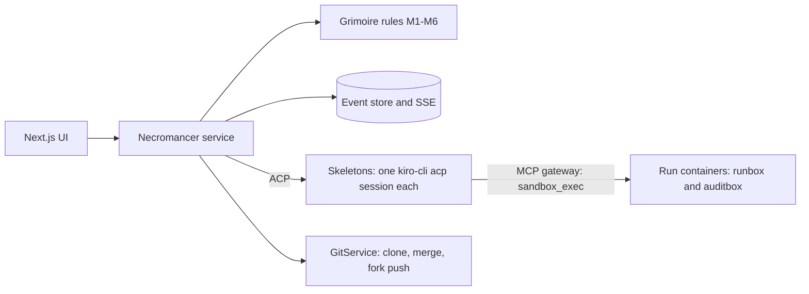

# Git-Graveyard: plan overview

> Kiroween 2026, Resurrection track. This page is a short overview. The authoritative design is `.kiro/specs/resurrection-engine/design.md` (Revision 4 wins over earlier revisions); the requirements and the task plan sit next to it. The earlier Chinese plan is kept in git history.

## What happens in a run

1. **Autopsy (no model).** The Grimoire reads GitHub metadata and the repository archive, finds legacy patterns with rules M1 to M6, and decides dead or alive. Every signal carries a receipt (`file:line`).
2. **Exhume.** With an invite code, the run is queued. The Exhumer clones the repository into a sandbox and runs install, build and tests. The result is the Death Certificate.
3. **Pact.** The Planner, a Kiro CLI session, writes `requirements.md`, `design.md` and `tasks.md` for that repository. The user reads, edits and approves it. No builder starts before approval.
4. **Legion.** The Necromancer raises Skeleton workers, one Kiro CLI session each: the Bonesetter for dependencies and lock files, Soul-stitchers for code tasks (one worktree each), and the Warden, a read-only reviewer with its own container. A task merges only after the Grimoire gate passes and the Warden approves.
5. **Final check and report.** The Warden reruns install, build and tests on the result. The Scribe writes the report, which must pass an evidence check.
6. **Reliquary.** Outcome, before and after table, diff, task ledger, downloads (patch, spec bundle, report, event log, Death Certificate) and an optional push to the owner's own fork.

## Architecture

- Hard blocks live in code: no write to the original repository, no shell for Skeletons, no Kiro key or GitHub credential inside a container, and one-time permission answers only.
- Runs are detached from the browser. Events are stored append-only. History and Replay show only real recorded runs, published after admin review.
- Every number on screen comes from a recorded source; otherwise the UI says `not available` or `not reported`.

## Environments

- **Development:** the Instabox development box runs everything, with per-run Docker containers and one live run at a time.
- **Production:** an always-on host plus Docker Agentic Platform cloud sandboxes. Production exists only after the security access audit passes and uses fresh credentials; the audit runs again after promotion, and the development credentials are revoked.

## Build order

| Increment | Result |
|---|---|
| 0 | Phase 0 probes P1 to P17 and spikes S1 to S5 recorded |
| 1 | Vertical slice for one Node repository: one real recorded run, end to end, replayable |
| 2 | First three recorded runs; E11 defaults calibrated |
| 3 | The rest of v1: Python, Bonesetter, parallel Soul-stitchers, messaging and approvals, budgets and Admin, Scribe, failure states, Built with Kiro page, accessibility |
| 4 | Production backend behind the promotion gate |

The task plan is `.kiro/specs/resurrection-engine/tasks.md`.
