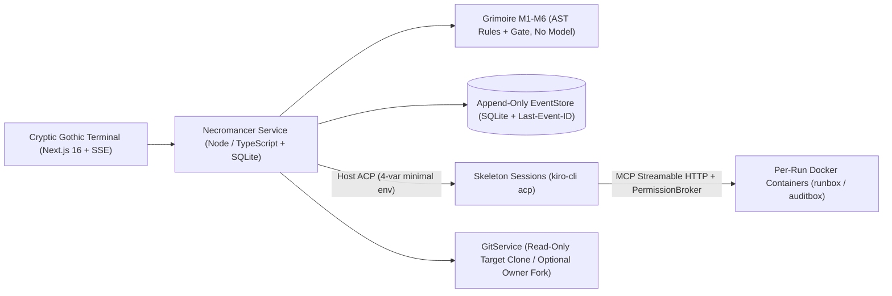

# Git-Graveyard

> **Kiroween 2026 · Resurrection Track Entry** — Diagnose why abandoned GitHub repositories died, plan an audited modernization Pact, and raise isolated Kiro CLI sessions inside a Cryptic Gothic Terminal to bring legacy builds and tests back to life.

[](https://github.com/YangObscurity/Git-Graveyard/actions/workflows/ci.yml)
[](LICENSE)

> **Demo Video (2–3 min):** _Pending final recording (`T7` — offline recorded-run replay is ready at [`/replay/live-gulp-plumber-t40`](output/demo-and-inspector-guide-2026-11-17.md))._
>
> **Disclosure:** Skeleton sessions run on Kiro CLI. Git-Graveyard is an independent project.

---

## Why Git-Graveyard

Millions of open-source repositories are abandoned not because the ideas stopped working, but because their toolchains froze in time: deprecated `request` callbacks, pre-ESM builds, Webpack 2 pipelines, or unpinned lockfiles. Blindly prompting a coding agent against untrusted third-party code leaks credentials, fabricates results, or breaks working logic.

**Git-Graveyard** treats resurrection as an auditable ceremony with deterministic gates at every boundary:

1. **Zero-LLM Autopsy (`Grimoire`)** — Static AST inspection (`@babel/parser` + `web-tree-sitter`) diagnoses abandoned patterns across rules `M1`–`M6` with verbatim `file:line` receipts and zero invented scores or estimates.
2. **Real Sandbox Baseline (`Exhume`)** — Invite-code holders trigger an isolated per-run container that clones the repository read-only, runs real `install` / `build` / `test`, and stamps a signed `Death_Certificate`.
3. **Human-Locked Planning (`Pact`)** — A dedicated `Planner` Skeleton drafts a repository-specific `requirements.md`, `design.md`, and `tasks.md`; mandatory verification steps (`Warden final check`, `Scribe report`, `Grimoire gate`) stay locked (`[Locked]`) before any code editor runs.
4. **Isolated Multi-Role Execution (`Legion`)** — Specialized `kiro-cli` ACP sessions execute edits in isolated git worktrees through a host MCP gateway (`sandbox_exec`), answered one permission at a time (`allow_once` / `reject_once`).
5. **Unbypassable Verification (`Warden` + `Grimoire Gate`)** — Every task merges only when the Grimoire syntax gate passes **and** an independent read-only `Warden` (separate session, separate container, zero write tools) approves the matching `candidateSha256`.
6. **Verified Delivery & Honest Replay (`Reliquary` + `History`)** — Delivers unified `all.patch`, `spec.json`, `report.md`, `events.ndjson`, and `death-certificate.json` with verified SHA-256 digests, plus exact `seq`-ordered offline replay of real recorded runs.

---

## Architecture & End-to-End Flow



### Six-Stage User Journey

| Stage | Route | What Happens |
|---|---|---|
| **Gate** | `/` | Enter any public GitHub URL, inspect `HealthBadge`, run instant Autopsy, or unlock live runs with an invite code |
| **Tombstone** | `/tomb/[owner]/[repo]` | Static `Signal_Chip` diagnosis with `file:line` receipts + live `Death_Certificate` baseline table |
| **Pact** | `/runs/[runId]/pact` | Inspect & edit the generated spec/tasks with non-removable `[Locked]` verification guardrails and budget caps |
| **Legion** | `/runs/[runId]/legion` | Real-time SSE dashboard tracking per-Skeleton progress, live approvals, open asks, pause/resume, and inline unlock |
| **Reliquary** | `/runs/[runId]/relic` | Outcome banner, Before/After build & test comparison, Monaco / `<pre>` unified diff, `TaskLedger`, and SHA-256 artifact downloads |
| **History & Replay** | `/history` & `/replay/[runId]` | Immutable `seq`-ordered playback of real recorded runs (no mutating controls, full redaction preservation) |

---

## How Kiro Powers Git-Graveyard (`.kiro/` Proof)

The root [`.kiro/`](.kiro/) directory is committed in full and drives both repository construction and live resurrection orchestration:

| Kiro Pillar | Committed Artifacts | Role in Git-Graveyard |
|---|---|---|
| **Specs** | [`.kiro/specs/resurrection-engine/`](.kiro/specs/resurrection-engine/) (`requirements.md`, `design.md`, `tasks.md`) | Spec-driven architecture (Revision 4) and dependency-ordered build waves; at runtime, the Planner Skeleton also generates a per-repo spec Pact for human approval |
| **Steering** | [`.kiro/steering/`](.kiro/steering/) (`product.md`, `tech.md`, `structure.md`, `modernization-rules.md`) | `inclusion: always` rules enforcing copy integrity, merge invariants, security boundaries, and traceable modernization rules `M1`–`M6` |
| **Agent Hooks** | [`.kiro/hooks/build-hooks.json`](.kiro/hooks/build-hooks.json) | Automated `PostFileSave` (`npm run test:props` on `lib/rules/*.ts`), `PostTaskExec` (`npm run test:golden`), and `PreToolUse` (`scripts/hooks/guard-paths.mjs` blocking writes to pinned golden/fixture trees with exit code `2`) |
| **Role Agents & ACP + MCP** | [`lib/agents/templates/*.md`](lib/agents/templates/) (`planner`, `exhumer`, `bonesetter`, `soul-stitcher`, `warden`, `scribe`) | Each role runs in its own host `kiro-cli` ACP session with pinned Claude 5.5 models (`auto` excluded), isolated `$HOME/.kiro/`, zero declared client `fs`/`terminal` tools, and host `McpGateway` (`sandbox_exec`) bridging into hardened containers |
| **What Does NOT Use Kiro** | [`lib/grimoire/`](lib/grimoire/) & [`lib/rules/`](lib/rules/) | Autopsy diagnosis and pre-merge syntax gating execute purely via deterministic `@babel/parser` and `web-tree-sitter` AST analysis — zero LLM calls and zero invented scores |

---

## Hardened Execution & Integrity Guarantees

- **Strict Credential Containment:** `kiro-cli` sessions execute on the host with an allowlisted 4-variable environment (`KIRO_API_KEY`, `KIRO_HOME`, `HOME`, `PATH`) and host-side auth resolution. Target repository code runs exclusively inside ephemeral Docker containers (`InstaboxDockerBackend`: `@sha256` pinned images, `--cap-drop=ALL`, `--security-opt no-new-privileges`, `--read-only`, `--tmpfs /tmp`, non-root `1000:1000`, egress proxy policy) with zero Kiro keys, GitHub tokens, or Docker sockets mounted.
- **Read-Only on Upstream Targets:** Target repositories are cloned read-only — Git-Graveyard never pushes, opens PRs, files issues, or posts comments on upstream repositories. Optional branch pushes (`graveyard/<runId>`) are restricted to forks owned by the operator when explicitly permitted by the invite code.
- **Zero-Trust Target Input Handling:** Target `.kiro/`, `AGENTS.md`, skills, and `mcp.json` are neutralized before Skeleton inspection (`lib/security/untrusted-content.ts`) alongside symlink traversal checks (`lib/security/symlink-scanner.ts`) and token/path redaction (`lib/security/redactor.ts`).
- **Invite-Code Gated Live Runs:** Live Docker + Kiro CLI runs do not accept visitor-supplied API keys; they require an invite code issued for an environment provisioned with a Docker runtime and host Kiro CLI credentials.

---

## Judge Quickstart (No Docker or Kiro Credentials Required)

Judges and reviewers can inspect the full application, run offline tests, and replay a real containerized Kiro CLI resurrection (`live-gulp-plumber-t40` on `floatdrop/gulp-plumber`, outcome `resurrected`, 66 recorded events) with **Node.js 24+** and **zero API keys**:

```bash
git clone https://github.com/YangObscurity/Git-Graveyard.git
cd Git-Graveyard
npm install
npm run dev
```

Once running on `http://localhost:3000`:

1. **Replay the Recorded Real Run (`T40`):**
   - Visit `/history` → click **`floatdrop/gulp-plumber`** (`Recorded run` badge)
   - Step through all 66 `seq`-ordered events at `/replay/live-gulp-plumber-t40`
   - Inspect Before/After verification (`install: passed -> passed`, `tests_repo: failed -> passed`), unified `all.patch`, `TaskLedger`, and SHA-256 artifact checksums at `/runs/live-gulp-plumber-t40/relic`
2. **Run Static Autopsy (Online GitHub Metadata, Optional `GITHUB_TOKEN`):**
   - Submit any public GitHub URL on `/` (e.g. `https://github.com/floatdrop/gulp-plumber`) to inspect `/tomb/floatdrop/gulp-plumber`
3. **Explore All UI States & Live Backend Diagnostics:**
   - Open `/debug/ui?uiDebug=1` for the interactive lifecycle preset gallery (`loading`, `empty`, `active`, `blocked`, `failed`, `resurrected`)
   - Switch to `Live Runtime Inspector` (`/debug/ui?uiDebug=1&mode=live`) to inspect SQLite store parity, artifact SHA-256 verification, toolchain probes, API endpoint probes, and the Dev Sandbox Driver Panel
   - Append `?uiDebug=1` to any route for the floating live HUD (`UiDebugLiveHud`) and browser `window.__GIT_GRAVEYARD_UI_DEBUG__` console API

### Verification Commands

```bash
npm run typecheck    # TypeScript check (tsc --noEmit)
npm run status       # CLI live-state diagnostics (stores, recorded runs, toolchains)
npm run build        # Monaco copy, engineVersion generation, WASM verify & Next.js build
npm run test:debug   # Live diagnostics API + UI debug contracts
npm run test:props   # fast-check property tests (Grimoire, Pact, Warden, Merge Gate, Replay)
npm run test:golden  # Byte-for-byte deterministic Grimoire golden suite
npm run test:e2e     # Offline Playwright E2E (Gate -> Tomb -> Pact -> Legion -> Reliquary -> Replay)
```

---

## Self-Hosting Live Runs (Invite-Code Mode)

To host live invite-code-gated resurrections:

- **Execution Runtime:** Docker daemon with a `@sha256` pinned image (default resolves `node:22-bookworm` digest via `INSTABOX_DOCKER_IMAGE`) for `InstaboxDockerBackend` (or cloud sandbox backend in future Increment 4).
- **Kiro CLI on Host:** `kiro-cli` available on `PATH` or `~/.local/bin`, authenticated via `KIRO_API_KEY` or host CLI login (`~/.local/share/kiro-cli`).
- **GitHub API Limit:** Set `GITHUB_TOKEN` to raise GitHub REST API limits above the unauthenticated 60 req/hr quota. Never commit keys, tokens, invite secrets, or SSH addresses.

---

## Repository Structure

```text
Git-Graveyard/
├── .kiro/
│   ├── hooks/                 # Build-time Kiro hooks (PostFileSave, PostTaskExec, PreToolUse)
│   ├── settings/              # Kiro workspace settings
│   ├── specs/                 # resurrection-engine requirements, Revision 4 design & task graph
│   └── steering/              # Always-on product, tech, structure & M1-M6 rules
├── app/                       # Next.js 16 App Router pages & API routes (/api/*, /runs/*, /debug/ui)
├── components/                # Cryptic Gothic Terminal views, Pact editor, Legion cards, Reliquary & debug HUD
├── lib/                       # Necromancer orchestrator, scheduler, ACP supervisor, MCP gateway, Docker backend, Grimoire, Warden, SQLite stores
├── e2e/                       # Offline Playwright E2E suite (no external Kiro/GitHub secrets needed)
├── test/                      # Unit, API, UI, security, property (fast-check) & golden test suites
├── scripts/                   # Phase 0 probes, live runner, CLI status inspector, fixture/hook scripts
├── output/                    # Recorded run bundle (live-gulp-plumber-t40) & guides
├── LICENSE                    # MIT
├── PLAN.md                    # Short architectural overview
└── REFERENCES.md              # Contest rules, 2025 benchmark winners & technical references
```

---

## Contest Checklist & Maintainer Docs

- [ ] Public GitHub repository (currently private pending team credential rotation before submission)
- [x] `.kiro/` directory at repository root (specs, steering docs, hooks)
- [x] Open-source license ([MIT](LICENSE))
- [ ] 2 to 3 minute demo video (`T7`)
- [x] Working application (real sandboxed run `live-gulp-plumber-t40`, offline Replay, live diagnostics & Playwright E2E verified)

**Additional Documentation:**
- [Demo, Replay & Live-State Inspector Guide](output/demo-and-inspector-guide-2026-11-17.md)
- [Team Handoff & Continuation Plan (Increment 2–5)](output/handoff-increment2-5-2026-11-18.md)
- [Architecture Overview (`PLAN.md`)](PLAN.md) · [Contest References (`REFERENCES.md`)](REFERENCES.md)
